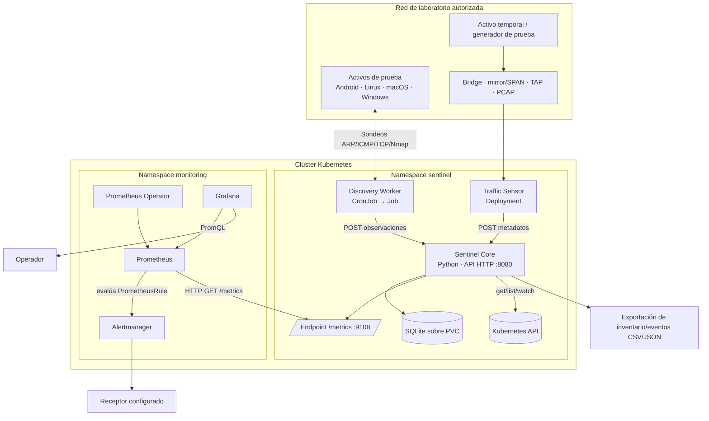

# Sentinel — Stack tecnológico y guía de sustentación

**Versión de referencia:** 1.0  
**Fecha:** 28 de noviembre de 2026  
**Base documental:** especificación de arquitectura y PRD de Sentinel, versión documental 3.0.  
**Propósito:** explicar el papel de cada tecnología, su aplicación en Sentinel, sus integraciones y el momento en que interviene durante la operación.

> **Nota de precisión sobre versiones:** los documentos del proyecto identifican varias tecnologías y sus responsabilidades, pero no fijan todas las versiones ejecutadas, el runtime de contenedores, la distribución Kubernetes, el CNI, el StorageClass ni el mecanismo físico/virtual definitivo de captura. Por eso este documento explica el stack funcional sin inventar números de versión ni afirmar que una opción marcada como candidata u opcional ya está desplegada. La sección 15 contiene los comandos para obtener los valores exactos del entorno implementado.

---

## 1. Resumen ejecutivo del stack

Sentinel es una plataforma de observación de red desplegada sobre Kubernetes. Los procesos de descubrimiento y captura recogen información de una red autorizada y la envían a un servicio central escrito en Python. El servicio valida y normaliza las observaciones, mantiene el inventario y los eventos en SQLite, calcula condiciones deterministas y expone métricas. Prometheus consulta esas métricas, evalúa reglas y entrega las alertas a Alertmanager. Grafana consulta Prometheus para presentar los dashboards al operador.

| Capa | Tecnologías | Responsabilidad principal |
|---|---|---|
| Red de laboratorio | Ethernet/IP, ARP, ICMP, TCP, HTTP; bridge, mirror/SPAN, TAP o PCAP según el entorno | Conectar activos, permitir sondeos autorizados y proporcionar una copia observable del tráfico |
| Descubrimiento | Nmap, parser XML, procesos Python | Encontrar hosts visibles y consultar puertos/servicios permitidos |
| Captura | Sensor Python; Scapy como biblioteca candidata para captura y disección | Extraer metadatos IP y ARP, calcular tasas y enviar observaciones |
| Lógica de aplicación | Python 3.x, API HTTP interna, cliente oficial Kubernetes para Python | Ingerir datos, normalizar, reconciliar inventario, crear eventos y consultar el estado de los workloads |
| Persistencia | SQLite sobre PersistentVolumeClaim (PVC) | Conservar inventario, observaciones, ciclos e historial de eventos |
| Orquestación | Kubernetes, Pods, Deployment, CronJob, Job, Service, Namespace, PVC, ConfigMap y Secret | Programar procesos, mantener cargas de trabajo y proporcionar comunicación y almacenamiento |
| Empaquetado | Imagen OCI y Helm | Empaquetar la aplicación y desplegar recursos de Kubernetes de forma declarativa |
| Métricas | Prometheus Operator, Prometheus, ServiceMonitor, PrometheusRule y PromQL | Recoger series temporales y evaluar reglas declarativas |
| Alertamiento | Alertmanager | Agrupar, deduplicar, silenciar y enrutar las alertas generadas por Prometheus |
| Visualización | Grafana | Consultar métricas y presentar dashboards |
| Seguridad del clúster | ServiceAccount, RBAC, Secrets, NetworkPolicy, Pod Security Admission, securityContext y capabilities Linux | Limitar permisos de Kubernetes, aislar comunicaciones y restringir privilegios del contenedor |
| Desarrollo y entrega | Git, pytest, lint, Helm lint, validación de manifests y pipeline CI/CD | Mantener código versionado y comprobar cambios antes de desplegarlos |
| GitOps | Argo CD, opcional según la entrega | Sincronizar el estado declarado del repositorio con Kubernetes |

### Clasificación utilizada en este documento

- **Definido en la arquitectura:** tecnología o mecanismo que forma parte del diseño técnico aprobado.
- **Dependiente del entorno:** componente cuyo uso concreto depende de la infraestructura o de los resultados de una prueba de concepto.
- **Candidato:** tecnología contemplada para la implementación, pero cuya adopción debe comprobarse en el código desplegado.
- **Opcional / mejora:** tecnología que no es necesaria para el flujo mínimo descrito.
- **No especificado:** dato que debe extraerse de los manifests, imágenes o clúster; no se debe improvisar durante la sustentación.

---

## 2. Arquitectura y recorrido general



### Orden del flujo

1. **Configuración:** se declaran los segmentos, direcciones, puertos, ventanas y límites autorizados mediante la configuración del despliegue.
2. **Programación:** Kubernetes ejecuta el `CronJob` de descubrimiento; el controlador crea un `Job` para realizar el ciclo.
3. **Descubrimiento:** el proceso de Python invoca Nmap con parámetros controlados y recibe respuestas ARP/ICMP/TCP según el alcance habilitado.
4. **Captura:** el `Traffic Sensor` recibe el feed de red seleccionado y extrae metadatos IP y ARP.
5. **Envío:** ambos colectores envían lotes al Core mediante la API HTTP interna en el puerto `8080`.
6. **Normalización y persistencia:** Core valida, normaliza, compara ciclos, asigna identidades estables a eventos y es el único proceso que escribe en SQLite.
7. **Cálculo:** Core construye métricas de dominio, agrega tráfico por ventana y calcula condiciones respecto de la línea base configurada.
8. **Exposición:** Core publica el endpoint de métricas en el puerto `9108`.
9. **Scraping:** Prometheus descubre el Service por medio de `ServiceMonitor` y consulta `/metrics` mediante HTTP GET.
10. **Evaluación:** Prometheus evalúa `PrometheusRule`; el campo `for`, cuando se configura, exige que la condición persista durante un intervalo antes de que la alerta pase a estado firing.
11. **Gestión de alertas:** Alertmanager agrupa, deduplica, silencia e intenta enrutar las notificaciones a los receptores que estén configurados.
12. **Consulta:** Grafana consulta las series en Prometheus y presenta dashboards. El detalle del inventario —por ejemplo, IP/MAC/puertos/servicios— se obtiene desde Core mediante las exportaciones CSV/JSON, no desde las labels de Prometheus.

---

## 3. Kubernetes: plano de ejecución y orquestación

### 3.1 ¿Qué es Kubernetes?

Kubernetes es un sistema de orquestación de contenedores. Recibe declaraciones del estado deseado y utiliza sus controladores para programar Pods, mantener réplicas, ejecutar trabajos y conectar cargas de trabajo. El clúster está compuesto conceptualmente por un plano de control y nodos de trabajo.

**Uso en Sentinel:** Kubernetes no es únicamente el lugar donde se aloja una interfaz. Es el plano que programa el descubrimiento, ejecuta los procesos de aplicación, publica servicios internos, monta la persistencia y aloja el stack de observabilidad.

**Se conecta con:** imágenes OCI, Pods, Deployments, CronJobs, Jobs, Services, PVCs, Namespaces, ConfigMaps, Secrets, ServiceAccounts, RBAC y Helm.

**Cuándo interviene:** desde el despliegue y durante todo el funcionamiento. Programa los ciclos, mantiene el Core y el sensor ejecutándose, y permite consultar el estado operativo de los trabajos.

### 3.2 Recursos de Kubernetes utilizados

| Recurso | Definición general | Aplicación en Sentinel | Momento del flujo |
|---|---|---|---|
| **Cluster** | Conjunto de control plane y nodos que ejecutan Pods | Entorno donde corren Sentinel y el stack de observabilidad | Siempre |
| **Namespace** | División lógica de recursos dentro del clúster | `sentinel` para la aplicación; `monitoring` para observabilidad; `sentinel-capture` solo si el despliegue de captura lo exige | Despliegue y aislamiento |
| **Pod** | Unidad mínima que Kubernetes programa; contiene uno o más contenedores | Aloja los procesos Core, Discovery, Sensor y componentes de observabilidad | Ejecución |
| **Deployment** | Controlador que mantiene una cantidad declarada de Pods | Core con una réplica escritora; Traffic Sensor con una réplica inicial | Ejecución continua |
| **CronJob** | Programa trabajos según una expresión de calendario | Inicia periódicamente el descubrimiento de activos | Cada ciclo de inventario |
| **Job** | Ejecuta una tarea hasta completarla según sus condiciones | Instancia de trabajo creada por el CronJob de descubrimiento | Durante un ciclo de descubrimiento |
| **Service** | Abstracción de red estable para acceder a Pods | `sentinel-core` expone la API interna `8080` y métricas `9108` como puertos nombrados | Comunicación interna y scraping |
| **ClusterIP** | Tipo de Service accesible dentro de la red del clúster | Evita exponer la API de ingesta directamente fuera del clúster | Envío de observaciones / scrape interno |
| **PersistentVolumeClaim (PVC)** | Solicitud declarativa de almacenamiento persistente | Monta el archivo SQLite en Core | Durante lectura/escritura de inventario y eventos |
| **ConfigMap** | Configuración no sensible desacoplada de la imagen | Rangos, puertos, frecuencia y valores de funcionamiento no secretos | Arranque y configuración |
| **Secret** | Recurso para datos sensibles | Tokens de ingesta utilizados por colectores y Core | Autenticación del envío interno |
| **ServiceAccount** | Identidad asignada a un Pod para interactuar con la API Kubernetes | Identidad específica de Core; los colectores no necesitan token del API server | Cuando Core consulta estado del clúster |
| **Role / RoleBinding** | Permisos y vinculación a una identidad dentro de un namespace | Core obtiene únicamente `get/list/watch` sobre Pods, Jobs y CronJobs | Consulta del estado operativo |
| **ServiceMonitor** | Recurso de Prometheus Operator que define qué Service y puerto deben ser scrapeados | Configura el descubrimiento del endpoint `/metrics` del Core | Scraping de métricas |
| **PrometheusRule** | Recurso de reglas seleccionado por Prometheus Operator | Declara expresiones de alerta de Sentinel | Evaluación periódica de alertas |

**Punto de sustentación:** Kubernetes gestiona los componentes que forman Sentinel, no los endpoints monitoreados. El permiso de Core para consultar Pods, Jobs y CronJobs no significa que pueda crear, modificar o borrar workloads. Los permisos efectivos se demuestran mediante pruebas RBAC.

### 3.3 API de Kubernetes y cliente Python

Kubernetes expone una API para consultar y gestionar los recursos del clúster. Sentinel Core utiliza el cliente oficial de Kubernetes para Python y la configuración *in-cluster* para autenticarse desde su Pod.

- **Qué consulta:** Pods, Jobs y CronJobs en el namespace autorizado.
- **Verbos permitidos:** `get`, `list`, `watch`.
- **Verbos no concedidos:** `create`, `update`, `patch`, `delete`.
- **Uso práctico:** revisar si un Job de descubrimiento terminó, si un Pod está disponible y si el CronJob sigue programado.
- **No hace:** cambiar el estado del clúster ni manipular los recursos que consulta.

Comandos de demostración:

```bash
kubectl auth can-i get pods \
  --as=system:serviceaccount:sentinel:sentinel-core -n sentinel

kubectl auth can-i list jobs \
  --as=system:serviceaccount:sentinel:sentinel-core -n sentinel

kubectl auth can-i watch cronjobs.batch \
  --as=system:serviceaccount:sentinel:sentinel-core -n sentinel

kubectl auth can-i create jobs \
  --as=system:serviceaccount:sentinel:sentinel-core -n sentinel

kubectl auth can-i patch pods \
  --as=system:serviceaccount:sentinel:sentinel-core -n sentinel
```

Los tres primeros deben responder `yes`; los dos últimos, `no`.

---

## 4. Contenedores, imágenes OCI y Helm

### 4.1 Contenedores e imagen OCI

Una imagen OCI es un formato estandarizado para empaquetar una aplicación, sus dependencias y metadatos para ejecutarla como contenedor. Kubernetes programa Pods que ejecutan contenedores a partir de esas imágenes.

**Aplicación en Sentinel:** Core, Discovery Worker y Traffic Sensor reutilizan una imagen OCI común, pero arrancan con comandos, ServiceAccounts, variables y `securityContext` diferentes. Esto permite compartir las dependencias de Python y Nmap sin dar los mismos permisos a todos los procesos.

**Conexiones:** imagen OCI → Pod → Deployment/CronJob/Job → nodo Kubernetes → runtime de contenedores.

**Cuándo interviene:** al construir la aplicación, publicar la imagen y desplegarla; posteriormente, cada Pod ejecuta el comando configurado.

> La especificación no identifica el runtime de contenedores del nodo ni afirma que Docker o Podman sean el runtime utilizado. OCI define el formato de imagen; no determina por sí solo el motor que ejecuta los contenedores.

### 4.2 Helm

Helm es un gestor de paquetes para Kubernetes. Un **chart** agrupa plantillas y valores de configuración que generan recursos Kubernetes. Una instalación del chart se registra como una **release**.

**Aplicación en Sentinel:** Helm permite instalar y parametrizar `kube-prometheus-stack`, que reúne los recursos y componentes de observabilidad. Los valores del chart se gestionan de forma declarativa y deben mantenerse versionados junto al proyecto.

**Conexiones:** Helm chart → manifests Kubernetes → API server → Deployments/StatefulSets/Services/CRDs del stack.

**Cuándo interviene:** en la instalación inicial, actualización de la release y validación previa (`helm lint`, `helm template`).

Comandos típicos:

```bash
helm repo add prometheus-community \
  https://prometheus-community.github.io/helm-charts
helm repo update
helm show values prometheus-community/kube-prometheus-stack
helm lint ./charts/sentinel
helm template monitoring prometheus-community/kube-prometheus-stack \
  --namespace monitoring -f values-monitoring.yaml
helm list -A
```

La ruta `./charts/sentinel` es un ejemplo: se debe sustituir por la ruta real del chart de la aplicación si existe. La release de monitoreo usa el chart publicado por Prometheus Community.

### 4.3 kube-prometheus-stack

`kube-prometheus-stack` es un Helm chart de la comunidad Prometheus que integra el despliegue de Prometheus Operator, Prometheus, Grafana, Alertmanager y componentes de métricas del clúster como `kube-state-metrics` y `node-exporter`, según los valores y dependencias de la versión instalada.

**En Sentinel:** proporciona el plano de métricas, almacenamiento temporal, evaluación de reglas, alertamiento y dashboards. No reemplaza la lógica de inventario de Sentinel ni almacena la información detallada de activos.

---

## 5. Python y componentes de aplicación

### 5.1 Python 3.x

Python es el lenguaje de implementación de la lógica de aplicación.

**En Sentinel se utiliza para:**

- Core: API interna de ingesta/consulta, validación, normalización, comparación de inventario y persistencia.
- Discovery Worker: invocación controlada de Nmap, lectura de respuestas y conversión a observaciones normalizadas.
- Traffic Sensor: lectura/procesamiento del feed de paquetes, extracción de metadatos y agregación por ventana.
- Lógica de condiciones: línea base, umbrales e indicadores publicados para observabilidad.
- Exportación: preparar el detalle estructurado del inventario y los eventos.

**Conexiones:** Python llama a Nmap, puede apoyarse en Scapy si está instalado, utiliza el cliente Python de Kubernetes desde Core, recibe/envía datos por HTTP y accede a SQLite desde Core.

**Cuándo interviene:** durante la ejecución de cada proceso y en el tratamiento de cada lote de observaciones.

**Dato que se debe precisar en la sustentación:** la arquitectura solo registra `Python 3.x`; el número exacto de versión debe obtenerse de la imagen ejecutada o del entorno del Pod.

### 5.2 Cliente oficial Kubernetes para Python

La biblioteca `kubernetes` permite a un programa Python consumir la API Kubernetes. Puede cargar la configuración desde el archivo de configuración local o desde el entorno *in-cluster*.

**En Sentinel:** Core usa la configuración *in-cluster* y consulta el estado de Pods, Jobs y CronJobs. La biblioteca no otorga privilegios por sí misma; las operaciones efectivas dependen del ServiceAccount y sus reglas RBAC.

**Momento:** cuando Core revisa el estado de ejecución del sistema desplegado.

### 5.3 API HTTP interna de Sentinel Core

La API HTTP interna permite que los colectores entreguen sus lotes al Core y que el Core exponga datos para consulta/exportación.

| Ruta documentada | Emisor | Destino | Propósito |
|---|---|---|---|
| `POST /internal/v1/discovery-observations` | Discovery Worker | Core `:8080` | Entregar observaciones, ciclo, rango, método, timestamp, cobertura y errores parciales |
| `POST /internal/v1/traffic-observations` | Traffic Sensor | Core `:8080` | Entregar ventana, interfaz, protocolo, bytes/s, direcciones IP y campos ARP |
| `GET /metrics` | Prometheus | Core `:9108` | Obtener métricas agregadas para scraping |

El Core debe validar y normalizar cada lote y devolver información que permita identificar su aceptación. El formato definitivo del cuerpo, límites de lote, timeouts, reintentos e idempotencia se debe consultar en el código desplegado; la especificación funcional establece los contratos, pero no todos los detalles de implementación.

**Framework web:** los documentos no fijan FastAPI, Flask, Django ni otro framework. No se debe nombrar uno en la presentación sin verificar los imports y las dependencias de la imagen real.

---

## 6. Descubrimiento de activos: protocolos y Nmap

### 6.1 Protocolos observados

| Protocolo | Capa / función | Papel en Sentinel | Cuándo se usa |
|---|---|---|---|
| **ARP** | Resolución de direcciones IPv4 en el segmento de capa 2 | Descubrir vecinos locales y registrar asociaciones IP↔MAC; observar opcode, `psrc`, `pdst`, `hwsrc` y `hwdst` | Descubrimiento local y análisis de cambios ARP |
| **ICMP** | Mensajes de control de red, como solicitudes/respuestas echo | Comprobar disponibilidad de hosts cuando la política de red lo permite | Durante el descubrimiento |
| **TCP** | Transporte orientado a conexión | Consultar puertos y obtener respuestas de los servicios autorizados | Sondeo de puertos y servicios |
| **IP (IPv4/IPv6)** | Direccionamiento y transporte de paquetes entre redes | Extraer origen, destino, protocolo y longitud de capa IP para el cálculo de bytes/s | Captura de tráfico continuo |
| **HTTP** | Protocolo de aplicación para intercambio de recursos | Transporte de la API interna de colectores hacia Core; también es el servicio web del servidor del laboratorio | Ingesta y escenario de prueba |
| **SNMP** | Protocolo de gestión de dispositivos de red | Se contempla para consultar equipos compatibles con credenciales de solo lectura | Extensión posterior; no asumir que está activo en el MVP |

### 6.2 Nmap

Nmap es una herramienta de descubrimiento y auditoría de servicios de red. Puede identificar hosts, puertos y, mediante sondas específicas, obtener información sobre servicios y versiones.

**Uso documentado en Sentinel:** Nmap se invoca desde Discovery Worker con argumentos construidos a partir de una allowlist. El perfil de sondeo TCP descrito es:

```bash
nmap -sT -sV --version-light -p <puertos_autorizados> \
  -oX - <rango_autorizado>
```

| Parámetro | Significado | Aplicación |
|---|---|---|
| `-sT` | TCP connect scan; utiliza la llamada `connect` del sistema operativo | Consultar puertos TCP sin requerir el método SYN de paquetes crudos |
| `-sV` | Detección de servicio/versión mediante sondas a puertos abiertos | Obtener evidencia sobre los servicios que responden |
| `--version-light` | Reduce la intensidad/conjunto de sondas de versión | Mantener el sondeo más acotado que el perfil predeterminado |
| `-p` | Selecciona puertos | Aplicar la lista de puertos permitidos |
| `-oX -` | Produce resultados XML en stdout | Facilitar el procesamiento programático sin archivo temporal |

**Por qué XML:** la salida XML es adecuada para integrarse con otro programa. Discovery Worker puede leer el resultado y convertir hosts, puertos y servicios en observaciones normalizadas.

**Limitaciones que debes explicar:**

- `-sT` completa conexiones TCP y puede generar entradas en los logs del activo.
- `-sV` envía sondas de aplicación; no es captura pasiva.
- Si solo se conoce el número de puerto, el servicio se conserva como probable, no como identificado con certeza.
- El MVP no habilita `-O` (detección activa de SO), `-sU` (escaneo UDP), scripts NSE (`-sC`/`--script`), modo agresivo `-A` ni `--allports`.
- La información de sistema operativo será declarada en el laboratorio, inferida solo si se habilita un método con evidencia, o `desconocida`.

**Momento:** en cada ciclo programado por el CronJob de descubrimiento.

### 6.3 Scapy

Scapy es una biblioteca Python para construir, enviar, capturar, decodificar y manipular paquetes de red. Facilita trabajar con protocolos como ARP y diseccionar cabeceras.

**Posible función en Sentinel:** implementación del Traffic Sensor para leer una interfaz o un feed PCAP y extraer campos de IP/ARP.

**Estado documental:** la arquitectura la marca como candidato de implementación. Para afirmar en la sustentación que Scapy fue parte de la versión desplegada, verifica que aparezca en las dependencias de la imagen y en el código del sensor. Si el proyecto usa otra biblioteca o un binding de captura, sustituye esta sección por el componente real.

**No confundir:** Scapy puede manipular y enviar paquetes, pero Sentinel lo utiliza —según el alcance de producto— para observación y extracción de metadatos; no se usa para modificar los endpoints ni ejecutar una respuesta.

---

## 7. Captura y métricas de tráfico

### 7.1 Fuente de visibilidad

Para observar el tráfico de una red, el sensor debe recibir una copia o acceso efectivo a los paquetes que le interesa medir. Las opciones documentadas son:

- **Bridge de laboratorio:** interconecta los activos virtuales y permite entregar al sensor el tráfico del segmento de prueba.
- **Mirror/SPAN:** el switch replica el tráfico de puertos/VLAN seleccionados hacia un puerto de monitoreo.
- **TAP:** dispositivo físico que entrega una copia del tráfico de un enlace.
- **PCAP:** formato de captura que puede utilizarse para pruebas reproducibles o como feed de paquetes.
- **Interfaz del nodo / `hostNetwork`:** alternativa excepcional, con implicaciones de seguridad y aislamiento; no asumir que se usó sin revisar manifests.

**Punto clave:** Kubernetes no replica automáticamente el tráfico de la LAN hacia un Pod. La fuente de captura debe configurarse explícitamente.

### 7.2 Cálculo de tráfico IP

Sentinel registra por ventana:

- `observed_at` en UTC;
- `src_ip`;
- `dst_ip`;
- `protocol`;
- `bytes_per_second`;
- `interface`;
- `sensor_id`.

La longitud utilizada es la de la capa IP, no la trama Ethernet completa:

- IPv4: `total_length`.
- IPv6: longitud del payload más la cabecera base.

La tasa se calcula como:

\[
\text{bytes/s} = \frac{\sum \text{longitud de paquetes IP en la ventana}}{\text{duración efectiva de la ventana}}
\]

La agregación inicial documentada es de cinco segundos `[INTERNO]`. Las direcciones IP se conservan en eventos y logs estructurados, no como labels ilimitadas de Prometheus.

### 7.3 Observación ARP

ARP se procesa por separado del tráfico IP. Se registran los campos `op`, `psrc`, `pdst`, `hwsrc`, `hwdst`, timestamp, interfaz y sensor. La tasa se expresa como mensajes ARP por segundo.

No se debe explicar un aumento ARP como si fueran bytes/s de un flujo IP. Tampoco se debe llamar automáticamente “ARP spoofing confirmado” a una variación IP↔MAC: el sistema registra la asociación observada y el contexto temporal.

### 7.4 Línea base

La línea base inicial descrita en el PRD utiliza cinco muestras separadas por cinco segundos:

- muestras esperadas: `t=5, 10, 15, 20, 25 s`;
- ventana aproximada de inicialización: 25 segundos;
- media: \(\mu\);
- varianza muestral: \(s^2 = \sum(x_i-\mu)^2/(n-1)\), con `n=5`;
- desviación estándar: \(s=\sqrt{s^2}\).

El umbral final (absoluto, `μ + k·s` o combinación) y el valor de `k` dependen de la evaluación del tráfico normal del laboratorio. No se debe presentar un umbral como valor definitivo sin comprobar la configuración realmente desplegada.

---

## 8. Persistencia: SQLite y PVC

### 8.1 SQLite

SQLite es un motor de base de datos relacional, transaccional y embebido. A diferencia de una base de datos cliente-servidor, se ejecuta dentro del proceso que la utiliza y almacena la información en un archivo.

**En Sentinel:** mantiene el inventario, las observaciones, los ciclos de descubrimiento, las últimas asociaciones IP/MAC, los puertos y servicios observados, el historial y los eventos con identidad estable.

**Conexiones:** Sentinel Core es el único escritor. Discovery Worker y Traffic Sensor envían lotes por HTTP; no escriben directamente el archivo de la base de datos.

**Cuándo interviene:** después de la ingesta y validación de cada lote, cuando Core actualiza el inventario o registra un evento.

**Límite:** una sola réplica escritora en el diseño del MVP. SQLite sobre PVC simplifica la operación de laboratorio, pero no proporciona por sí sola alta disponibilidad distribuida ni un modelo de escritura multi-réplica.

### 8.2 PersistentVolumeClaim

Un PVC es una solicitud de almacenamiento persistente dentro de Kubernetes. El Pod monta el volumen que satisface esa solicitud.

**En Sentinel:** el PVC conserva el archivo SQLite aunque el Pod de Core sea reemplazado. El PVC debe ser montado únicamente por Core, manteniendo el patrón de un escritor.

**Datos que faltan para describir el despliegue exacto:** StorageClass, tamaño del PVC, modo de acceso, backend CSI, política de expansión y procedimiento de backup.

---

## 9. Observabilidad: Prometheus, Prometheus Operator, Alertmanager y Grafana

### 9.1 Prometheus

Prometheus es un sistema de monitoreo que recoge y almacena métricas como series temporales y evalúa reglas.

**En Sentinel:** consulta el endpoint `http://sentinel-core:9108/metrics` (la URL exacta depende del nombre resoluble del Service y del puerto de Service), almacena métricas agregadas y evalúa reglas de tráfico/ARP/estado de sensor.

**Modelo pull:** Prometheus inicia la consulta HTTP GET; los colectores no envían directamente sus datos a Prometheus. Los colectores envían datos al Core; el Core los convierte en métricas; Prometheus realiza el scrape.

**Momento:** consulta cada intervalo de scrape definido en la configuración del Prometheus.

### 9.2 Métricas de Sentinel

La arquitectura incluye estos nombres de ejemplo para instrumentar Core:

| Métrica | Qué representa | Uso |
|---|---|---|
| `sentinel_traffic_bytes_per_second{protocol,interface}` | Tasa agregada de tráfico IP | Paneles y condiciones de tráfico |
| `sentinel_arp_messages_total{operation,interface}` | Contador de mensajes ARP por operación/interfaz | Seguimiento de actividad ARP |
| `sentinel_arp_messages_per_second{interface}` | Tasa ARP agregada | Umbral de actividad ARP |
| `sentinel_arp_mapping_changes_total` | Cambios de asociación IP↔MAC | Evolución de cambios observados |
| `sentinel_traffic_threshold_exceeded{scope}` | Condición de tráfico por encima del umbral | Regla de alerta |
| `sentinel_arp_rate_threshold_exceeded{interface}` | Condición de actividad ARP elevada | Regla de alerta |
| `sentinel_collector_up{collector}` | Disponibilidad del colector | Alerta operativa del sensor |
| `sentinel_discovery_last_success_timestamp_seconds` | Marca temporal del último ciclo exitoso | Frescura del inventario |
| `sentinel_discovery_duration_seconds` | Duración de los ciclos | Rendimiento del descubrimiento |
| `sentinel_discovery_errors_total` | Errores de descubrimiento | Diagnóstico operativo |
| `sentinel_assets_observed` | Cantidad de activos observados | Panel de inventario agregado |
| `sentinel_events_total{event_type}` | Contador de eventos por tipo | Panel de eventos |

**Cardinalidad:** las IP de origen/destino, MAC y puertos detallados no deben añadirse indiscriminadamente como labels. Cada combinación de labels genera series temporales; valores prácticamente ilimitados pueden elevar memoria y almacenamiento. El detalle de cada activo se consulta en SQLite/Core mediante CSV o JSON.

### 9.3 Prometheus Operator

Prometheus Operator es un operador de Kubernetes que administra instancias de Prometheus y sus recursos declarativos. Observa CRDs como `Prometheus`, `ServiceMonitor` y `PrometheusRule`, y configura el scraping y las reglas de las instancias que controla.

**En Sentinel:** simplifica la selección declarativa del Service de Core y la asociación de reglas para el stack instalado mediante Helm.

**Cuándo interviene:** cuando se crean o actualizan recursos `ServiceMonitor` y `PrometheusRule`, y durante la reconciliación de la configuración de Prometheus.

### 9.4 ServiceMonitor

`ServiceMonitor` define qué Services deben ser scrapeados, mediante selectores, namespaces, puertos y rutas configuradas.

**En Sentinel:** conecta Prometheus con el Service `sentinel-core`, usando el puerto nombrado `metrics`, que corresponde al puerto numérico `9108`, y la ruta `/metrics`.

**Error habitual que conviene evitar:** el `ServiceMonitor` referencia el nombre del puerto del Service, no necesariamente el número `9108` directamente. Además, los selectores de labels y namespaces del Prometheus Operator deben coincidir.

### 9.5 PrometheusRule y PromQL

- **PrometheusRule:** objeto declarativo que agrupa reglas de evaluación, incluidas alertas.
- **PromQL:** lenguaje de consulta de Prometheus, utilizado para seleccionar, agregar y operar sobre series temporales.
- **`for`:** periodo durante el cual una condición debe permanecer activa antes de que una alerta pase a firing.

**En Sentinel:** la lógica de dominio calcula y publica indicadores; Prometheus aplica reglas temporales sobre esos indicadores. Esta separación evita que el sensor, Core y Prometheus implementen por duplicado el mismo estado temporal de alertamiento.

### 9.6 Alertmanager

Alertmanager recibe las alertas firing/resolved emitidas por Prometheus. Gestiona:

- agrupación de alertas similares;
- deduplicación;
- silencios;
- inhibiciones;
- enrutamiento hacia receptores configurados.

**En Sentinel:** administra el ciclo de notificación. El canal externo (correo, webhook u otro receptor) debe configurarse explícitamente; no se presupone que exista automáticamente por instalar el chart.

### 9.7 Grafana

Grafana es una plataforma de consulta y visualización. Se conecta a una fuente de datos y presenta los resultados en paneles y dashboards.

**En Sentinel:** utiliza Prometheus como datasource y PromQL para consultar:

- tráfico agregado por ventana, protocolo e interfaz;
- actividad ARP;
- cambios de asociación en forma agregada;
- disponibilidad del sensor;
- ciclos y errores de descubrimiento;
- contadores y condiciones de dominio.

Grafana no es la base de inventario. El detalle de IP, MAC, puertos y servicios debe obtenerse mediante la interfaz/exportación del Core.

### 9.8 kube-state-metrics y node-exporter

El chart `kube-prometheus-stack` incluye habitualmente componentes como:

- **kube-state-metrics:** expone métricas derivadas del estado de objetos Kubernetes (por ejemplo, estado de Pods y Jobs).
- **node-exporter:** expone métricas de sistema operativo/hardware del nodo, como CPU, memoria, filesystem y red del host.

Estos componentes complementan las métricas de Sentinel: ayudan a observar la plataforma que ejecuta el producto, no sustituyen las métricas de activos de la LAN.

---

## 10. Logs, eventos y evidencia

### 10.1 Logs estructurados

Los procesos registran logs en formato JSON por `stdout` y `stderr`. Kubernetes y el runtime conservan la salida del contenedor y se puede consultar con `kubectl logs`.

Ejemplos de datos que un registro puede conservar:

- timestamp UTC;
- componente y sensor;
- activo o par origen/destino;
- método de observación;
- protocolo;
- condición o evento;
- regla y umbral asociados;
- valor medido;
- estado del proceso o error.

No se almacena payload completo de paquetes en el perfil MVP. Se conservan los metadatos necesarios para interpretar la medición.

### 10.2 Diferencia entre observación, evento, condición y alerta

| Término | Significado | Ejemplo |
|---|---|---|
| Observación | Dato obtenido del sondeo o captura | Una respuesta ARP o una muestra de bytes/s |
| Evento | Hecho persistido que representa una transición o cambio | `ArpMappingChanged`, `AssetFirstSeen` |
| Condición | Resultado determinista del cálculo de Core | `TrafficThresholdExceeded` |
| Alerta | Estado disparado por una regla de Prometheus y gestionado por Alertmanager | “Umbral de tráfico excedido” |

Una alerta informa una condición medible; no demuestra intención maliciosa. Por ejemplo, un incremento de tráfico no debe etiquetarse automáticamente como DDoS confirmado y un cambio IP↔MAC no demuestra por sí mismo ARP spoofing.

### 10.3 Loki

Loki es una solución de agregación/consulta de logs que puede integrarse con Grafana.

**Estado en Sentinel:** opcional; no se necesita para el flujo descrito en el MVP. Los logs se conservan en `stdout/stderr` y se consultan con `kubectl logs`. Si el despliegue implementado sí usa Loki, debe añadirse como componente real y documentar retención, almacenamiento y datasource de Grafana.

---

## 11. Seguridad y aislamiento

### 11.1 ServiceAccounts y RBAC

RBAC define qué acciones puede realizar una identidad en la API Kubernetes.

**En Sentinel:**

- Core utiliza `sentinel-core` y solo necesita lectura de Pods, Jobs y CronJobs.
- Discovery y Traffic Sensor no consultan el API server; usan `automountServiceAccountToken: false`.
- Los colectores se autentican ante la API interna del Core mediante tokens específicos de ingesta, no mediante permisos Kubernetes.

**Defensa:** los permisos RBAC y los permisos de captura del kernel son dos mecanismos diferentes; conceder uno no concede el otro.

### 11.2 Secrets y ConfigMaps

- `ConfigMap` contiene configuración no sensible, por ejemplo rangos, puertos, frecuencia y umbrales.
- `Secret` contiene tokens de ingesta y datos sensibles.
- Los tokens no deben incorporarse a las imágenes, a un ConfigMap ni a logs.
- Los Secrets tienen alcance de namespace; si un colector se mueve a otro namespace, necesita su Secret en ese namespace gestionado desde una fuente segura.

### 11.3 NetworkPolicy

NetworkPolicy define qué tráfico IP/puerto se permite entre Pods o hacia/desde ellos, siempre que el plugin de red (CNI) implemente enforcement.

**En Sentinel:** puede limitar el acceso a la API Core a Discovery/Sensor y permitir el scraping desde Prometheus. No crea una copia del tráfico de la red física y no sustituye el mecanismo de captura.

**CNI:** es el plugin de red del clúster que proporciona conectividad entre Pods y puede aplicar NetworkPolicy. El CNI concreto no está identificado en la especificación; debe obtenerse del clúster real.

### 11.4 Pod Security Standards / Pod Security Admission

Los estándares de seguridad de Pods limitan configuraciones como privilegios elevados, namespaces del host, volúmenes hostPath y capabilities.

**En Sentinel:** el Core debe ajustarse a una política restrictiva. Si un colector requiere `CAP_NET_RAW`, no basta con moverlo a otro namespace; la excepción debe definirse de forma explícita y acompañarse de controles de admisión restrictivos.

### 11.5 Linux capabilities

Las capabilities dividen privilegios tradicionalmente asociados a root en capacidades más específicas.

| Capability | Uso general | Situación en Sentinel |
|---|---|---|
| `CAP_NET_RAW` | Acceso a sockets RAW/PACKET | Puede ser necesaria para determinadas operaciones ARP/captura; conceder solo si la prueba en el entorno lo demuestra |
| `CAP_NET_ADMIN` | Administración/configuración de interfaces y operaciones de red como activar modo promiscuo | No se concede por defecto; solo se evaluaría si el diseño de captura lo requiere explícitamente |

No usar `privileged: true` como atajo. La configuración de `securityContext`, usuario no-root, filesystem de solo lectura y seccomp/AppArmor depende del soporte del runtime y del resultado de la prueba de captura.

---

## 12. CI/CD, control de versiones y GitOps

### 12.1 Git

Git es el sistema de control de versiones del código y de los manifiestos declarativos. Permite revisar cambios, comparar versiones, recuperar estados previos y asociar el historial de implementación a commits.

**En Sentinel:** el repositorio contiene el código Python, chart/manifests, configuración de despliegue, pruebas y documentación.

### 12.2 CI/CD

La arquitectura documenta un pipeline con estas etapas:

1. cambio de código o chart;
2. lint del código y de la configuración;
3. ejecución de pruebas con `pytest`;
4. validación de manifests y Helm chart;
5. construcción de imagen OCI;
6. análisis de dependencias/imagen;
7. publicación con tag inmutable;
8. actualización del estado declarado de despliegue;
9. despliegue o sincronización en Kubernetes.

**Herramientas explícitas:** `pytest`, `helm lint`, `helm template` y herramientas de validación del clúster.  
**No especificado en el documento:** proveedor de pipeline (GitHub Actions, GitLab CI, Jenkins u otro), herramienta exacta de lint, escáner de imagen y registry. Nómbralos solo después de revisar el workflow real.

### 12.3 Argo CD

Argo CD es una herramienta GitOps para sincronizar el estado de recursos Kubernetes con la configuración declarada en Git.

**En Sentinel:** la arquitectura lo contempla como opcional para la fase de entrega. Si está desplegado, Argo CD observa el repositorio y reconcilia los manifiestos/releases configurados; un rollback se puede realizar mediante una reversión declarativa.

**Estado:** opcional en la especificación. Para presentarlo como parte efectiva del stack, comprobar que existe su namespace/release/Application y que el clúster está sincronizado.

---

## 13. Herramientas de operación y verificación

| Herramienta | Para qué sirve | Ejemplo en Sentinel |
|---|---|---|
| `kubectl` | Cliente CLI para consultar recursos Kubernetes | `kubectl get pods -A`, `kubectl logs`, `kubectl auth can-i` |
| `helm` | Instalar, validar y administrar charts/releases | `helm list -A`, `helm lint`, `helm template`, `helm get values` |
| `nmap` | Descubrimiento y sondeo TCP autorizado | Perfil `-sT -sV --version-light -p ... -oX -` |
| `pytest` | Ejecutar pruebas automatizadas Python | Validar parser, reglas de dominio, normalización y API |
| `promtool` | Validar reglas y configuración relacionada con Prometheus | `promtool check rules <archivo>` |
| `sha256sum` | Comprobar integridad de archivos mediante SHA-256 | Verificar el manifiesto documental o artefactos de release |
| `git` | Historial y revisión de código | `git status`, `git log`, `git diff` |

Los comandos de ejemplo deben ajustarse a nombres de Deployments, namespaces y rutas presentes en el despliegue real.

---

## 14. Tecnologías que son extensiones o quedan por precisar

| Tecnología / decisión | Estado documentado | Qué significa para la sustentación |
|---|---|---|
| Scapy | Candidato para captura/disección | Verificar dependencias e imports reales antes de afirmar que está integrado |
| SNMP / SNMP Exporter | Extensión posterior | No presentarlo como componente del MVP si no está desplegado |
| Loki | Opcional | Logs consultados inicialmente con `kubectl logs`; Loki solo si está instalado |
| Argo CD | Opcional | Incluirlo en el diagrama de instalación únicamente si el proyecto lo usa efectivamente |
| `CAP_NET_RAW` | Dependiente de captura/descubrimiento | Confirmar capability del Pod y política de admisión |
| `CAP_NET_ADMIN` | No concedida por defecto | No afirmar que se utiliza salvo evidencia concreta |
| `hostNetwork` | Excepción posible, no predeterminada | Inspeccionar Pod spec y CNI |
| Blackbox Exporter | No se presupone incluido en el chart | No añadirlo al diagrama si no existe en el namespace monitoring |
| Prometheus Adapter | No se presupone incluido en el chart | No incluirlo como parte efectiva del stack sin instalación explícita |
| Canal externo de alertas | Receptor sin especificar | Comprobar Alertmanager config y receiver antes de afirmar correo/webhook |
| Ingress / Gateway | No fijado en la arquitectura | Verificar cómo se accede a Grafana/API (port-forward, NodePort, LoadBalancer, Ingress u otro) |
| Framework de API Python | No fijado | Revisar dependencias y punto de entrada del Core |
| Runtime de contenedores | No fijado | Obtener el valor reportado por los nodos |
| Distribución y versión Kubernetes | No fijadas | Obtener desde `kubectl version` y los nodos |
| CNI | No fijado | Identificar los Pods/daemonsets en `kube-system` y validar NetworkPolicy |
| StorageClass / CSI | No fijado | Revisar PVC, PV y StorageClass |
| Versiones de Python, Nmap, Scapy y SQLite | No fijadas | Extraerlas de las imágenes y del runtime desplegado |

---

## 15. Cómo obtener el stack exacto de la instalación

Estos comandos permiten convertir la guía de stack lógico en un inventario de versiones reales. Ejecútalos desde un equipo con acceso al clúster y conserva sus salidas para anexarlas a la presentación o al repositorio.

### 15.1 Kubernetes, nodos y runtime

```bash
kubectl version -o yaml
kubectl get nodes -o wide
kubectl get nodes \
  -o custom-columns=NAME:.metadata.name,KUBELET:.status.nodeInfo.kubeletVersion,RUNTIME:.status.nodeInfo.containerRuntimeVersion,OS:.status.nodeInfo.osImage,KERNEL:.status.nodeInfo.kernelVersion
```

Esto identifica la versión del servidor/cliente, versión de kubelet, runtime que reporta cada nodo, sistema operativo e información del kernel.

### 15.2 Workloads e imágenes desplegadas

```bash
kubectl get pods -n sentinel -o wide
kubectl get deploy,cronjob,job,svc,pvc -n sentinel
kubectl get pods -n sentinel \
  -o jsonpath='{range .items[*]}{.metadata.name}{"\n"}{range .spec.containers[*]}{"  "}{.name}{"  "}{.image}{"\n"}{end}{end}'
```

La imagen y su tag/digest permiten conocer qué build está ejecutándose en cada workload. Comprueba también la estrategia de actualización y la cantidad real de réplicas.

### 15.3 Python, Nmap, bibliotecas y framework

Sustituye `sentinel-core` por el nombre del Pod o Deployment real:

```bash
kubectl exec -n sentinel deploy/sentinel-core -- python --version
kubectl exec -n sentinel deploy/sentinel-core -- pip freeze
kubectl exec -n sentinel deploy/sentinel-core -- nmap --version
```

Si el sensor y Discovery tienen procesos separados, comprueba las dependencias en esas imágenes o contenedores también. `pip freeze` permite identificar Scapy, el cliente Kubernetes, el framework HTTP y las bibliotecas concretas realmente instaladas.

### 15.4 Helm y stack de observabilidad

```bash
helm list -A
helm list -n monitoring -o yaml
kubectl get pods,svc,statefulset -n monitoring -o wide
kubectl get servicemonitor,prometheusrule -A
kubectl get pods -n monitoring \
  -o jsonpath='{range .items[*]}{.metadata.name}{"\n"}{range .spec.containers[*]}{"  "}{.name}{"  "}{.image}{"\n"}{end}{end}'
```

Después de identificar el nombre real de la release:

```bash
helm get values <release> -n monitoring
helm get manifest <release> -n monitoring
```

Registra la versión del chart y los tags/digests de Prometheus, Grafana, Alertmanager, Prometheus Operator y los exporters que aparezcan instalados.

### 15.5 Persistencia, red y seguridad

```bash
kubectl get pvc,pv,storageclass -A
kubectl get networkpolicy -A
kubectl get serviceaccount,role,rolebinding -n sentinel
kubectl get pods -n sentinel -o yaml
kubectl get pods -n kube-system -o wide
```

Inspecciona el `securityContext`, las capabilities, `hostNetwork`, `hostPath`, `automountServiceAccountToken`, los selectores de NetworkPolicy y el CNI instalado.

### 15.6 GitOps y pipeline

```bash
git remote -v
git log -5 --oneline
git status --short
kubectl get applications.argoproj.io -A
kubectl get pods -n argocd -o wide
```

Si Argo CD no existe, no lo incluyas como tecnología ejecutada. Revisa el directorio `.github/workflows/`, `.gitlab-ci.yml`, Jenkinsfile u otro archivo equivalente para identificar el proveedor real del pipeline.

---

## 16. Preguntas de sustentación y respuestas técnicas

### 1. ¿Por qué Kubernetes es una parte importante de Sentinel?

Porque programa el descubrimiento periódico, ejecuta Core y Sensor, proporciona servicios internos, monta el almacenamiento persistente y aloja el stack de observabilidad. Además, Core consulta el estado de sus propios Pods, Jobs y CronJobs para registrar el estado operativo de los procesos.

### 2. ¿Sentinel necesita instalar software residente en cada activo?

El diseño documentado no requiere software residente en los endpoints. El descubrimiento se realiza mediante consultas de red autorizadas y el tráfico se recibe desde una fuente de captura configurada. Esto limita la información a los datos que puedan observarse desde la red.

### 3. Si se dice que es de solo lectura, ¿por qué Nmap genera tráfico?

“Solo lectura” significa que Sentinel no modifica configuración ni estado administrativo del endpoint. ARP, ICMP, TCP y las sondas `-sV` envían paquetes y pueden generar carga o registros. Por eso los sondeos están limitados por rangos, puertos, frecuencia y autorización.

### 4. ¿Cómo ve el tráfico de todos los activos un Pod?

No lo ve automáticamente. Se requiere un bridge de laboratorio, mirror/SPAN, TAP o feed equivalente que entregue una copia del tráfico. La red overlay de Kubernetes y NetworkPolicy no sustituyen una fuente de visibilidad LAN.

### 5. ¿Por qué Core y los colectores son procesos separados?

Discovery y Sensor tienen ritmos y permisos diferentes. Discovery se ejecuta de forma periódica como CronJob/Job; el sensor mantiene observación continua mientras hay un feed disponible. Ambos remiten datos al Core, que centraliza validación, inventario y persistencia.

### 6. ¿Por qué los colectores no escriben directamente en SQLite?

Para mantener un único escritor y concentrar la validación y normalización en Core. Así se evitan accesos concurrentes directos desde procesos con distintos ciclos de vida.

### 7. ¿Por qué SQLite?

Porque es una base relacional embebida y de archivo único, apropiada para limitar el número de componentes del prototipo. El costo es que el diseño utiliza una sola réplica escritora y no se presenta como persistencia de alta disponibilidad.

### 8. ¿Por qué Prometheus no almacena las IP como labels?

Porque direcciones y combinaciones origen/destino pueden generar cardinalidad alta. Prometheus guarda métricas agregadas; la evidencia detallada se mantiene en inventario/eventos y se exporta desde Core.

### 9. ¿Cuál es la diferencia entre Prometheus y Grafana?

Prometheus recoge y almacena series temporales, consulta métricas y evalúa reglas. Grafana consulta una o más fuentes de datos y presenta los resultados en dashboards. Grafana no sustituye la base de datos del inventario.

### 10. ¿Qué responsabilidad tiene Alertmanager?

Recibe alertas de Prometheus y administra agrupación, deduplicación, silencios, inhibiciones y rutas hacia receptores. No recalcula la línea base ni las condiciones de dominio.

### 11. ¿Sentinel detecta DDoS o confirma ARP spoofing?

No de forma general. Detecta condiciones definidas, como tráfico por encima de un umbral, actividad ARP elevada o un cambio de asociación IP↔MAC. Esas condiciones generan evidencia y alertas para revisión, pero no prueban por sí solas una intención maliciosa.

### 12. ¿Qué ocurre si un Job de descubrimiento falla?

Core consulta el estado del Job y registra el ciclo como fallido o parcial. Un ciclo incompleto no debe utilizarse para afirmar que los activos ausentes dejaron de existir. La condición de sensor sin telemetría se reserva al Traffic Sensor.

### 13. ¿Qué diferencia hay entre RBAC y capabilities?

RBAC limita acciones sobre objetos de Kubernetes a través del API server. Las capabilities Linux limitan operaciones del proceso dentro del kernel, por ejemplo abrir determinados sockets de red. Son controles distintos y se verifican por separado.

### 14. ¿Por qué no se concede `privileged: true` al sensor?

Porque concede un conjunto amplio de privilegios. La arquitectura pretende habilitar únicamente las capabilities que la prueba de captura demuestre necesarias y conservar restricciones de Pod Security y RBAC.

### 15. ¿Cómo se demuestra que el sistema funcionó?

Con evidencia reproducible: salida de descubrimiento, inventario persistido, observaciones de tráfico por ventana, eventos con timestamps, métricas en Prometheus, reglas disparadas, agrupación/estado en Alertmanager y dashboards en Grafana. Para el escenario ARP, se compara la asociación IP↔MAC observada y la actividad ARP antes y después de la inyección controlada.

---

## 17. Glosario para la presentación

| Término | Definición breve |
|---|---|
| API server | Punto de entrada de la API de Kubernetes |
| ARP | Protocolo de resolución de direcciones IPv4 en el segmento local |
| Alert firing | Alerta cuya condición permanece activa el tiempo requerido |
| Bridge | Puente de red que conecta segmentos/interfases en una red virtual o física |
| CNI | Interfaz/plugin que configura la conectividad de red de Pods y puede aplicar políticas |
| CIDR | Notación para representar un rango de direcciones IP |
| ClusterIP | Dirección virtual interna de un Service Kubernetes |
| CronJob | Recurso que programa Jobs periódicos |
| DaemonSet | Controlador que ejecuta un Pod en nodos seleccionados; no es el modo inicial del sensor salvo que la prueba lo requiera |
| Event | Registro de un hecho o cambio observado en Sentinel |
| Feed | Fuente de datos o copia de tráfico que recibe el sensor |
| Firing / resolved | Estados de una alerta activa / resuelta |
| HTTP GET | Método utilizado por Prometheus para consultar el endpoint de métricas |
| Ingress | Recurso/controlador de exposición HTTP(S) del clúster; su uso no está fijado en la arquitectura |
| Job | Recurso que ejecuta una tarea hasta completar las condiciones declaradas |
| Label | Dimensión asociada a una serie temporal de Prometheus |
| Mirror/SPAN | Configuración de switch que replica tráfico a un puerto de monitoreo |
| Nmap XML | Formato estructurado de salida de Nmap para procesamiento por software |
| Node-exporter | Exporter de métricas del sistema operativo del nodo |
| Observation | Dato obtenido de un sondeo o paquete capturado |
| Operator | Patrón/controlador que automatiza la gestión de una aplicación sobre Kubernetes |
| PCAP | Formato de captura de paquetes |
| PromQL | Lenguaje de consulta de Prometheus |
| PVC | Solicitud de almacenamiento persistente de Kubernetes |
| RBAC | Control de acceso basado en roles |
| Scrape | Consulta periódica de Prometheus a un endpoint de métricas |
| ServiceMonitor | Recurso que declara objetivos de scraping para Prometheus Operator |
| TAP | Dispositivo que entrega una copia del tráfico de un enlace |
| Workload | Aplicación o proceso ejecutado sobre Pods en Kubernetes |

---

## 18. Fuentes oficiales y documentación técnica

**Fuentes técnicas consultadas el 28 de noviembre de 2026.** Las versiones específicas de cada componente deben contrastarse con las imágenes, charts y paquetes del despliegue real.

### Kubernetes

- [Kubernetes — Cluster Architecture](https://kubernetes.io/docs/concepts/architecture/): arquitectura de clúster, control plane y nodos.
- [Kubernetes — Workloads](https://kubernetes.io/docs/concepts/workloads/): Pods, Deployments, Jobs y controladores.
- [Kubernetes — Service Accounts](https://kubernetes.io/docs/concepts/security/service-accounts/): identidades de Pods y permisos.
- [Kubernetes — RBAC](https://kubernetes.io/docs/reference/access-authn-authz/rbac/): Roles, RoleBindings y autorización.
- [Kubernetes — Network Policies](https://kubernetes.io/docs/concepts/services-networking/network-policies/): políticas de red de Pods.
- [Kubernetes — Pod Security Standards](https://kubernetes.io/docs/concepts/security/pod-security-standards/): restricciones de seguridad.
- [Kubernetes — Persistent Volumes](https://kubernetes.io/docs/concepts/storage/persistent-volumes/): volúmenes y PVC.

### Helm y empaquetado

- [Helm — Introduction](https://helm.sh/docs/intro/introduction/): charts, releases e instalación/gestión de aplicaciones.
- [Helm — Charts](https://helm.sh/docs/topics/charts/): estructura y valores de charts.
- [Prometheus Community — kube-prometheus-stack](https://github.com/prometheus-community/helm-charts/tree/main/charts/kube-prometheus-stack): chart de observabilidad utilizado como base del despliegue.

### Python y bibliotecas de red

- [Python Documentation](https://docs.python.org/3/): lenguaje Python.
- [Kubernetes Python Client](https://github.com/kubernetes-client/python): cliente oficial para la API Kubernetes.
- [Nmap — TCP Connect Scan](https://nmap.org/book/scan-methods-connect-scan.html): comportamiento de `-sT`.
- [Nmap — Service and Version Detection](https://nmap.org/book/man-version-detection.html): comportamiento de `-sV`.
- [Nmap — XML Output](https://nmap.org/book/output-formats-xml-output.html): salida estructurada para automatización.
- [Scapy — Introduction](https://scapy.readthedocs.io/en/latest/introduction.html): captura, envío y disección de paquetes.
- [Linux capabilities(7)](https://man7.org/linux/man-pages/man7/capabilities.7.html): capacidades de privilegio del kernel.

### Observabilidad y persistencia

- [Prometheus — Alerting Rules](https://prometheus.io/docs/prometheus/latest/configuration/alerting_rules/): reglas y duración `for`.
- [Prometheus — Alerting Overview](https://prometheus.io/docs/alerting/latest/overview/): flujo de alertas hacia Alertmanager.
- [Prometheus Operator — API Reference](https://prometheus-operator.dev/docs/api-reference/api/): Prometheus, ServiceMonitor y PrometheusRule.
- [Grafana — Prometheus Data Source](https://grafana.com/docs/grafana/latest/datasources/prometheus/): conexión de Grafana con Prometheus y consultas.
- [SQLite — About](https://www.sqlite.org/about.html): motor relacional embebido y base de datos de archivo único.

---

## 19. Mensaje técnico central para sustentar Sentinel

Sentinel integra descubrimiento activo acotado, captura de metadatos de red y observabilidad cloud-native en un despliegue Kubernetes. Discovery Worker y Traffic Sensor alimentan un Core en Python; Core normaliza y conserva el inventario y los eventos en SQLite, calcula condiciones y expone métricas. Prometheus recoge esas métricas y evalúa reglas, Alertmanager administra las notificaciones y Grafana proporciona la visualización. Kubernetes programa y mantiene los componentes, mientras que RBAC, Secrets, NetworkPolicy, Pod Security y capabilities Linux delimitan el acceso y los privilegios. El resultado es una plataforma de monitoreo que presenta hechos medidos y condiciones configuradas sin administrar los endpoints ni atribuir automáticamente intención maliciosa.
