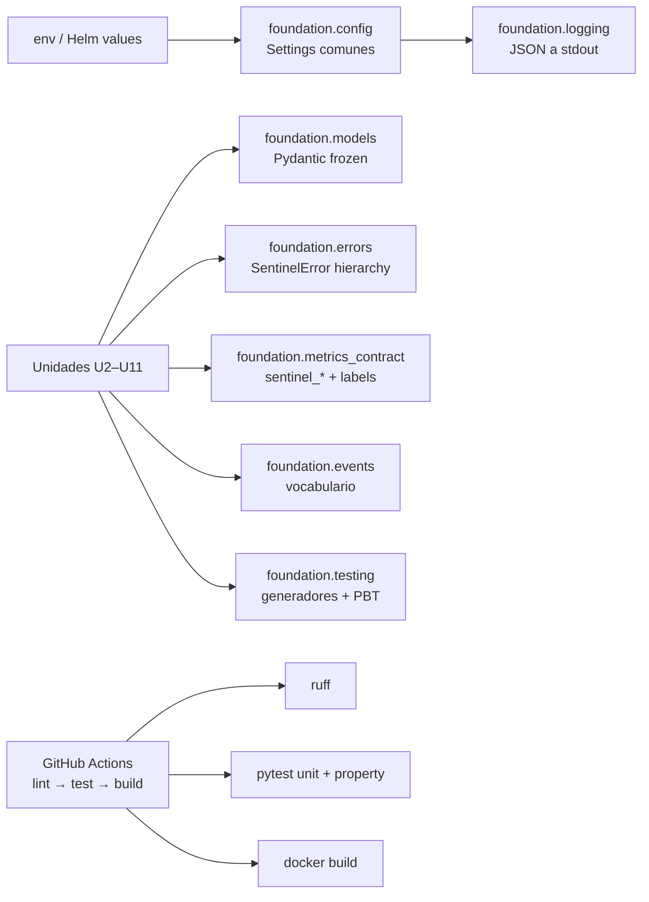

# Functional Design — U1 (Project foundation & CI skeleton)

**Fase**: CONSTRUCTION — Functional Design (Parte 2: Generation)
**Fecha**: 2026-11-11
**Estado**: GENERATED — pendiente de aprobación
**Unidad**: U1 — `src/sentinel/foundation/`
**Decisiones (plan Q1–Q9)**: A en todas — modelos Pydantic compartidos; config solo común; constantes de métricas en foundation; logging stdlib+JSON; GitHub Actions; ruff; jerarquía `SentinelError`; PBT de áreas construidas (EN-02 → implemented parcial); Python 3.11.
**Historias**: EN-01 (implemented), EN-05 (implemented), EN-02 (implemented parcial — re-alcance registrado en `implementation-scope.md`).

---

## 1. Propósito de la lógica de fundación

Foundation es **código puro, sin E/S de red ni clúster**: solo define contratos, convenciones y utilidades que todas las unidades consumen. Cualquier I/O (sondeo, captura, HTTP, SQLite) queda fuera de este módulo (criterio de frontera de U1).

---

## 2. Componentes lógicos

### 2.1 `foundation.config` — Configuración común (Q2=A)

```text
Settings (Pydantic)
├── log_level: Literal["DEBUG","INFO","WARNING","ERROR"] = "INFO"
├── component: str = "sentinel"          # nombre del proceso/workload
└── debug: bool = False

load_settings() -> Settings
```

- **Origen**: variables de entorno (`SENTINEL_LOG_LEVEL`, `SENTINEL_COMPONENT`, `SENTINEL_DEBUG`), que Helm values inyecta como `env`.
- **Alcance**: SOLO estas claves comunes. `scope.*`, `discovery.*`, `traffic.*`, `gui.*` **no** existen aquí — los define cada unidad que las necesite (U4/U5/U3) con su propio loader reutilizando el patrón de `load_settings`.
- **Validación**: falla rápido al arranque si el nivel de log es inválido (`ConfigError`).

### 2.2 `foundation.logging` — Pipeline de logging JSON (Q4=A)

```text
get_logger(component) -> logging.Logger
    └── logger con JsonFormatter → StreamHandler(stdout)
```

- Campos obligatorios en cada línea: `ts` (ISO 8601 UTC), `level`, `component`, `event`, `msg`.
- Campos extra: pares `clave=valor` pasados por `logger.info("...", extra={"event": "...", "host": ...})` → se serializan como JSON adicional.
- Niveles según `Settings.log_level`; un handler de stdout por logger (sin handlers duplicados: patrón `logger.handlers` check).
- Los logs van **a stdout** (captura por el logging de Kubernetes); nunca archivo ni stderr mezclado.
- `event` es obligatorio: constantes de nombres de evento compartidas viven en `foundation.events` (p. ej. `EV_SCOPE_VIOLATION`, `EV_CYCLE_FAILED`) para que U4/U5/U2 usen el mismo vocabulario en logs.

### 2.3 `foundation.metrics_contract` — Contrato de métricas (Q3=A)

```text
METRIC_PREFIX = "sentinel_"
FORBIDDEN_LABELS = {"src_ip", "dst_ip", "mac", "asset_id"}   # cardinalidad
ALLOWED_LABELS_DEFAULT = {"component", "protocol", "interface", "rule", "state"}

metric_name(name) -> f"{METRIC_PREFIX}{name}"     # validación: [a-z0-9_]+
assert_labels(labels) -> None                      # KeyError/ValueError si hay label prohibido
```

- Catálogo inicial (familias, no valores): `sentinel_discovery_cycles_total`, `sentinel_flows_total`, `sentinel_bytes_per_second`, `sentinel_arp_messages_total`, `sentinel_alerts_firing`, `sentinel_baseline_established`, `sentinel_collector_heartbeat_age_seconds`, `sentinel_api_requests_total`.
- U7 (`MetricsExporter`) importa estas constantes; foundation **no** recolecta ni expone métricas — solo define nombres/labels válidos.
- Test de contrato: `tests/unit/test_metrics_contract.py` valida nombres y rechaza labels prohibidos.

### 2.4 `foundation.errors` — Jerarquía de excepciones (Q7=A)

```text
SentinelError(Exception)
├── ConfigError            # settings inválidos
├── ScopeError             # alcance violado / host fuera de allowlist  (usa U4)
├── ValidationError        # payload de observación inválido            (usa U2/U4/U5)
├── ProbeError             # fallo de sondeo (nmap/arp/icmp)            (usa U4)
├── IngestionError         # fallo de ingesta/reintento                 (usa U2/U4/U5)
└── StorageError           # fallo de persistencia                      (usa U2)
```

- Cada subtipo lleva `code` (str estable, p. ej. `scope_violation`) y mensaje humano.
- **Traducción a HTTP** la hace U2 (API Layer): `ScopeError → 400 + code`, `ValidationError → 422`, etc. Foundation no importa FastAPI.
- Regla: los módulos propios de cada unidad extienden esta jerarquía; nunca lanzan excepciones genéricas no envueltas en errores de dominio para fallos de negocio.

### 2.5 `foundation.models` — Entidades Pydantic compartidas (Q1=A)

Set único de modelos de dominio (detalle en `domain-entities.md`): `Asset`, `Observation` (variantes discovery/traffic/arp), `DiscoveryCycle`, `TrafficWindow`, `ArpMapping`, `InventoryEvent`, `AlertCondition`, `Baseline`. Config `frozen=True` (inmutables tras validación) y `extra="forbid"` (payload desconocido = error, no silencio).

- Los mismos modelos consumen: U2 (API/ingesta), U4/U5 (construcción de lotes), U3 (render vía API), U6 (condiciones).
- Normalizadores primitivos como tipos de campo: `IPv4/IPv6`, `MAC` (formato `aa:bb:cc:dd:ee:ff`, minúsculas), `UTCDateTime` (tz-aware; rechaza naive).

### 2.6 `foundation.events` — Vocabulario de eventos

Enumeración canónica de tipos de evento/estado usados en logs, `InventoryEvent.type` y reglas:
`asset_first_seen`, `asset_missing`, `port_service_changed`, `arp_mapping_changed`, `discovery_cycle_failed`, `scope_violation`, `sensor_heartbeat`, `condition_firing`, `condition_resolved`.

### 2.7 `foundation.testing` — Soporte de tests y PBT (Q8=A)

- Layout: `tests/unit/<modulo>/`, `tests/property/`, `tests/integration/`.
- `hypothesis` como dependencia de desarrollo; fixtures compartidas (XML de Nmap de ejemplo, lotes de observaciones) en `tests/fixtures/`.
- **PBT designado (EN-02 implemented parcial)** — solo donde el área esté construida:
  - U4: parseo de Nmap XML (propiedades: idempotencia, rechazo de XML malformado, normalización de puertos);
  - U2: normalización de flujos/lotes (propiedades: conmutatividad de dedup, invariancia de normalización);
  - U6: cálculo de baseline (propiedades: μ∈[min,max], varianza≥0, supresión durante las primeras 5 muestras).
- Foundation aporta el paquete `foundation.testing` con generadores comunes (IPs, MACs, timestamps) reutilizados por esos tests.

### 2.8 Entrypoints de imagen y layout (Q5/Q6/Q9 — ver también `unit-of-work.md` §3)

- Entrypoints ejecutables: `python -m sentinel.core`, `python -m sentinel.discovery`, `python -m sentinel.traffic` (imagen única, comandos separados — ST-M8-04). Foundation no tiene entrypoint.
- `foundation/__main__.py` **no existe**; `python -m sentinel.foundation` debe fallar con mensaje claro ("module is a library, not an entrypoint").
- Toolchain: `ruff check` + `ruff format --check` (lint+formato), `pytest`, Python **3.11** fijado en `pyproject.toml` (`requires-python = ">=3.11,<3.12"`) y en CI/Dockerfile.

### 2.9 Pipeline de CI (EN-01 — Q5=A, Q6=A)

```text
GitHub Actions (.github/workflows/ci.yml)
  job lint    → ruff check . && ruff format --check .
  job test    → pytest -q tests/unit tests/property   # falla si hay fallos
  job build   → docker build -t sentinel:test .        # tras lint+test OK
```

- Etapas exactas: `lint`, `test`, `build` (el resto — scan, helm-test, deploy — queda documentado, no en el pipeline base: `implementation-scope.md` §2).
- El job `test` ejecuta `pytest --maxfail=1`; exit code ≠ 0 ⇒ status check `failure` ⇒ merge bloqueado (criterio EN-01).
- Config única en `pyproject.toml` (ruff, pytest, project metadata); el workflow solo invoca comandos.

---

## 3. Diagrama de la lógica de fundación



---

## 4. Flujo de arranque (startup) de cualquier workload

```text
1. load_settings()            → ConfigError si falla (exit ≠ 0, logueado)
2. get_logger(settings.component)
3. parse de args del entrypoint (core|discovery|traffic)
4. arranque del módulo de la unidad (fuera de foundation)
```

---

## 5. Escenarios cubiertos

| Escenario | Comportamiento |
|---|---|
| Config inválida al arranque | `ConfigError` → mensaje JSON en stdout, proceso termina con código 1 |
| Log con campo obligatorio ausente | El formatter añade `event="unnamed"` y `msg`; test lo verifica |
| Nombre de métrica con prefijo malo | `metric_name` lanza `ValueError`; test del contrato falla |
| Label prohibido (`src_ip`) | `assert_labels` lanza `ValueError`; CI bloquea |
| Payload con campo desconocido | Pydantic `extra="forbid"` → `ValidationError` de foundation (no confundir con la de U2) |
| Timestamp naive | Rechazado por `UTCDateTime` (debe venir tz-aware o con Z) |
| XML Nmap malformado (PBT) | Propiedad falla con contraejemplo mínimo → `pytest tests/property` rojo |
| `python -m sentinel.foundation` | Sale con mensaje "library, not an entrypoint" |

---

## 6. Fuera de alcance de esta lógica

- HTTP, FastAPI, SQLite, scapy, nmap, sockets, K8s client (U2–U5).
- Algoritmo de baseline y condiciones (U6) — foundation solo aporta generadores PBT para sus propiedades.
- Políticas RBAC/PSA/NetworkPolicy (U10).
- Definición de rutas/labels finales de `/metrics` (U7 consume el contrato).

---

## 7. Approval Gate

**Estado**: GENERATED — pendiente de aprobación (ver mensaje de completitud).
