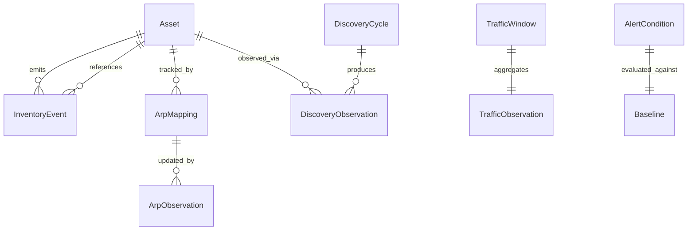

# Domain Entities — U1 (Foundation)

**Fase**: CONSTRUCTION — Functional Design
**Fecha**: 2026-11-11
**Estado**: GENERATED — pendiente de aprobación
**Unidad**: U1 — `src/sentinel/foundation/models.py` (Q1=A: Pydantic compartidos, `frozen=True`, `extra="forbid"`)
**Consumidores**: U2 (API/ingesta/persistencia), U3 (render vía API), U4/U5 (construcción de lotes), U6 (condiciones), U7 (métricas agregadas).

---

## 1. Tipos de campo (value objects)

| Tipo | Definición | Validación |
|---|---|---|
| `IPv4/IPv6Address` | `ipaddress.IPv4Address/IPv6Address` como tipo Pydantic | rechaza strings inválidos |
| `MACAddress` | `str` normalizado | regex `^([0-9a-f]{2}:){5}[0-9a-f]{2}$` (minúsculas); se normaliza al validar |
| `UTCDateTime` | `datetime` tz-aware | naive ⇒ error; se convierte a UTC |
| `Protocol` | `Literal["tcp","udp","icmp","arp","other"]` | enum cerrado |
| `OsProvenance` | `Literal["observed","inferred","declared","unknown"]` | BR-18: `unknown` jamás se presenta como confirmado |
| `AssetStatus` | `Literal["present","absent"]` | — |
| `CycleStatus` | `Literal["running","completed","partial","timeout","failed"]` | services.md §2.2 |
| `ConditionState` | `Literal["baseline_establishing","firing","resolved","no_data"]` | FR-BASE-04/05 |
| `EventId` / `Uuid` | `uuid.UUID` | se asigna al persistir (U2); foundation solo tipa |

---

## 2. Entidades

### 2.1 `Asset` — Inventario de activos

| Campo | Tipo | Notas |
|---|---|---|
| `asset_id` | `UUID` | identidad estable en el inventario (asigna U2) |
| `ips` | `list[IPv4Address]` | IPs observadas (puede haber varias) |
| `mac` | `MACAddress \| None` | `None` si nunca se observó (no inventar) |
| `hostname` | `str \| None` | solo si se observó/descubrió |
| `os_name` | `str \| None` | valor crudo (p. ej. "Linux") |
| `os_provenance` | `OsProvenance` | default `unknown` |
| `status` | `AssetStatus` | `absent` tras N ciclos exitosos sin verlo (U2) |
| `first_seen` / `last_seen` | `UTCDateTime` | — |
| `source` | `Literal["discovery","manual","declared"]` | origen del registro |
| `sensor_id` | `str` | reservado multi-sensor (FR-DISC-04); MVP = `"sensor-0"` |

**Relación**: `Asset 1—* InventoryEvent`; `Asset 1—* Observation` (por IP/MAC); `Asset 1—* ArpMapping`.

### 2.2 `Observation` (base) y variantes

Base común (todas las variantes):

| Campo | Tipo | Notas |
|---|---|---|
| `observed_at` | `UTCDateTime` | momento de la observación |
| `sensor_id` | `str` | reservado (BR-15) |
| `source` | `Literal["discovery","traffic","arp"]` | — |

**`DiscoveryObservation`** (U4 → U2):

| Campo | Tipo | Notas |
|---|---|---|
| `ip` | `IPv4Address` | host observado |
| `mac` | `MACAddress \| None` | si ARP respondió |
| `hostname` | `str \| None` | — |
| `ports` | `list[PortInfo]` | `port`, `protocol`, `state`, `service`, `version`, `confidence: Literal["confirmed","probable","unknown"]` — probable = solo por número de puerto (DECISIONES §2) |
| `os_name` / `os_provenance` | `str \| None` / `OsProvenance` | sin `-O` en MVP ⇒ casi siempre `unknown` |
| `method` | `Literal["arp","icmp","tcp","nmap"]` | método del sondeo |

**`TrafficObservation`** (U5 → U2) — agregado, no paquete individual:

| Campo | Tipo | Notas |
|---|---|---|
| `window_start` / `window_end` | `UTCDateTime` | ventana (default 5 s) |
| `interface` | `str` | — |
| `protocol` | `Protocol` | — |
| `packet_length_bytes` | `int` | longitud IP acumulada (PRD §3.2: IPv4 `total_length`) |
| `bytes_per_second` | `float` | `packet_length_bytes / duración_efectiva` |
| `packets` / `flows` | `int` | conteos de la ventana |
| `pairs` | `list[FlowPair]` | `src_ip`, `dst_ip` — en observaciones/logs, **no** como labels de métricas (BR-21) |

**`ArpObservation`** (U5 → U2):

| Campo | Tipo | Notas |
|---|---|---|
| `interface` | `str` | — |
| `opcode` | `Literal[1,2]` | request/reply |
| `psrc` / `pdst` | `IPv4Address` | — |
| `hwsrc` / `hwdst` | `MACAddress` | — |

### 2.3 `DiscoveryCycle` — Ejecución de descubrimiento

| Campo | Tipo | Notas |
|---|---|---|
| `run_id` | `UUID` | identidad de la ejecución |
| `status` | `CycleStatus` | `running → completed/partial/timeout/failed` |
| `trigger` | `Literal["scheduled","manual"]` | manual desde GUI (ST-M10-04) |
| `started_at` / `finished_at` | `UTCDateTime` / `None` | `timeout` por `discovery.timeout_seconds` |
| `hosts_targeted` / `hosts_seen` | `int` | — |
| `error` | `str \| None` | con `code` de `SentinelError` si falló |

**Regla**: `AssetMissing` solo se deriva de ciclos `completed` (arquitectura §"Core consulta…"); ciclos `failed` generan `discovery_cycle_failed` en log/eventos, no `SensorUnavailable`.

### 2.4 `TrafficWindow` — Ventana agregada persistible

Idéntica a `TrafficObservation` pero con `window_id: UUID` para referencias desde métricas/alertas; en el MVP ambas pueden ser el mismo modelo (`TrafficObservation` con `window_id` opcional) — decisión de implementación en U2/U5 sin romper el contrato.

### 2.5 `ArpMapping` — Asociación IP↔MAC

| Campo | Tipo | Notas |
|---|---|---|
| `ip` | `IPv4Address` | — |
| `mac` | `MACAddress` | — |
| `interface` | `str` | — |
| `first_seen` / `last_seen` | `UTCDateTime` | — |
| `changed_at` | `UTCDateTime \| None` | seteado al detectar cambio (E-04) |

### 2.6 `InventoryEvent` — Eventos de inventario

| Campo | Tipo | Notas |
|---|---|---|
| `event_id` | `UUID` | identidad estable al persistir (FR-CORE-04); deduplicación por este valor |
| `type` | `EventType` | `asset_first_seen`, `asset_missing`, `port_service_changed`, `arp_mapping_changed`, `discovery_cycle_failed` (vocabulario de `foundation.events`) |
| `asset_id` | `UUID \| None` | `None` si es de ciclo sin activo asociado |
| `occurred_at` | `UTCDateTime` | — |
| `details` | `dict[str, str \| int \| float]` | campos puntuales del evento (puerto viejo/nuevo, IP, MAC…) |
| `severity` | `Literal["info","warning","critical"]` | default `info` |

### 2.7 `AlertCondition` — Condición determinista

| Campo | Tipo | Notas |
|---|---|---|
| `condition_id` | `UUID` | — |
| `rule` | `Literal["R-01","R-02","R-03","R-04"]` | traffic, arp_rate, arp_mapping, sensor_down |
| `state` | `ConditionState` | `baseline_establishing` durante primeras 5 muestras (FR-BASE-04) |
| `measured_value` | `float \| None` | valor observado |
| `threshold` | `float \| None` | `μ + k·s` o umbral absoluto |
| `fired_at` / `resolved_at` | `UTCDateTime \| None` | — |
| `evidence` | `dict[str, str \| int \| float]` | contexto reproducible (rango, interfaz, protocolo) |

### 2.8 `Baseline` — Línea base (la consume U6; el tipo vive en foundation)

| Campo | Tipo | Notas |
|---|---|---|
| `metric_key` | `str` | p. ej. `bytes_per_second:eth0:tcp` |
| `samples` | `list[float]` | primeras 5 muestras (FR-BASE-01) |
| `mean` / `variance` | `float` | μ y s² (FR-BASE-02) |
| `established` | `bool` | `false` hasta 5 muestras |
| `interval_seconds` | `int` | default 5 |

---

## 3. Diagrama de relaciones

---

## 4. Reglas de identidad y normalización (resumen)

- `asset_id` y `condition_id`: UUIDv4 asignados por U2 al persistir.
- `event_id`: UUID estable por evento de inventario — deduplicación de ingesta (U2).
- MAC: siempre minúsculas con `:`; IP: `ipaddress`; timestamps: UTC tz-aware.
- `sensor_id`: presente en todas las observaciones (BR-15).
- Modelos inmutables: cualquier "cambio" = nuevo modelo/objeto (Pydantic frozen).

---

## 5. Approval Gate

**Estado**: GENERATED — pendiente de aprobación (ver mensaje de completitud).
