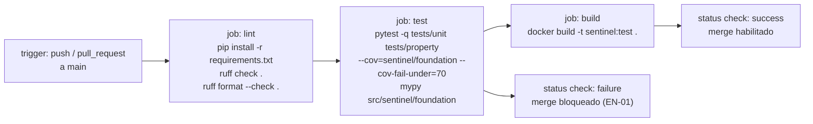
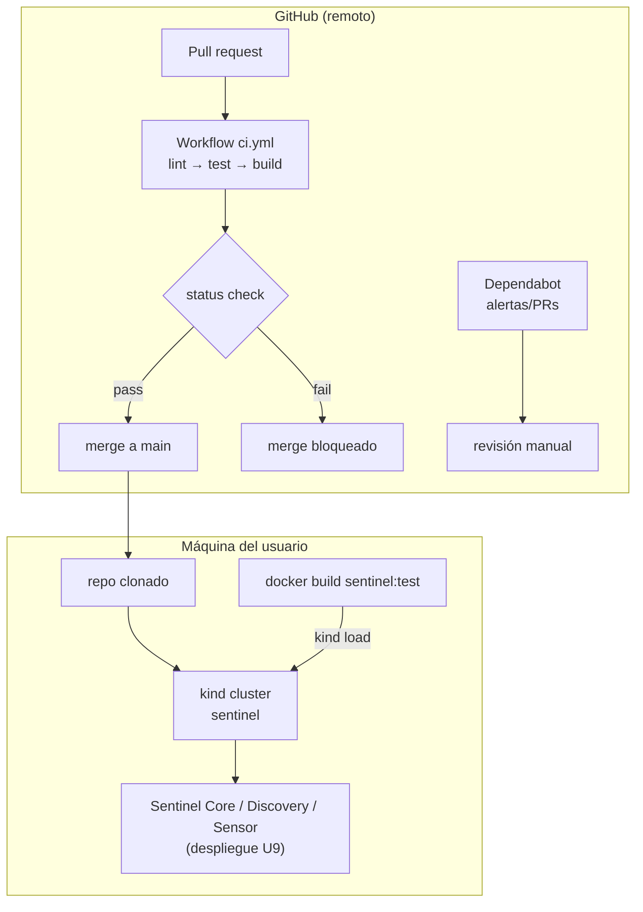

# Deployment Architecture — U1 (Foundation CI & Image Delivery)

**Fase**: CONSTRUCTION — Infrastructure Design
**Fecha**: 2026-11-11
**Estado**: GENERATED — pendiente de aprobación
**Unidad**: U1 — pipeline e imagen; despliegue de app en kind (máquina del usuario)
**Decisiones**: FQ1=A (GitHub Actions simple), Q2=A (kind load), Q3=B (docker build simple), Q4=B (sin artifacts)

---

## 1. Flujo CI (GitHub Actions — `.github/workflows/ci.yml`)



**Especificación de jobs**:

| Job | Comando base | Falla si… |
|---|---|---|
| `lint` | `ruff check . && ruff format --check .` | cualquier estilo/errores |
| `test` | `pytest … --cov-fail-under=70` + `mypy` | tests rojos, cobertura <70%, errores de tipos |
| `build` | `docker build -t sentinel:test .` | Dockerfile/imports rotos |

**Reglas**: jobs corren en `ubuntu-latest` (hosted); `build` solo tras `lint`+`test` verdes (`needs:`); sin caché (Q3=B), sin artifacts (Q4=B), sin etapas de scan/push/deploy (scope §2).

---

## 2. Entrega de la imagen a la demo (máquina del usuario)

```text
1. git clone https://github.com/JLForU/TAI_Proyecto.git
2. pip install -r requirements.txt          # o confiar en CI
3. ruff check . && pytest …                 # gate local (mismo comando que CI)
4. docker build -t sentinel:test .
5. kind create cluster --name sentinel      # una vez
6. kind load docker-image sentinel:test --name sentinel
7. (U9) helm install sentinel charts/sentinel -n sentinel …
```

- **No hay registro remoto**: la imagen viaja del disco local al cluster vía `kind load` (Q2=A).
- El paso 7 pertenece al alcance de U9; U1 solo garantiza que `sentinel:test` se construye con Alpine/no-root y entrypoints correctos.

---

## 3. Diagrama de ambientes



---

## 4. Qué queda fuera de esta arquitectura (documentado, no implementado)

| Elemento | Estado | Dónde se decide |
|---|---|---|
| Push de imagen a ghcr.io/Docker Hub | Futuro (documentado) | Q2=A; registro de deuda |
| buildx / caché de capas | Descartado deliberadamente | Q3=B |
| Artifacts de coverage/junit | Descartados | Q4=B |
| Escaneo de imagen (EN-04), SAST, secret scanning | Deuda de seguridad | Q5 requirements=B (SEC-04) |
| Etapas helm-test / deploy a kind desde CI | No en pipeline base | Scope §2; posible despliegue manual/local |
| Self-hosted runners, multi-entorno (dev/stage/prod) | No aplica | Proyecto single-environment en local |

---

## 5. Approval Gate

**Estado**: GENERATED — pendiente de aprobación (ver mensaje de completitud).
