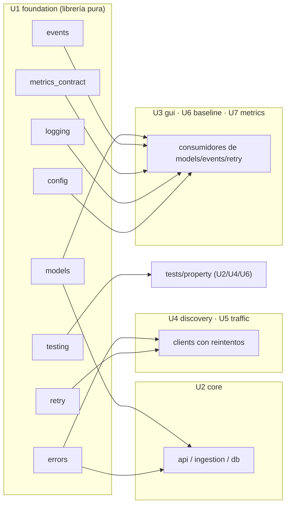

# Logical Components — U1 (Foundation)

**Fase**: CONSTRUCTION — NFR Design
**Fecha**: 2026-11-11
**Estado**: GENERATED — pendiente de aprobación formal
**Unidad**: U1 — `src/sentinel/foundation/` (layout completo en `unit-of-work.md` §3)
**Decisiones clave**: Q3=A (cliente HTTP fuera de foundation), Q1=A (`foundation.retry` compartido), Q2=A (límites como constantes).

---

## 1. Componentes lógicos de foundation

| Componente | Archivo | Responsabilidad | NFR que sirve |
|---|---|---|---|
| Settings loader | `foundation/config.py` | Cargar/validar `LOG_LEVEL`, `COMPONENT`, `DEBUG` desde env; fail-fast | REL-02 (P1) |
| JSON Logger factory | `foundation/logging.py` | `get_logger(component)` con `JsonFormatter`, handler único stdout | REL-01/03, MNT (P4) |
| Error hierarchy | `foundation/errors.py` | `SentinelError` + subtipos con `code` estable | REL (FD BR-23/24) |
| Domain models | `foundation/models.py` | Pydantic frozen: `Asset`, `Observation`×3, `DiscoveryCycle`, `TrafficWindow`, `ArpMapping`, `InventoryEvent`, `AlertCondition`, `Baseline` + value objects + **constantes de límite** (P2) | SEC (P2), MNT (P7) |
| Event vocabulary | `foundation/events.py` | Enum canónico de `event`/`EventType` | MNT (BR-11) |
| Metrics contract | `foundation/metrics_contract.py` | Prefijo `sentinel_`, catálogo de familias, `assert_labels` | SEC cardinalidad (BR-20..22) |
| Retry helper | `foundation/retry.py` | `with_retries` backoff+jitter stdlib (Q1=A) | Resilience (P3) |
| Testing support | `foundation/testing/__init__.py` | Generadores hypothesis (IPs, MACs, timestamps, lotes) reutilizados por PBT | MNT-05 (FD BR-28) |
| Package metadata | `pyproject.toml`, `requirements.txt` | `requires-python >=3.11,<3.12`, deps fijadas, config ruff/mypy/pytest | TS-01/03, MNT-01..03 |
| CI workflow | `.github/workflows/ci.yml` | Jobs `lint`, `typecheck`, `test`, `build` (Q5 FD; Q4=A: Dependabot aparte) | MNT, EN-01 (P5, P6) |
| Dependabot config | `.github/dependabot.yml` | Alertas/PRs pip + github-actions (Q4=A) | SEC-02 (P6) |
| Containerfile | `Dockerfile` | Alpine, no-root, entrypoints `python -m sentinel.{core,discovery,traffic}` (imagen única) | SEC-05, ST-M8-04 |
| Debt register | `docs/security-debt.md` (redacción en U11) | Deuda SAST/scan/secret-scan explícita (Q5=B, P8) | SEC-04 |

**Nota**: `foundation` no tiene `__main__.py`; los entrypoints reales pertenecen a los módulos `core`, `discovery`, `traffic` (U2/U4/U5) sobre la imagen construida aquí.

---

## 2. Bordes con otras unidades (quién importa qué)



| Consumidor | Importa de foundation | **No** importa |
|---|---|---|
| U2 Core | models, errors, events, logging, config, metrics_contract | testing (solo tests), retry (Core no reintenta salvo caso propio) |
| U3 GUI | models, events (vía API en runtime) | config de red, retry |
| U4 Discovery | models, errors (`ScopeError`, `ProbeError`), logging, config, **retry** | models de U2, `foundation.*` de persistencia (no existe) |
| U5 Traffic | models, errors (`IngestionError`), logging, **retry** | idem |
| U6 Baseline | models (`Baseline`, `AlertCondition`), events | cliente HTTP |
| U7 Metrics | metrics_contract, models | logs propios de foundation |
| U11 Tests/GT | testing (generadores) | — |

**Regla de borde (hereda BR-19)**: ningún módulo de U2–U11 importa `fastapi`, `sqlite3`, `scapy`, `nmap`, `socket` **desde foundation** — esas dependencias viven en el módulo que las necesita.

---

## 3. Cliente HTTP de colectores (Q3=A — decisión de borde)

| Opción descartada | Por qué |
|---|---|
| `foundation.http` compartido | Viola BR-19 (foundation sin I/O de red); metería `httpx` en la librería base de todos |
| Paquete nuevo `sentinel/shared/` | Componente no previsto en las 11 unidades; fronteras nuevas sin aprobación |
| **Elegido**: `sentinel/discovery/client.py` y `sentinel/traffic/client.py` | Cada colector posee su cliente (token desde env, `with_retries` de foundation, modelos compartidos); duplicidad mínima (un POST + manejo de 4xx/5xx), fronteras limpias |

Contrato mínimo del cliente (compartido por diseño, no por código): `send_batch(batch: Batch, token: str) -> Ack`, `IngestionError` en fallo definitivo, nunca excepción sin envolver.

---

## 4. Estructura final de foundation (árbol)

```text
src/sentinel/foundation/
├── __init__.py            # re-exporta API pública (models, errors, get_logger, with_retries)
├── config.py              # Settings + load_settings          (P1)
├── logging.py             # get_logger + JsonFormatter        (P4)
├── errors.py              # jerarquía SentinelError
├── models.py              # entidades + value objects + MAX_* (P2, P7)
├── events.py              # vocabulario de eventos
├── metrics_contract.py    # prefijo, catálogo, assert_labels
├── retry.py               # with_retries                     (P3)
└── testing/
    ├── __init__.py
    └── generators.py      # strategies hypothesis            (P5)
```

---

## 5. Approval Gate

**Estado**: GENERATED — pendiente de aprobación formal (ver mensaje de completitud).
