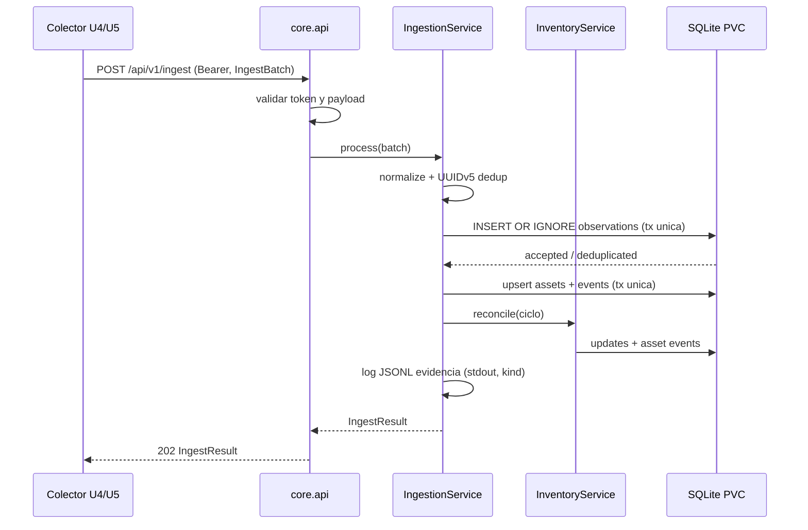
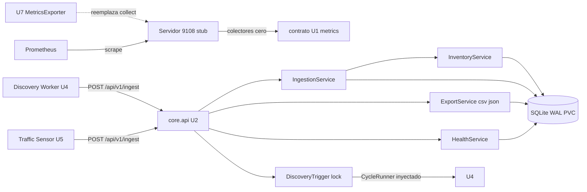

# Business Logic Model — U2 (Core API, persistence & export)

**Fase**: CONSTRUCTION — Functional Design
**Fecha**: 2026-11-11
**Estado**: GENERATED — pendiente de aprobación
**Unidad**: U2 — `src/sentinel/core/` (api/, ingestion/, inventory/, export/, health/, discovery/, db/)
**Plan de preguntas**: `construction/plans/u2-core-functional-design-plan.md` (Q1–Q13 = A)
**Entradas**: ST-M4-01..07, FR-CORE-01..05, FR-EXP-01..03, OQ-02, `services.md`, `component-methods.md`, contratos U1.

---

## 1. Propósito y frontera

U2 es el **único escritor de SQLite** y la cara HTTP interna del Core (`/api/v1` + `/metrics`):

- **Hace**: ingesta con token, normalización, deduplicación, correlación por IP, reconciliación de inventario, persistencia, consulta paginada, export CSV/JSON, evidencia JSONLines, salud del Core, servidor `/metrics` (stub de colectores), trigger de discovery con lock único.
- **No hace** (frontera): sondeo (U4), captura de tráfica (U5), evaluación de condiciones/alertas/baselines (U6), render de métricas reales (U7), GUI (U3), reporte (`GET /api/v1/report` → U3/U7), despliegue/K8s (U9/U10), auth de operador (demo port-forward), escritura en activos monitorizados.

Stack fijado por requisitos: Python 3.11, FastAPI + uvicorn, SQLite 3 en PVC, HTTP/JSON, services síncronos.

---

## 2. Componentes lógicos

| Componente | Responsabilidad | Depende de |
|---|---|---|
| `core.api` (C2) | Rutas FastAPI `/api/v1/*`, mapeo de errores HTTP, auth de ingesta | servicios, `core.config` |
| `core.ingestion.IngestionService` | Validar lote, normalizar, dedup UUIDv5, persistir, correlacionar, reconciliar, emitir evidencia | repos, InventoryService |
| `core.inventory.InventoryService` | Reconciliar activos (present/absent), emitir `asset_first_seen`, `asset_missing`, `arp_mapping_changed` | AssetRepository |
| `core.query` | Consulta paginada de assets/events/alerts con filtros | repos |
| `core.export.ExportService` | CSV/JSON en memoria bajo demanda | EventRepository |
| `core.health.HealthService` | Estado del Core desde DB + heartbeat por `sensor_id` | repos |
| `core.metrics` | Servidor 9108 + render de familias U1 con colectores en cero (stub; U7 implementa `collect()`) | `foundation.metrics_contract` |
| `core.discovery.DiscoveryTrigger` | Rutas + `DiscoveryRunRepository` + lock único + `CycleRunner` inyectado (U4) | U1 retry |
| `core.db` | Conexión sqlite3 por request, WAL, migraciones DDL, repositorios SQL | stdlib `sqlite3` (Q1=A) |
| `core.config` | Loader propio reutilizando el patrón de `foundation.config` | env `SENTINEL_*` (Q13=A) |

---

## 3. Flujos

### 3.1 Ingesta — `POST /api/v1/ingest` (ST-M4-01, Q2=A, Q3=A)

```text
1. Auth: Bearer token == SENTINEL_INGEST_TOKEN si está definida
   - token ausente/incorrecto -> 401 (no se procesa nada)
   - token no configurado -> 403 con msg "ingest token not configured"
     (arranque exitoso solo si U9 inyecta el Secret)
2. Validar payload con Pydantic (U1 IngestBatch, MAX_BATCH_ITEMS=1000)
   - inválido -> 422 con detalle de campo (campo obligatorio faltante -> 400/422)
3. Para cada observación:
   a. normalize(): MAC a canónico minúsculas, IP tipada, timestamps a UTC tz-aware
      (re-normalizar antes de hashear: reenvíos con otro formato chocan igual)
   b. dedup_key = UUIDv5(NAMESPACE_FIJO, hash(sha256 del contenido normalizado:
      source, kind, sensor_id, observed_at, campos de detalle))
   c. INSERT OR IGNORE en observations (UNIQUE dedup_key) -> contador deduplicated
   d. resolver/upsert Asset por IP observada -> asset_id en la observación
4. Reconciliar inventario (InventoryService) -> eventos de inventario (§3.2)
5. Persistir events generados (INSERT OR IGNORE por event_id = UUIDv5)
6. Evidencia: 1 línea JSON por evento/inferencia vía foundation.logging (§3.6)
7. Respuesta 202 IngestResult {ingest_id, accepted, deduplicated, events_persisted}
   - lote 100% duplicado -> 202 con accepted=0, deduplicated=N (idempotente)
   - error de DB -> 503 (IngestionError/StorageError), sin persistencia parcial
     (transacción única: o todo el lote o nada)
```

### 3.2 Reconciliación de inventario (ST-M4-04, Q4=A)

```text
Para cada IP del lote:
  - IP nueva -> INSERT asset (status=present, first_seen=now) + evento asset_first_seen
  - IP conocida -> UPDATE last_seen=now, status=present (si estaba absent)
  - IP conocida con MAC distinta -> UPDATE mac + evento arp_mapping_changed
  - sin observación en un ciclo completed:
      incrementa miss_count; si miss_count >= SENTINEL_MISSING_CYCLES (default 3)
      -> status=absent + evento asset_missing (una sola vez por transición)
```

- Solo ciclos **completed** cuentan para ausencia (partial/timeout/failed no).
- `last_seen` se actualiza en **cada** observación, no por ciclo.
- El umbral es **configurable** (Q4=A); `miss_count` se reinicia al volver a verse.

### 3.3 Consulta paginada (ST-M4-07, Q8=A)

- `GET /api/v1/assets|events|alerts` con filtros (`status`, `from`,`to`,`asset_id`,`rule`,`severity`,`state`).
- Paginación `limit` (default 100, máx 1000) + `offset`; respuesta `{items, total, limit, offset}`.
- `GET /api/v1/assets/{asset_id}` → `AssetDetail` con observaciones de **todas** las fuentes unidas por IP + ventana (correlación Q5=A: columna `asset_id` en observations).

### 3.4 Export (ST-M4-06, Q7=A)

- `GET /api/v1/export?format=csv|json&from=&to=` → 200 con cuerpo; **bajo demanda**, sin scheduler ni push (FR-EXP-03).
- CSV en memoria con cabecera exacta: `timestamp,asset_or_pair,method,protocol,condition,rule,threshold,measured_value,result`.
- `format` inválido → 400; sin datos → CSV solo cabecera / JSON `[]`.

### 3.5 Salud (Q11=B)

- `GET /api/v1/health` → estado derivado **solo de DB**: uptime del proceso, conectividad DB, último `received_at` global, último ingest por `sensor_id` (heartbeat → "sensor caído" sin K8s), conteos de assets/events/alerts, último ciclo registrado (`discovery_runs`).
- Sin dependencia del API de Kubernetes (U9/U10 rellenan después si aplica).

### 3.6 Evidencia JSON Lines (ST-M4-05, Q6=A)

- Cada evento/inferencia se emite por `foundation.get_logger` a **stdout**: una línea JSON con los campos de evidencia obligatorios: hora, activo/par, método, protocolo, condición, regla, umbral, valor medido, resultado + `kind ∈ {observation, inference, event, alert}`.
- Reutiliza BR-09..12 de U1 (JSON por línea, ISO 8601 UTC, vocabulario de `foundation.events`).

### 3.7 Métricas stub en 9108 (Q10=A)

- U2 crea el servidor HTTP en `9108` y renderiza **todas las familias** del contrato U1 (`sentinel_*`) con valores en cero/stub.
- U7 sustituye los cuerpos de `collect()` por valores reales **sin cambiar** rutas ni nombres de familia (IP7).

### 3.8 Trigger de discovery (Q9=A)

- `POST /api/v1/discovery` → valida request, adquiere **lock único de ejecución**; si hay ciclo en curso → `409`; si OK → `202 DiscoveryRun` (`run_id`, estado `running`).
- `GET /api/v1/discovery/{run_id}` → estado (`running|completed|timeout|failed`); inexistente → 404.
- El runner es una interfaz `CycleRunner` **inyectada** (la implementa U4 con `run_cycle`); sin runner inyectado → `503` con mensaje claro.
- `acquire_single_run_lock()` en proceso (threading) + persistencia en `discovery_runs`; timeout → estado `timeout` (services.md §2.2).

---

## 4. Identidad de eventos y deduplicación (Q3=A)

```text
dedup_key = uuid.uuid5(NAMESPACE_DETERMINISTA, sha256(canonical_json(contenido_normalizado)))
event_id  = dedup_key  (para eventos: UNIQUE = PK)
observations: UNIQUE(dedup_key) + INSERT OR IGNORE
```

- Namespace fijo constante en código (no configurable).
- Hash sobre contenido **ya normalizado** ⇒ reenvíos con formato distinto (MAC mayúsc., timestamps con otro offset) generan el mismo UUID.
- Idempotencia total del lote: repetir el mismo POST no cambia `events_persisted` (AC ST-M4-03).

---

## 5. Manejo de errores (Q12=A, BR-24)

| Situación | HTTP | Cuerpo |
|---|---|---|
| Token de ingesta inválido/ausente | 401 | `{"detail": "unauthorized"}` |
| Token no configurado en el proceso | 403 | `{"detail": "ingest token not configured"}` |
| Payload fuera de schema (Pydantic) | 422 | detalle de campo inválido |
| Falta campo obligatorio / lote malformado | 400 | campo inválido |
| `ScopeError` (host fuera de alcance en trigger) | 400 | `{"detail": ..., "code": "scope_violation"}` |
| Recurso inexistente (run_id, asset_id) | 404 | `{"detail": "not found"}` |
| Discovery ya en curso | 409 | `{"detail": "discovery already running"}` |
| `ValidationError` de dominio | 400 | detalle |
| `IngestionError` / `StorageError` (DB) | 503 | `{"detail": "storage unavailable"}` |
| Runner no inyectado (U4 pendiente) | 503 | `{"detail": "discovery runner not available"}` |
| Error no previsto | 500 | `{"detail": "internal error"}` + log completo, **sin** stacktrace al cliente |

---

## 6. Configuración de U2 (Q13=A)

`core.config` (`CoreSettings`) — patrón idéntico a `foundation.config` (env `SENTINEL_*`, fail-fast):

| Clave | Default | Uso |
|---|---|---|
| `SENTINEL_DB_PATH` | `/data/sentinel.db` | ruta del archivo SQLite (PVC) |
| `SENTINEL_INGEST_TOKEN` | vacío | Bearer de `POST /ingest` (Secret de U9) |
| `SENTINEL_PAGE_LIMIT` | `100` | `limit` por defecto (máx 1000) |
| `SENTINEL_MISSING_CYCLES` | `3` | umbral N de ausencia |

---

## 7. Diagrama de secuencia — ingesta



## 8. Diagrama de contexto de datos



---

## 9. Fuera de alcance de esta etapa

- `GET /api/v1/report` (historia U3/FR-GUI-06; API de lectura de reportes la declara U3).
- Evaluación de condiciones y escritura de `alerts`/`baselines` (U6; U2 solo define el esquema en `domain-entities.md`).
- Cuerpos reales de `collect()` (U7).
- Implementación de `CycleRunner` (U4).
- Auth de operador, TLS, multi-sensor, cola de mensajes (anti-requisitos / fuera de MVP).
