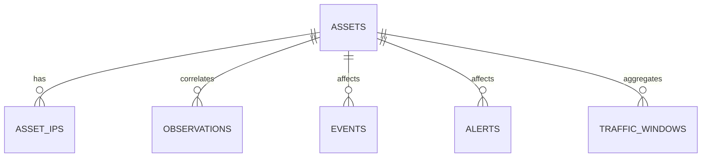

# Domain Entities — U2 (Core API, persistence & export)

**Fase**: CONSTRUCTION — Functional Design
**Fecha**: 2026-11-11
**Estado**: GENERATED — pendiente de aprobación
**Unidad**: U2 — `src/sentinel/core/db/` (esquema) + `core/api/schemas.py` (modelos HTTP)
**Cierra**: **OQ-02** — esquema SQLite exacto de events, assets, alerts, baselines
**Decisiones**: Q1=A (sqlite3 + repos + WAL), Q3=A (UUIDv5), Q5=A (correlación por `asset_id`), Q8=A (limit/offset), Q13=A (config)
**Comentarios**: tablas `alerts` y `baselines` se **definen** aquí (FR-CORE-03) pero las escribe U6; U2 solo hace SELECT para query/export.

---

## 1. Esquema SQLite (OQ-02)

Modo: WAL, `foreign_keys=ON`, DDL idempotente al arrancar (`CREATE TABLE IF NOT EXISTS`). Timestamps en ISO 8601 UTC (texto). JSON almacenado como TEXT (serializado por stdlib `json`).

### 1.1 `assets` — inventario

| Columna | Tipo | Constraints | Notas |
|---|---|---|---|
| `asset_id` | TEXT | PK | UUIDv4 estable por activo |
| `mac` | TEXT | | canónico minúsculas (BR-U2-10) |
| `hostname` | TEXT | NULL | |
| `os_name` | TEXT | NULL | |
| `os_provenance` | TEXT | | `observed\|inferred\|declared\|unknown` (U1) |
| `status` | TEXT | NOT NULL | `present\|absent` |
| `miss_count` | INTEGER | NOT NULL DEFAULT 0 | ciclos completed sin verse (BR-U2-14) |
| `first_seen` | TEXT | NOT NULL | ISO 8601 UTC |
| `last_seen` | TEXT | NOT NULL | ISO 8601 UTC |
| `source` | TEXT | | `discovery\|arp\|traffic` (fuente que lo creó) |
| `sensor_id` | TEXT | NULL | |

Índices: `idx_assets_status (status)`, `idx_assets_last_seen (last_seen)`.

### 1.2 `asset_ips` — correlación IP→activo (Q5=A)

| Columna | Tipo | Constraints |
|---|---|---|
| `ip` | TEXT | PK (IP observada, texto canónico) |
| `asset_id` | TEXT | NOT NULL, FK → `assets(asset_id)` |
| `first_seen` | TEXT | NOT NULL |
| `last_seen` | TEXT | NOT NULL |

Una IP apunta a **un** activo; un activo puede tener varias IPs (multi-homed). Índice: `idx_asset_ips_asset (asset_id)`.

### 1.3 `observations` — hechos crudos por sensor

| Columna | Tipo | Constraints | Notas |
|---|---|---|---|
| `dedup_key` | TEXT | PK | UUIDv5 del contenido normalizado (BR-U2-06) |
| `asset_id` | TEXT | NOT NULL, FK → `assets` | columna de correlación (Q5=A) |
| `source` | TEXT | NOT NULL | `discovery\|traffic\|arp` |
| `kind` | TEXT | NOT NULL | subtipo de observación (p. ej. `tcp_syn`, `arp_request`) |
| `sensor_id` | TEXT | NULL | para heartbeat (BR-U2-37) |
| `observed_at` | TEXT | NOT NULL | ISO 8601 UTC (normalizado) |
| `received_at` | TEXT | NOT NULL | ISO 8601 UTC al recibir |
| `payload` | TEXT | NOT NULL | JSON con campos específicos del tipo (puertos, ventana, psrc/hwsrc…) |

Índices: `idx_obs_asset_time (asset_id, observed_at)`, `idx_obs_sensor (sensor_id, observed_at)`, `idx_obs_source (source, observed_at)`.

### 1.4 `events` — eventos con identidad estable

| Columna | Tipo | Constraints | Notas |
|---|---|---|---|
| `event_id` | TEXT | PK | UUIDv5 (BR-U2-06) |
| `type` | TEXT | NOT NULL | p. ej. `asset_first_seen`, `asset_missing`, `arp_mapping_changed`, `traffic_threshold_exceeded`, `sensor_down` |
| `asset_id` | TEXT | NULL, FK → `assets` | par/activo afectado |
| `severity` | TEXT | NOT NULL DEFAULT `info` | `info\|warning\|critical` |
| `rule` | TEXT | NULL | id de regla (R-01…) cuando aplica |
| `occurred_at` | TEXT | NOT NULL | ISO 8601 UTC |
| `details` | TEXT | NOT NULL | JSON: evidencia completa (umbral, valor medido, método, protocolo, condición, resultado) |
| `created_at` | TEXT | NOT NULL | ISO 8601 UTC al persistir |

Índices: `idx_events_time (occurred_at)`, `idx_events_asset (asset_id, occurred_at)`, `idx_events_type (type, occurred_at)`, `idx_events_rule (rule)`.

### 1.5 `alerts` — estado de condiciones (escrita por U6)

| Columna | Tipo | Constraints | Notas |
|---|---|---|---|
| `alert_id` | TEXT | PK | UUIDv5 por (condition, asset/metric, primera activación) |
| `condition_id` | TEXT | NOT NULL | identificador de condición |
| `rule` | TEXT | NOT NULL | `R-01`… |
| `metric_key` | TEXT | NULL | clave de métrica (traffic, arp…) |
| `asset_id` | TEXT | NULL, FK → `assets` | |
| `state` | TEXT | NOT NULL | `firing\|resolved` (U1 ConditionState) |
| `measured_value` | REAL | NULL | |
| `threshold` | REAL | NULL | |
| `fired_at` | TEXT | NOT NULL | |
| `resolved_at` | TEXT | NULL | |
| `evidence` | TEXT | NULL | JSON (campos de BR-U2-25) |
| `updated_at` | TEXT | NOT NULL | |

Índices: `idx_alerts_state (state, fired_at)`, `idx_alerts_asset (asset_id, fired_at)`.

### 1.6 `baselines` — estado de ventanas (escrita por U6)

| Columna | Tipo | Constraints | Notas |
|---|---|---|---|
| `metric_key` | TEXT | PK | clave canónica de métrica (U1 MetricKey) |
| `interval_seconds` | INTEGER | NOT NULL | ventana (5 s por defecto, PRD) |
| `samples` | TEXT | NOT NULL | JSON de la ventana actual |
| `mean` | REAL | NULL | μ |
| `variance` | REAL | NULL | s² (o `stddev`; consistente con U6) |
| `established` | INTEGER | NOT NULL DEFAULT 0 | 0/1 (baseline establishing vs lista) |
| `updated_at` | TEXT | NOT NULL | |

### 1.7 `discovery_runs` — ciclos manuales (Q9=A)

| Columna | Tipo | Constraints | Notas |
|---|---|---|---|
| `run_id` | TEXT | PK | UUIDv4 |
| `status` | TEXT | NOT NULL | `running\|completed\|timeout\|failed` (U1 CycleStatus) |
| `trigger` | TEXT | NOT NULL | `manual_api\|manual_ui` |
| `hosts_targeted` | TEXT | NOT NULL | JSON de hosts |
| `started_at` | TEXT | NOT NULL | |
| `finished_at` | TEXT | NULL | |
| `hosts_seen` | INTEGER | NULL | al completar |
| `error` | TEXT | NULL | si `failed` |

Índice: `idx_runs_status (status, started_at)`.

### 1.8 Relaciones (ER)

Nota: `traffic_windows` es la agregación de observaciones `traffic` que U6 consulta para baselines (reside en U2 como vista/tabla derivada si U6 la necesita; se define al implementar U6 sin cambiar este esquema base).

---

## 2. Entidades de dominio (modelos Pydantic de U1 consumidos por U2)

U2 **reutiliza** los modelos `frozen=True` de `foundation.models`: `Asset`, `Observation`, `Event`, `Alert`, `IngestBatch` (+ `DiscoveryBatch`, `TrafficBatch`, `ArpBatch`), `IngestResult`, `Page[T]`, `MetricKey`, `DiscoveryRun`, `DiscoveryRunStatus`, `ScopeMode`. U2 no redefine tipos de campo; solo añade filtros y páginas de respuesta.

---

## 3. Modelos de respuesta API (`core/api/schemas.py`)

| Modelo | Campos | Origen |
|---|---|---|
| `IngestResult` | `ingest_id: Uuid`, `accepted: int`, `deduplicated: int`, `events_persisted: int` | component-methods §2 |
| `Page[T]` | `items: list[T]`, `total: int`, `limit: int`, `offset: int` | Q8=A |
| `AssetSummary` | `asset_id`, `mac`, `ips`, `hostname`, `status`, `first_seen`, `last_seen` | query assets |
| `AssetDetail` | `AssetSummary` + `os_name`, `os_provenance`, `recent_observations[]` (todas las fuentes por IP+ventana), `recent_events[]` | ST-M4-04 AC1 |
| `EventOut` | `event_id`, `type`, `asset_id`, `severity`, `rule`, `occurred_at`, `details` | ST-M4-03 AC2 |
| `AlertOut` | `alert_id`, `condition_id`, `rule`, `state`, `measured_value`, `threshold`, `fired_at`, `resolved_at` | ST-M4-07 |
| `HealthStatus` | `status: up\|degraded`, `uptime_seconds`, `db_connected`, `last_ingest_at`, `sensor_heartbeats: {sensor_id: last_seen}`, `counts: {assets, events, alerts}`, `last_discovery_run` | Q11=B |
| `DiscoveryRequest` | `hosts: list[str]`, `timeout_seconds: int` | component-methods |
| `DiscoveryRunStatus` | `run_id`, `status`, `started_at`, `finished_at`, `hosts_seen`, `error` | BR-U2-33 |

---

## 4. Export row (CSV)

Fila plana (orden fijo = cabecera): `timestamp, asset_or_pair, method, protocol, condition, rule, threshold, measured_value, result` — fuente: `events.details` serializado; si un campo no aplica ⇒ cadena vacía (no se inventan valores).
