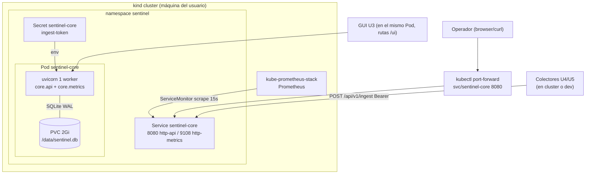

# Deployment Architecture — U2 (Core API, persistence & export)

**Fase**: CONSTRUCTION — Infrastructure Design
**Fecha**: 2026-11-11
**Estado**: GENERATED — pendiente de aprobación
**Unidad**: U2 — Core desplegado en kind (máquina del usuario)
**Decisiones**: Q1–Q8 = A (ver `infrastructure-design.md` ID-U2-01..09)

---

## 1. Topología (demo en kind)



Texto alternativo: el Core corre como un único Pod con el servidor API (8080) y el de métricas (9108) en procesos/entes del mismo contenedor; SQLite vive en un PVC de 2 Gi; el token llega desde un Secret como variable de entorno; Prometheus scrapea el puerto de métricas vía ServiceMonitor; el operador accede solo por port-forward.

---

## 2. Puertos y flujos de red

| Puerto | Protocolo | Quién | Flujo |
|---|---|---|---|
| 8080 | HTTP | port-forward (operador), colectores U4/U5, GUI U3 (mismo Pod) | `/api/v1/*` |
| 9108 | HTTP | Prometheus (en cluster) | `GET /metrics` (scrape 15 s) |
| — | — | Sin Ingress, sin NodePort, sin LB | SEC-01: exposición externa = solo port-forward |

Reglas:
- **Sin TLS** en lab (Q4 NFR Req=A); documentado en runbook.
- Colectores en dev local hablan a `localhost:8080` vía port-forward o red del Pod.
- NetworkPolicy default-deny + allow del Core = U10 (OQ-04).

---

## 3. Flujo de arranque del Core

```text
1. env: SENTINEL_DB_PATH, SENTINEL_INGEST_TOKEN (Secret), PAGE_LIMIT, MISSING_CYCLES
2. lifespan startup:
   a. PRAGMA integrity_check  → falla ⇒ log + exit 1 (P1; archivo intacto)
   b. DDL idempotente (7 tablas + índices)  (BR-U2-20)
   c. stale runs: running → failed "core restarted"  (P2)
3. uvicorn sirve 8080 (/api/v1, /openapi, /docs) + servidor métricas 9108 (stub)
4. probes: startupProbe TCP tolera el arranque; readiness pasa cuando /health ve la DB
5. shutdown (SIGTERM): wal_checkpoint(TRUNCATE) + close  (P4)
```

---

## 4. Probes (Q6=A)

| Probe | Mecanismo | Umbral | Semántica |
|---|---|---|---|
| `startupProbe` | TCP 8080 | 30 × 2 s | Tolera DDL/integrity al boot |
| `livenessProbe` | TCP 8080 | 10 s | Proceso caído ⇒ reiniciar |
| `readinessProbe` | `GET /api/v1/health` | 5 s | DB no responde ⇒ fuera del Service (**no** reinicia) |

---

## 5. Ciclo de desarrollo vs demo (Q1=A)

| Fase | Ejecución | DB | Comando base |
|---|---|---|---|
| Code Generation / unit+property tests | `uvicorn`/pytest en la máquina | SQLite temporal por test / `./dev.db` | `pytest tests/unit tests/property` · `uvicorn sentinel.core.api.app:app` |
| Build & Test | imagen `sentinel:test` + kind | PVC efímero de la cluster | `docker build` → `kind load` → `helm install` (U9) |
| Demo | mismo Pod del Core + GUI U3 | PVC 2 Gi persistente | `kubectl port-forward svc/sentinel-core 8080:8080` |

---

## 6. Backup & restore (P12, AVAIL-01)

| Acción | Procedimiento (runbook U11) |
|---|---|
| Snapshot | Detener escrituras (escalar a 0) + snapshot del PVC (velero/CRI-O) o copia del `sentinel.db` con `sqlite3 .backup` |
| Restore | Copiar el archivo al PVC → arranque con `integrity_check` (P1) → si ok, sirve; si no, exit 1 y revisar snapshot |
| Recuperación simple | Borrar el Pod (no el PVC): el arranque reconstruye estado desde la DB (AVAIL-02) |

---

## 7. Approval Gate

**Estado**: GENERATED — pendiente de aprobación (ver mensaje de completitud).
