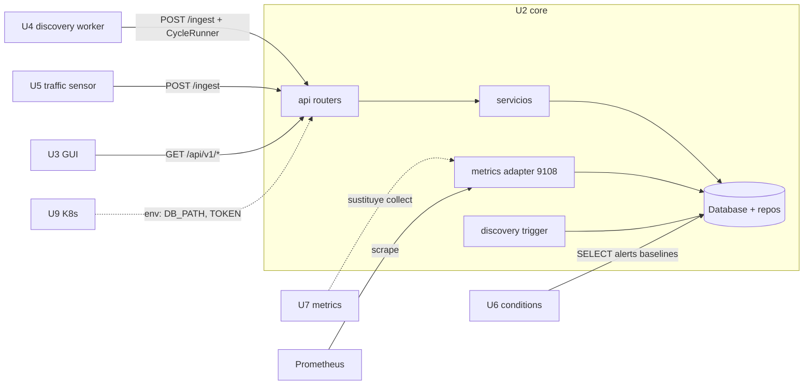

# Logical Components — U2 (Core API, persistence & export)

**Fase**: CONSTRUCTION — NFR Design
**Fecha**: 2026-11-11
**Estado**: GENERATED — pendiente de aprobación
**Unidad**: U2 — `src/sentinel/core/`
**Decisiones clave**: Q7=A (dependencias FastAPI + routers por área), Q8=A (`Database` context manager), Q9=A (router→servicio→repo), Q10=A (adaptador `core.metrics` sobre contrato U1).

---

## 1. Componentes lógicos de U2

| Componente | Archivo | Responsabilidad | NFR / patrón |
|---|---|---|---|
| Core settings | `core/config.py` | `CoreSettings` (4 claves `SENTINEL_*`, fail-fast, patrón U1) | FD Q13, BR-U2-41 |
| Database | `core/db/database.py` | Context manager por request/transaction, `write_lock` (P3), `startup_checks` = integrity_check + stale runs (P1/P2), `close()` en lifespan (P4) | REL-01/02, AVAIL-02 |
| Repositorios | `core/db/repos/{assets,observations,events,alerts,baselines,discovery_runs}.py` | SQL delgado parametrizado (INSERT OR IGNORE, SELECT con filtros/paginación, EXPLAIN verificado) | BR-U2-06..07, MNT (P8) |
| App factory | `core/api/app.py` | `create_app()` + lifespan (startup_checks, metrics stub, shutdown checkpoint) | P1/P2/P4 |
| Dependencias | `core/api/deps.py` | `require_ingest_token` (401/403 + telemetría P10, `compare_digest` P11), `pagination_params` (limit/offset) | SEC-02, BR-U2-23 |
| Manejo de errores | `core/api/errors.py` | Exception handlers → tabla HTTP del FD §5 (400/401/403/404/409/422/503/500 sin traceback) | BR-U2-39/40 |
| Routers | `core/api/routes_{ingest,query,export,health,discovery,metrics}.py` | Endpoints delineados en `component-methods.md` §1 (sin `/report`: es de U3); schemas Pydantic de respuesta | FR-CORE-01, ST-M4-01..07 |
| IngestionService | `core/ingestion/service.py` | Validación → normalización → UUIDv5 → transacción única → evidencia (§3.1 FD) | BR-U2-01..08, REL-04 |
| InventoryService | `core/inventory/service.py` | Reconciliación (N ciclos completed, first_seen/missing/arp_mapping_changed) | BR-U2-13..17 |
| QueryService | `core/query/service.py` | Filtros + paginación + `AssetDetail` con correlación por IP+ventana | BR-U2-21..24 |
| ExportService | `core/export/service.py` | CSV/JSON en memoria, cabecera exacta, sin scheduler | BR-U2-28..31 |
| HealthService | `core/health/service.py` | Estado desde DB + heartbeats por `sensor_id` + conteos + último run | BR-U2-36/37 |
| Discovery trigger | `core/discovery/trigger.py` | Lock único + `DiscoveryRunRepository` + protocolo `CycleRunner` inyectado (503 si ausente) | BR-U2-32..35, Q9 FD |
| Metrics adapter | `core/metrics/{server,collect}.py` | Servidor 9108; `collect()` stub reutiliza `foundation.metrics_contract` (nombres/labels/render); U7 sustituye `collect` | Q10 FD, P7, IP7 |
| Evidence helper | `core/evidence.py` | `emit(kind, event_type, fields)` → una línea JSON vía `foundation.get_logger` con campos de evidencia + `kind` | BR-U2-25..27 |
| Core tests | `tests/unit/core/`, `tests/property/` | TestClient + SQLite temporal; PBT `PB-U2-01..03`; EXPLAIN (P8); cobertura ≥70% | MNT-02/04, TS-U2-04/10 |

---

## 2. Layering interno (Q9=A)

```text
HTTP  →  core/api/routes_*.py   (schemas, status codes, dependencias)
           ↓
       core/*/service.py        (lógica de negocio, sin FastAPI, sin SQL)
           ↓
       core/db/repos/*.py       (SQL parametrizado, sin lógica de negocio)
           ↓
       core/db/database.py      (conexión, write_lock, transacciones)
```

- **Cero SQL** en routers; **cero FastAPI** en servicios y repos.
- Servicios reciben repos/`Database` por inyección (testables con SQLite temporal).

---

## 3. Bordes con otras unidades (quién importa qué)



| Frontera | Contrato | Quién decide |
|---|---|---|
| U4/U5 → U2 | `POST /api/v1/ingest` + Bearer; reintentos con `foundation.retry` | U2 (Q2/Q12 FD/NFR) |
| U4 → U2 | `CycleRunner` inyectado en el trigger | implementación en U4 |
| U3 → U2 | GET assets/events/alerts/health/export + trigger discovery | U2 expone; U3 consume (IP3) |
| U6 → U2 | SELECT sobre `alerts`/`baselines` (tablas creadas por U2, escritas por U6) | esquema U2 (OQ-02) |
| U7 → U2 | Sustituye `collect()` manteniendo familias/labels/rutas | contrato U1 (IP7) |
| U9 → U2 | `SENTINEL_DB_PATH`, `SENTINEL_INGEST_TOKEN` desde Secret/values | config U2 (Q13 FD) |

---

## 4. Composición de la app (Q7=A)

```text
create_app()
├── lifespan: startup_checks() → metrics stub start → shutdown checkpoint
├── deps: require_ingest_token, pagination_params
├── routes_ingest.py    POST /api/v1/ingest
├── routes_query.py     GET  /api/v1/assets, /assets/{id}, /events, /alerts
├── routes_export.py    GET  /api/v1/export
├── routes_health.py    GET  /api/v1/health
├── routes_discovery.py POST /api/v1/discovery, GET /discovery/{run_id}
├── routes_metrics.py   GET  /metrics (proxy al servidor 9108 o mount)
└── errors.py           exception handlers (tabla FD §5)
```

- Auth **por dependencia en la ruta de ingesta** (no middleware global): las rutas de consulta siguen sin auth (demo port-forward, FD Q2=A).
- `/metrics` se sirve en el servidor propio **9108** (FR-CORE-02); el router lo documenta/proxy si hace falta para OpenAPI.

---

## 5. Decisiones de composición (resumen)

| Pregunta | Decisión | Efecto |
|---|---|---|
| Q7 | Dependencias + routers por área | Auth acotada al ingest; errores por handler tipado |
| Q8 | `Database` con context manager + lock + lifespan | P1–P4 viven en un solo componente |
| Q9 | Router → servicio → repo | Servicios unit-testables sin HTTP; SQL aislado y verificable con EXPLAIN |
| Q10 | Adaptador sobre `metrics_contract` | U7 cambia solo `collect()`; contrato U1 intacto |
