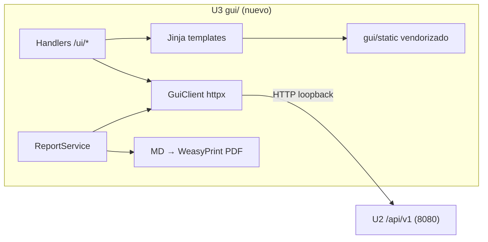
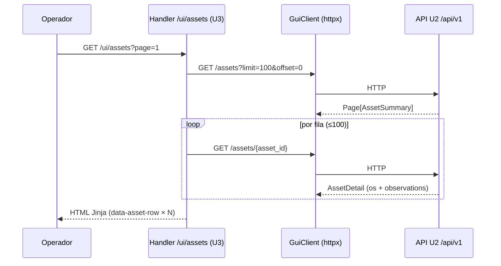
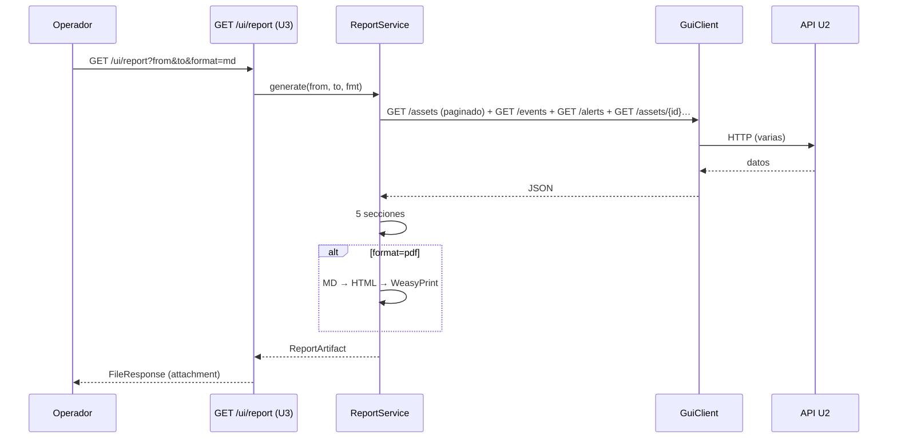

# Business Logic Model — U3 (Operator GUI & network report)

**Fase**: CONSTRUCTION — Functional Design
**Fecha**: 2026-11-13
**Estado**: GENERATED — pendiente de aprobación
**Unidad**: U3 — `src/sentinel/gui/` (vistas + `report/`)
**Traza**: ST-M10-01..07, FR-GUI-01..08, FR-EXP-02, NFR-TECH-04, NFR-OPS-04/05; plan Q1–Q13 = A (Q11 corregida) + FQ1/FQ2 = A; inputs `services.md` §2.2/2.4–2.6, `component-methods.md` §6/§10.

---

## 1. Propósito y frontera

U3 añade al monolito Core la **GUI del operador** (server-rendered) y el **ReportService**:

- **Hace**: renderiza `/ui/*` (Jinja2 + HTMX + Tailwind/DaisyUI), genera reporte MD/PDF bajo demanda, enlaza el export CSV/JSON de U2, dispara discovery por form.
- **No hace** (frontera): **nunca abre SQLite** ni importa repos/servicios de U2 — **todo el módulo U3 (vistas y ReportService) consume solo la API HTTP por loopback** (`requirements.md` §6.5 + Q2=A); no evalúa condiciones; no sondea; no modifica activos; sin auth de operador (FR-GUI-07: acceso por `kubectl port-forward`, decisión de servicio en U9); no lee estado de K8s (U9/U10, Q6=A); sin worker de reportes síncrono (App Design Q6=A).
- **Depende de**: U2 aprobado — `GET /api/v1/{assets,assets/{id},events,alerts,health,export,discovery,discovery/{run_id}}`. `GET /api/v1/report` **lo declara y sirve U3** (C7).
- **Contrato diferido a U4** (IP4): expansión del alcance `explicit_hosts` para el modo "lista completa" del trigger y el disparo real del `scope_violation` (el handler `ScopeError`→400 ya existe en U2; nadie lo dispara hasta que U4 aporte el allowlist).

---

## 2. Componentes lógicos

| Componente | Módulo | Responsabilidad |
|---|---|---|
| `GuiClient` | `gui/client.py` | Cliente httpx síncrono a `API_BASE` (`http://127.0.0.1:8080`, constante Q13=A, inyectable en tests); `get_json`, `post_form`; traduce excepciones de red a `CoreUnavailableError` |
| Handlers `/ui/*` | `gui/routes.py` | Un handler por página (§10 de component-methods): valida params, llama `GuiClient`, construye view models, renderiza Jinja → `HTMLResponse` |
| Templates | `gui/templates/*.html` | Jinja2: `base`, `assets`, `asset_detail`, `events` (timeline), `alerts`, `health`, `report`, `error` |
| Static | `gui/static/` | `htmx.min.js` + CSS Tailwind/DaisyUI pre-generado + favicon, vendorizados en repo (Q12=A), servidos por StaticFiles |
| `ReportService` (C7) | `gui/report/service.py` | `generate(from,to,fmt)`: obtiene datos vía `GuiClient` → 5 secciones MD ordenadas → `format=md` (bytes) o `format=pdf` (MD→HTML→PDF con WeasyPrint, Q11=A) |
| Section builders | `gui/report/sections.py` | `build_inventory_section`, `build_changes_section`, `build_top_talkers_section`, `build_alerts_section`, `build_evidence_range_section` (§6) + `render_pdf(markdown)` |



---

## 3. Flujos

### 3.1 Inventario paginado — `GET /ui/assets` (ST-M10-01, Q1=A, Q4=A, FQ1=A)

```text
?page=N&status=?  →  GuiClient GET /api/v1/assets?limit=100&offset=(N-1)*100&status=?
                  →  por cada fila: GET /api/v1/assets/{asset_id}   (N+1, ≤100 por página)
                  →  view models AssetRowVM (OS + procedencia desde el detalle;
                     source de la fila = distinct source de recent_observations)
                  →  tabla Jinja con data-asset-row por fila
```

- Paginación server-side: `limit=100` fijo, `page` → `offset`; total desde `Page.total` ⇒ `pages = ceil(total/100)`.
- **N+1 justificado** (FQ1=A): escala de lab, ≤100 filas/página sobre loopback en el mismo pod; sin tocar el contrato de U2.

### 3.2 Detalle de activo — `GET /ui/assets/{asset_id}` (ST-M10-02, Q1=A)

```text
asset_id → GuiClient GET /api/v1/assets/{asset_id} → AssetDetail
        → secciones: Observaciones (recent_observations, ≤200)
                      Eventos (recent_events, ≤100)
                      Tráfico  = aggregate de observations source=traffic
                                 (bytes_per_second, pares) → o "sin datos"
                      ARP      = mappings de observations source=arp
                                 (ip↔mac, observado_at)
```

- Correlación por IP + ventana: los datos ya vienen correlacionados en `AssetDetail` (BR-U2-12 de U2); U3 solo agrupa por `source`/`kind` del payload.
- Sin observaciones de tráfico ⇒ texto `sin datos` (nunca ceros inventados, services.md §4).

### 3.3 Línea de tiempo — `GET /ui/events` (ST-M10-03, Q1=A, Q5=A)

```text
filtros asset_id, severity, rule, from, to, page
  ├─ events:  GuiClient GET /api/v1/events?from&to&asset_id&rule&severity  (server-side, U2)
  └─ alerts:  GuiClient GET /api/v1/alerts?from&to                       (solo rango+estado en U2)
              → filtrado en el handler por asset_id/rule/severity         (Q5=A, sin tocar U2)
  → merge ordenado por occurred_at/fired_at DESC → TimelineEntryVM (kind=event|alert)
  → badge firing (rojo) vs resolved (verde + resolved_at)
```

- `GET /ui/alerts` = vista solo-alertas (mismo pipeline, sin eventos).

### 3.4 Disparo de discovery — `POST /ui/discovery` (ST-M10-04, Q7=A)

```text
form-urlencoded: host=<ip>  (AC curl: -d 'host=192.168.1.10')
  → GuiClient POST /api/v1/discovery {"hosts": [host], "timeout_seconds": 30}
  → passthrough de estado:
      202 → redirect/polling HTMX: GET /api/v1/discovery/{run_id}
            (running → completed | timeout | failed; hx-get cada 2 s)
      400 scope_violation → mensaje "host fuera de alcance" (handler ScopeError de U2;
            el allowlist lo aporta U4 — IP4/ST-M1-01)
      409 → "ciclo ya en curso"
      503 → "runner no disponible (U4 pendiente)"
```

- **Modo lista completa** (`FR-GUI-04` "or the configured list"): contrato diferido a U4 — U4 expondrá el alcance/expansión (IP4) y U3 consumirá ese contrato; el AC solo prueba host individual. Fuera de alcance de U3 hasta entonces (documentado, no bloquea).

### 3.5 Salud — `GET /ui/health` (ST-M10-05, Q6=A)

```text
GuiClient GET /api/v1/health → HealthStatus
  → estado Core (up/degraded), uptime, último ingest,
    último ciclo exitoso (last_discovery_run), heartbeats por sensor
  → sensor sin heartbeat reciente → badge "sensor caído"
    (nunca presentar inventario vacío como "red sin activos")
```

### 3.6 Reporte — `GET /ui/report` + `GET /api/v1/report` (ST-M10-06, Q8=A..Q11=A)

```text
params: from=YYYY-MM-DD&to=YYYY-MM-DD requeridos (Q10=A); format=md (default) | pdf
  → ReportService.generate(from, to, fmt):
      1. inventory = paginate GET /assets (hasta total)
      2. changes   = GET /events?from&to filtrado por tipo ∈
                     {asset_first_seen, asset_missing, port_service_changed, arp_mapping_changed}
      3. talkers   = por activo GET /assets/{id} → aggregate traffic payloads
                     (FQ2=A); sin datos expuestos → "sin datos"
      4. alerts    = GET /alerts?from&to (todos los estados)
      5. evidence  = rango pedido + conteos de fuentes usadas
  → 5 secciones ## en orden fijo (Q9=A)
  → fmt=md  → bytes UTF-8 (Content-Disposition: attachment)
  → fmt=pdf → MD → HTML → WeasyPrint → bytes application/pdf
  → "Generated at …" se coloca FUERA de las secciones ## (Q10=A)
```

- Determinismo (NFR-OPS-05): mismo rango + mismos datos ⇒ secciones byte-idénticas; solo cambian datos persistidos.
- `GET /ui/report` (FileResponse, AC curl `-o report.md`) y `GET /api/v1/report` (contrato C7, devuelve el artefacto) comparten el mismo servicio (Q8=A).

### 3.7 Export — botón en la GUI (FR-EXP-02)

- Enlace directo a `GET /api/v1/export?format=csv|json&from&to` de U2; U3 no reimplementa export.

### 3.8 Static assets (NFR-OPS-04, Q12=A)

- `/static/*` montado desde `src/sentinel/gui/static/` (htmx + CSS vendorizados); la imagen los empaqueta (COPY de `src/`); sin CDN, sin build step en CI.

---

## 4. Consumo de API (contrato exacto de U2)

| Uso en U3 | Endpoint U2 | Parámetros |
|---|---|---|
| Inventario + paginación | `GET /api/v1/assets` | `limit`, `offset`, `status` |
| OS/procedencia por fila, detalle, top talkers | `GET /api/v1/assets/{asset_id}` | — |
| Timeline (eventos) | `GET /api/v1/events` | `from`, `to`, `asset_id`, `rule`, `severity`, `limit`, `offset` |
| Timeline/alertas | `GET /api/v1/alerts` | `from`, `to`, `state`, `limit`, `offset` |
| Salud | `GET /api/v1/health` | — |
| Disparo discovery | `POST /api/v1/discovery` | `hosts`, `timeout_seconds` |
| Estado del run (polling) | `GET /api/v1/discovery/{run_id}` | — |
| Export (enlace) | `GET /api/v1/export` | `format`, `from`, `to` |
| Reporte (C7, lo sirve U3) | `GET /api/v1/report` | `from`, `to`, `format` |

---

## 5. Manejo de errores (passthrough de la tabla FD U2 §5)

| Situación | Origen | Respuesta de la GUI |
|---|---|---|
| `400 scope_violation` | U2 (handler `ScopeError`) | Página/HTMX: "host fuera de alcance" + `code` |
| `400/422` validación | U2 | Mensaje de validación sin stacktrace |
| `404` run/asset no existe | U2 | Página 404 de la GUI |
| `409` ciclo en curso | U2 | Estado inline "ciclo ya en curso" |
| `503` runner ausente | U2 | "descubrimiento no disponible (U4 pendiente)" |
| Conexión loopback falla | `GuiClient` | Página **502** "Core API no disponible" (sin traceback) |
| Error inesperado en handler | U3 | 500 con página `error.html`, log JSON vía `foundation.logging` |

---

## 6. Configuración de U3 (Q13=A)

- **Sin claves `SENTINEL_*` nuevas.** `API_BASE = "http://127.0.0.1:8080"` como constante de `gui/client.py`, sobreescribible por parámetro en `create_app`/fixtures de tests (mismo patrón que `metrics_port` en U2).
- WeasyPrint y `markdown` se añaden a `requirements.txt` con pin exacto (patrón P6); Dockerfile de U1 gana paquetes de sistema `pango`/`cairo`/`gdk-pixbuf` (decisión registrada en el plan de Code Generation; hereda `CMD python -m sentinel.core`).

---

## 7. Diagrama de secuencia — página de inventario



## 8. Diagrama de secuencia — reporte



---

## 9. Fuera de alcance de esta etapa

- Expansión de alcance "lista completa" y allowlist real (U4, IP4).
- Lectura de K8s para salud (U9/U10).
- Auth de operador (futuro, FR-GUI-07), LoadBalancer/NodePort (prohibido, U9 chart).
- Secciones avanzadas de reporte (implementation-scope §3, mejora documentada).
- PDF con estilo corporativo avanzado (Q11=A solo MD→PDF fiel).
