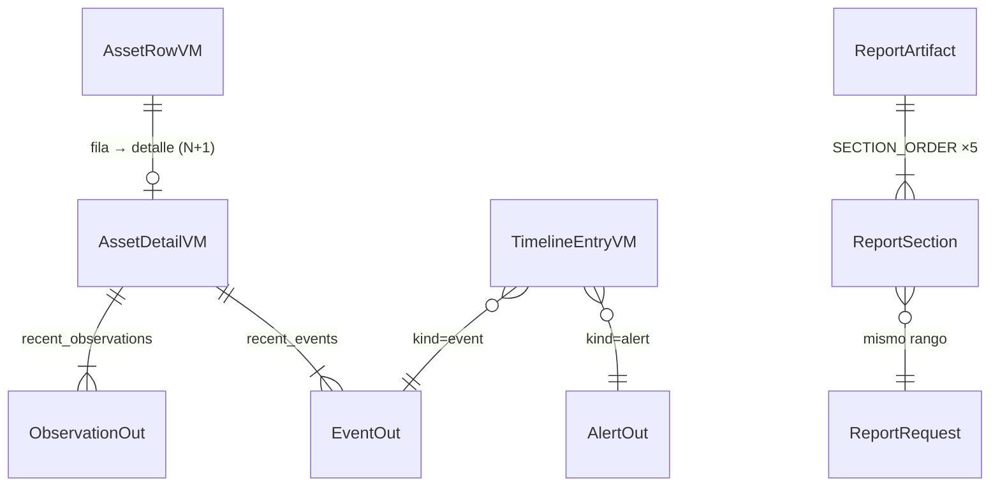

# Domain Entities — U3 (Operator GUI & network report)

**Fase**: CONSTRUCTION — Functional Design
**Fecha**: 2026-11-13
**Estado**: GENERATED — pendiente de aprobación
**Unidad**: U3 — `src/sentinel/gui/`
**Traza**: ST-M10-01..07, FR-GUI-01..08; plan Q1–Q13 + FQ1/FQ2; **U3 no tiene esquema propio** (no escribe DB) — sus entidades son view models y artefactos de reporte.

---

## 1. Contratos consumidos (HTTP, de U2 — sin modificar)

| Endpoint | Modelo de respuesta | Campos que U3 usa |
|---|---|---|
| `GET /api/v1/assets` | `Page[AssetSummary]` | `items[]`: `asset_id, mac, ips[], hostname, status, first_seen, last_seen`; `total, limit, offset` |
| `GET /api/v1/assets/{id}` | `AssetDetail` | lo anterior + `os_name, os_provenance, recent_observations[], recent_events[]` |
| `GET /api/v1/events` | `Page[EventOut]` | `event_id, type, asset_id, severity, rule, occurred_at, details{}` |
| `GET /api/v1/alerts` | `Page[AlertOut]` | `alert_id, condition_id, rule, metric_key, asset_id, state, measured_value, threshold, fired_at, resolved_at` |
| `GET /api/v1/health` | `HealthStatus` | `status, uptime_seconds, db_connected, last_ingest_at, sensor_heartbeats{}, counts{}, last_discovery_run` |
| `POST /api/v1/discovery` | `DiscoveryRunStatus` | `run_id, status, started_at, finished_at, hosts_seen, error` |
| `GET /api/v1/discovery/{run_id}` | `DiscoveryRunStatus` | ídem (polling) |
| `GET /api/v1/export` | file | solo enlace (no parsea) |
| `ObservationOut` (anidado) | — | `dedup_key, source, kind, sensor_id, observed_at, payload{}` |

> **Nota FQ1**: la tabla `assets` de U2 tiene columna `source` (`discovery|manual|declared`), pero **ningún endpoint la expone**. La columna "fuente" del inventario se deriva de los `source` de las observaciones recientes del activo (`discovery|traffic|arp`) — ver BR-U3-04. `assets.source` queda documentado como campo no expuesto (limitación conocida, sin cambio de contrato).

---

## 2. View models (`gui/viewmodels.py`)

| Entidad | Campos | Notas |
|---|---|---|
| `AssetRowVM` | `asset_id, ips: list[str], mac, hostname, os_label, os_provenance, provenance_label, last_seen, status, sources: list[str]` | `os_label` = `os_name` o `desconocido`; `provenance_label` = etiqueta ES (§4); `sources` = distinct de `recent_observations[].source` (FQ1) |
| `PageVM[T]` | `items: list[T], page, pages, total, limit, offset` | `page`/`pages` derivados de `Page.total` (BR-U3-05) |
| `AssetDetailVM` | `summary: AssetRowVM, os_name, os_provenance, observations: list[ObservationOut], events: list[EventOut], traffic: TrafficSummaryVM, arp: list[ArpMappingVM]` | secciones del AC `-k sections` |
| `TrafficSummaryVM` | `available: bool, bytes_per_second_max, pairs: list[{pair, bytes_per_second}], window: str` | `available=False` ⇒ plantilla pinta `sin datos` (BR-U3-07) |
| `ArpMappingVM` | `ip, mac, observed_at` | desde `payload` de observaciones `source=arp` |
| `TimelineEntryVM` | `kind: "event"\|"alert", when, title, severity_or_state, asset_id, rule, detail: str, resolved_at` | merge events+alerts ordenado DESC (§3.3 del BL model) |
| `HealthVM` | `status, uptime_seconds, last_ingest_at, last_cycle_at, sensors: list[{sensor_id, last_seen, down: bool}], counts, db_connected` | `down` = sin heartbeat reciente ⇒ badge `sensor caído` (BR-U3-17) |
| `DiscoveryRunVM` | `run_id, status, started_at, finished_at, hosts_seen, error, message` | `message` localizado (202/409/503/400) |
| `ErrorVM` | `status, title, detail, code` | páginas de error (404/409/422/502/500) |

## 3. Entidades de reporte (`gui/report/`)

| Entidad | Definición |
|---|---|
| `ReportFormat` | `Literal["md", "pdf"]` (default `md`) |
| `ReportRequest` | `date_from: date`, `date_to: date` (requeridos, `YYYY-MM-DD`, `date_from <= date_to`) |
| `ReportSection` | `anchor: str`, `heading: str` (texto `## `), `body: str` (Markdown) |
| `ReportArtifact` | `format: ReportFormat`, `filename: str` (`reporte_YYYY-MM-DD_YYYY-MM-DD.md\|.pdf`), `content_type: str`, `data: bytes` |
| `SECTION_ORDER` | constante fija: `["inventory", "changes", "top_talkers", "alerts", "evidence_range"]` (BR-U3-20) |

**Secciones (orden fijo, 5 × `## `):**

1. `## Inventory summary` — conteos + tabla resumen (IP, MAC, hostname, SO, estado, last seen)
2. `## Changes` — eventos de inventario del rango (BR-U3-23)
3. `## Top talkers` — top pares por `bytes_per_second` desde detalles de activos; vacío ⇒ `sin datos` (BR-U3-22)
4. `## Alerts` — alertas del rango con estado `firing|resolved`
5. `## Evidence range` — rango pedido, fuentes consultadas, conteos

**Fuera de las secciones** (no afecta al determinismo): cabecera `# Sentinel network report` + línea `Generated at: <UTC>` (BR-U3-21).

## 4. Mapeos de presentación (etiquetas ES)

| Dominio (API) | Etiqueta en GUI |
|---|---|
| `os_provenance: observed` | `observado` |
| `os_provenance: inferred` | `inferido` |
| `os_provenance: declared` | `declarado` |
| `os_provenance: unknown` / `os_name=null` | `desconocido` |
| `status: present` | `presente` |
| `status: absent` | `ausente` |
| `state: firing` | `firing` (badge rojo) |
| `state: resolved` | `resolved` (badge verde + `resolved_at`) |
| `severity: info\|warning\|critical` | `info` / `warning` / `critical` |
| observación sin tráfico | `sin datos` (nunca `0`) |

## 5. Lo que U3 NO define

- **Sin tablas ni migraciones** — U3 no escribe SQLite (FR-GUI-07/§6.5).
- **Sin claves de configuración nuevas** (Q13=A): `API_BASE` es constante inyectable.
- **Sin entidades de dominio nuevas de U1** — reutiliza `foundation` para logging/errores; los payloads de observación se consumen como `dict` (`ObservationOut.payload`).
- **Sin modelos de auth/sesión** (FR-GUI-07).

## 6. Relación con entidades existentes

