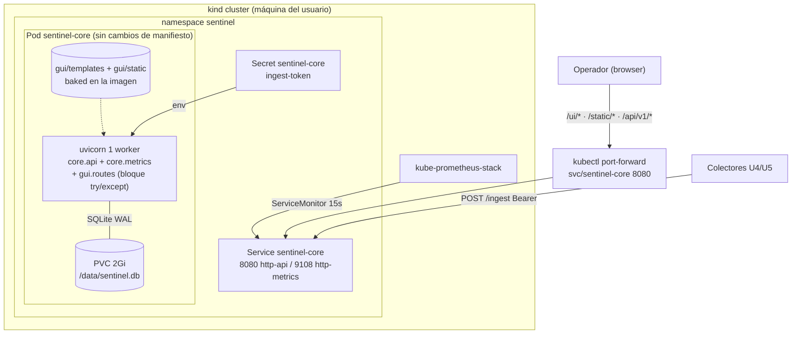

# Deployment Architecture — U3 (Operator GUI & network report)

**Fase**: CONSTRUCTION — Infrastructure Design
**Fecha**: 2026-11-14
**Estado**: GENERATED — pendiente de aprobación
**Unidad**: U3 — GUI desplegada dentro del Pod del Core en kind (máquina del usuario)
**Decisiones**: Q1–Q8 = A (ver `infrastructure-design.md` ID-U3-01..09)

---

## 1. Topología (demo en kind — tras U3)



Nota de flujo interno: dentro del Pod, `GuiClient` llama a la API vía `http://127.0.0.1:8080` (loopback, TS-U3-09) — sin cruce de Service ni de red externa.

Texto alternativo: la GUI no añade Pod, Service ni puerto — corre en el mismo proceso uvicorn del Core, con templates y estáticos embebidos en la imagen; el operador alcanza `/ui` por el mismo port-forward de 8080; el `GuiClient` llama a la API por loopback dentro del contenedor; Prometheus y el PVC no cambian.

---

## 2. Puertos y flujos de red (actualizado con U3)

| Puerto | Protocolo | Quién | Flujo |
|---|---|---|---|
| 8080 | HTTP | port-forward (operador) | `/api/v1/*` **y** `/ui/*` **y** `/static/*` (Q5=A) |
| 8080 (loopback) | HTTP | `GuiClient` dentro del Pod | `GET/POST /api/v1/*` hacia `127.0.0.1:8080` (TS-U3-09) |
| 9108 | HTTP | Prometheus | `GET /metrics` (sin cambios) |
| — | — | Sin Ingress, sin NodePort, sin LB, sin puerto nuevo | SEC-01 / NFR-U3-SEC-03 |

Reglas:
- El tráfico GUI→API **nunca sale del contenedor** (loopback): no requiere NetworkPolicy ni Service nuevo.
- `/static/*` lo sirve `StaticFiles` de FastAPI en 8080 (misma caché del navegador por URL).
- Sin TLS en lab (hereda U2).

---

## 3. Flujo de arranque (idéntico al de U2 + bloque U3)

```text
1. env: SENTINEL_DB_PATH, SENTINEL_INGEST_TOKEN (Secret)   [sin claves nuevas — TS-U3-07]
2. lifespan startup: integrity_check → DDL → stale runs      [U2, sin cambios]
3. create_app():
   a. [U2] routers /api/v1/*, errors, deps
   b. [U3] try: import sentinel.gui.routes
          → include_router(/ui) + mount(/static) + handler 502 + app.state.gui_config
          except ImportError: la app sigue solo-API          [NFR Design Q10]
4. uvicorn sirve 8080 (/api/v1, /ui, /static, /docs) + 9108
5. probes: startup TCP · liveness TCP · readiness /api/v1/health   [Q6=A, sin cambios]
6. shutdown: wal_checkpoint + close                          [U2, sin cambios]
```

---

## 4. Probes (Q6=A — sin cambios respecto a U2)

| Probe | Mecanismo | Umbral | Semántica |
|---|---|---|---|
| `startupProbe` | TCP 8080 | 30 × 2 s | Tolera DDL/integrity al boot |
| `livenessProbe` | TCP 8080 | 10 s | Proceso caído ⇒ reiniciar |
| `readinessProbe` | `GET /api/v1/health` | 5 s | DB no responde ⇒ fuera del Service (**no** reinicia); la GUI depende de la misma condición |

> **No** se cambia la readiness a `/ui/health` (Q6=B descartado): un montaje `/ui` roto se detecta en build/test (imagen siempre incluye `gui`), no debe sacar al Core del Service.

---

## 5. Flujo de un reporte (nuevo en U3)

```text
Operador → port-forward 8080 → GET /ui/report?from&to&format
  → validation.parse_date_range (400 si inválido)
  → ReportService.generate:  GuiClient → loopback /api/v1/{assets,events,alerts,assets/{id}…}
      · timeout 30 s · cualquier fallo ⇒ 502 (nunca MD parcial)
  → builders con esc() → MD en memoria
  · format=md  → Response(text/markdown)
  · format=pdf → template HTML (autoescape) → WeasyPrint → Response(application/pdf)
  → nada en disco (Q3=A) · sin límite de concurrencia (Q8=A)
```

---

## 6. Ciclo de desarrollo vs demo (Q1=A, con GUI)

| Fase | Ejecución | GUI | Comando base |
|---|---|---|---|
| Code Generation / unit+integration tests | `uvicorn`/pytest en la máquina | Import del paquete `gui` directo (sin Docker) | `pytest tests/unit tests/integration tests/gui` |
| Build & Test | imagen `sentinel:test` + kind | **Dockerfile con libs WeasyPrint** (ID-U3-01) | `docker build` → `kind load` → `helm install` (U9) |
| Demo | mismo Pod + PVC | Operador abre `http://localhost:8080/ui/…` tras port-forward | `kubectl port-forward svc/sentinel-core 8080:8080` |

---

## 7. Approval Gate

**Estado**: GENERATED — pendiente de aprobación (ver mensaje de completitud).
