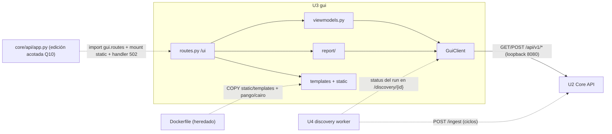

# Logical Components — U3 (Operator GUI & network report)

**Fase**: CONSTRUCTION — NFR Design
**Fecha**: 2026-11-14
**Estado**: GENERATED — pendiente de aprobación
**Unidad**: U3 — `src/sentinel/gui/`
**Decisiones clave**: Q6=A (`GuiClient` inyectado), Q8=A (router `/ui` + viewmodels + validation), Q9=A (`gui/report/` en 3 módulos), Q10=A (edición acotada de `core/api/app.py`), Q11=A (`StaticFiles`), Q12=A (`error.html` + helper + handler 502).

---

## 1. Componentes lógicos de U3

| Componente | Archivo | Responsabilidad | NFR / patrón |
|---|---|---|---|
| GuiClient | `gui/client.py` | Envoltorio de `httpx.Client` con `base_url` (loopback `API_BASE`, TS-U3-09) y timeout 10 s; métodos tipados por endpoint (`get_assets`, `get_asset`, `get_events`, `get_alerts`, `get_health`, `trigger_discovery`, `get_discovery_run`, `get_export`, `get_report`); errores de red/5xx ⇒ `CoreUnavailableError` | AVAIL-01/02 (P10), Q6=A |
| Validación | `gui/validation.py` | Parsers puros: `parse_date_range`, `parse_page`, `parse_format`, `parse_host` → valor o `foundation.errors.ValidationError` ⇒ 400 | SEC-02 (P6), Q5=A |
| View models | `gui/viewmodels.py` | Dataclasses de presentación: `AssetRowVM`, `AssetDetailVM`, `EventRowVM`, `AlertRowVM`, `HealthVM`, `DiscoveryRunVM` (con `poll_state`), `ReportVM`, `PageVM` (paginación), `ErrorVM`; conversión desde schemas Pydantic de U2 — **los handlers no manipulan dicts crudos** | USAB-01/02, BR-U3-17/19/21 |
| Templates | `gui/templates/*.html` | Jinja2 con autoescape ON (base, assets, asset_detail, events, alerts, health, discovery, report, error); partials HTMX para polling; estados vacíos explícitos | USAB-01/02, SEC-01 |
| Entorno Jinja | `gui/templates.py` | `get_templates()`: Environment único por proceso, `auto_reload=False` (P3) | PERF-01, Q3=A |
| Router GUI | `gui/routes.py` | `APIRouter(prefix="/ui")`: `GET /assets`, `/assets/{id}`, `/events`, `/alerts`, `/health`, `/report`, `POST /discovery`; flujo: validar (Q5) ⇒ GuiClient (Depends) ⇒ VM ⇒ render; errores ⇒ helper | BR-U3-06/10/16/21/30, Q8=A |
| ReportService | `gui/report/service.py` | `generate(from, to, client)` orquesta fetch secuencial → builders → `ReportArtifact(md, generated_at)`; fail-fast total + timeout 30 s (P2); `get_report(...)` decide `FileResponse` (md) o `Response` (pdf) | PERF-02, BR-U3-24/25 |
| Section builders | `gui/report/sections.py` | Funciones **puras** `build_section_1..5(data) -> str` + `SECTION_ORDER` + **`esc()`** (P5); cero I/O, cero templates | SEC-01 (P5), NFR-OPS-05 (determinismo), Q9=A |
| PDF renderer | `gui/report/pdf.py` | `render_pdf(md)`: template HTML intermedio (autoescape ON) → WeasyPrint → bytes; import de `weasyprint` perezoso (sin dependencia para `format=md`) | TECH-02 (FQ1=A), Q9=A |
| Static | `gui/static/{css,js}/` | Tailwind build vendorizado + JS de polling HTMX (Q1); sin CDN (TECH-03) | TECH-03, Q11=A |
| Error helper | `gui/errors.py` | `render_error(request, status, title, detail, code)` + plantilla `error.html`; handler de `CoreUnavailableError` → 502 | SEC-04, BR-U3-31, Q12=A |
| Tests | `tests/unit/gui/`, `tests/integration/gui/` | TestClient + `MockTransport` (P7); aserciones de substring; gates de cobertura dobles (P8) | MNT-01/02, TS-U3-10 |

---

## 2. Layering interno (Q8=A)

```text
HTTP  →  gui/routes.py            (validación, Depends[GuiClient], status codes)
           ↓
       gui/viewmodels.py          (dataclasses de presentación, conversión desde schemas U2)
           ↓
       gui/client.py              (httpx loopback → /api/v1/*, errores ⇒ CoreUnavailableError)
           ↓
       [U2 Core API]              (fuente única de datos; la GUI nunca toca la DB)

Reporte:
       gui/report/service.py      (orquestación + fail-fast)
           ├→ gui/report/sections.py   (builders puros + esc())
           └→ gui/report/pdf.py        (MD → HTML → WeasyPrint)
```

- **Cero SQL** y **cero acceso a `core/db`** desde `gui/` (frontera dura: solo el contrato HTTP loopback, TS-U3-09).
- Los builders son puros: entradas `data` → salida `str` (testables sin HTTP, deterministas).
- Los handlers no construyen HTML a mano ni tocan `httpx` directamente: siempre vía `GuiClient` + templates.

---

## 3. Bordes con otras unidades (quién importa qué)



| Frontera | Contrato | Quién decide |
|---|---|---|
| U3 → U2 | `httpx` solo contra `/api/v1/*` en loopback (`API_BASE`); forma de errores de U2 reutilizada | U2 expone; U3 consume (IP3, TS-U3-09) |
| U3 → U2 (edición) | Bloque try/except en `create_app()`: import de `sentinel.gui.routes`, montaje `/static`, handler `CoreUnavailableError` (Q10=A) — **edición acotada documentada** en `tech-stack-decisions.md` §3 | U3, sin romper solo-API si `gui` falta |
| U3 ← U2 | `ValidationError` ⇒ 400; tabla de errores/404/409/422 reutilizada en respuestas `/ui/*` | U2 (`core/api/errors.py`); U3 añade solo el 502 |
| U3 → U4 | La vista `/ui/discovery` lee `GET /discovery/{run_id}`; el trigger dispara `POST /discovery` (lock de U2) — sin contrato directo U3↔U4 | Vía API de U2 |
| U3 ← U9 | Imagen incluye `gui/static/`, `gui/templates/` y libs WeasyPrint (pango/cairo/gdk-pixbuf) | Impacto heredado declarado en TS-U3 §3 |
| U3 ← CI | `ci.yml`: paso `coverage report --include='*/gui/*' --fail-under=70` (Q7=A) | Impacto heredado declarado en TS-U3 §3 |

---

## 4. Composición de la app (Q10=A)

```text
create_app(settings, runner, metrics_port, api_base=API_BASE, http_client=None)
├── [U2] lifespan, deps, routers /api/v1/*, errors (400/401/403/404/409/422/500/503)
└── [U3] bloque try/except ImportError:
    ├── app.include_router(gui.routes.router)        # /ui/*
    ├── app.mount("/static", StaticFiles(...))       # Q11=A
    ├── app.state.gui_config = (api_base, http_client)
    └── app.add_exception_handler(CoreUnavailableError, → 502)   # Q12=A
```

- **Sin `sentinel.gui` instalado**: el `except ImportError` deja la app solo-API (mismo comportamiento que hoy).
- `python -m sentinel.core` / `CMD` de la imagen **no cambia**: la GUI entra automáticamente al importar `create_app`.
- Tests de U2 existentes siguen verdes (el bloque es aditivo; sin `gui` o con mocks, nada cambia).

---

## 5. Decisiones de composición (resumen)

| Pregunta | Decisión | Efecto |
|---|---|---|
| Q1 | Backoff exponencial + parada a los 5 fallos | Polling amable con la API caída, recuperación manual explícita |
| Q2 | Fail-fast 502 + MD en memoria | Nunca un reporte parcial silencioso; determinismo preservado |
| Q3 | Jinja Environment con `auto_reload=False` | Compilación única por proceso; sin recompilar en requests |
| Q4 | `esc()` única en builders | `format=md` seguro; PDF con autoescape doble |
| Q5 | `gui/validation.py` parsers puros | Params estrictos con la misma forma de error 400 de U2 |
| Q6 | `create_app(api_base, http_client)` + Depends | Tests con `MockTransport`, sin monkeypatch |
| Q7 | `coverage report --fail-under` sobre el mismo `.coverage` | Doble gate sin duplicar runtime de CI |
| Q8 | Router `/ui` + viewmodels + validation | Handlers delgados; presentación testeable en aislamiento |
| Q9 | `report/{service,sections,pdf}.py` | Orquestación, puros y PDF separados; puro testeable sin I/O |
| Q10 | Edición acotada de `core/api/app.py` | Un solo archivo heredado tocado; entrypoint intacto; degradable a solo-API |
| Q11 | `StaticFiles` montado en `/static` | Caché del navegador; estándar FastAPI |
| Q12 | `error.html` + `render_error` + handler 502 | Experiencia de error uniforme; sin traceback (SEC-04) |
