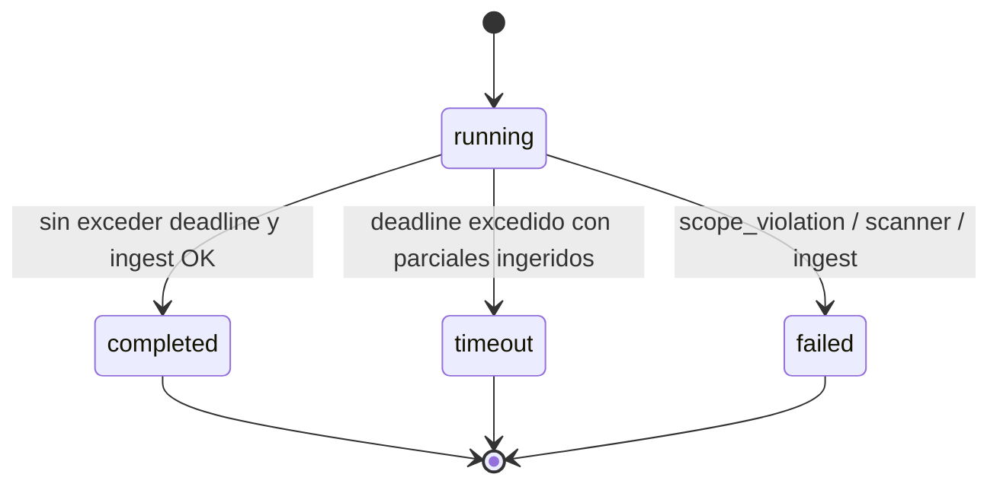

# Domain Entities — U4 (Configuration, scope & Discovery)

**Fase**: CONSTRUCTION — Functional Design
**Fecha**: 2026-11-16
**Estado**: GENERATED — pendiente de aprobación
**Unidad**: U4 — `src/sentinel/discovery/`
**Traza**: ST-M1-01..04, ST-M2-01..06; plan Q1–Q16 + FQ1=C; **U4 no escribe DB** — sus entidades son de dominio puro (Q11=A) y se proyectan a los contratos de U1 (`DiscoveryObservation`, `Batch`) y de U2 (`DiscoveryRunStatus`).

---

## 1. Entidades de dominio (`discovery/domain.py`, sin I/O)

### 1.1 `ScopeConfig`

| Campo | Tipo | Notas |
|---|---|---|
| `mode` | `Literal["cidr", "explicit_hosts"]` | FR-DISC-06 (default `explicit_hosts`) |
| `hosts` | `list[str]` | lista explícita normalizada (IPs/canonicales) |
| `cidrs` | `list[str]` | rangos `x.x.x.x/nn` (modo `cidr`) |
| `ports` | `list[int]` | allowlist TCP (default `[22, 80, 443]`) |

Invariantes (BR-U4-02/05/06): allowlist no vacía según modo; puertos 1..65535 sin duplicados; `validate_scope/validate_ports/validate_target` (C12) operan sobre esta entidad.

### 1.2 `ScanTarget`

| Campo | Tipo | Notas |
|---|---|---|
| `ip` | `IPv4Address` | dirección canónica a sondear |
| `hostname` | `str \| None` | solo si el escáner lo reporta (sin reverse-DNS propio) |

Se deriva de `ScopeConfig` (`resolve_targets`): en modo `cidr` se expande el rango (límite de hosts por ciclo = `MAX_TARGETS` acotado, p. ej. /24 ⇒ 256); en `explicit_hosts` se normaliza la lista.

### 1.3 `HostFinding`

| Campo | Tipo | Notas |
|---|---|---|
| `ip` | `IPv4Address` | |
| `mac` | `MACAddress \| None` | desde tabla ARP |
| `hostname` | `str \| None` | si el escáner lo aporta |
| `ports` | `list[PortInfo]` | reutiliza `foundation.models.PortInfo` (`port`, `protocol`, `state`, `service`, `version`, `confidence`) |
| `method` | `Literal["arp","icmp","tcp","nmap"]` | método **preponderante** tras la fusión (BR-U4-16) |
| `os_name` | `None` | fijo en MVP (D-U4-06) |

### 1.4 `CycleResult`

| Campo | Tipo | Notas |
|---|---|---|
| `status` | `CycleStatus = Literal["completed","timeout","failed"]` | mismos valores que `discovery_runs` de U2 |
| `hosts_seen` | `int` | nº de hallazgos fusionados con ≥1 indicio (Q16=A) |
| `hosts_targeted` | `int` | tamaño de `resolve_targets` |
| `findings` | `list[HostFinding]` | hallazgos fusionados (parciales si `timeout`) |
| `partial` | `bool` | `True` cuando se cortó por deadline |
| `error` | `str \| None` | causa (`scope_violation`, `timeout`, `scanner_error`, `ingestion_error`) |

### 1.5 `ValidationResult` (C12)

| Campo | Tipo | Notas |
|---|---|---|
| `ok` | `bool` | |
| `errors` | `list[str]` | mensajes en ES (p. ej. `"host fuera de alcance"`) |

Devuelto por `validate_scope`, `validate_ports`, `validate_target` (`component-methods.md` §8); `ok=False` ⇒ el llamador levanta `ScopeError`/`ValidationError`.

### 1.6 `DiscoverySettings` (`discovery/config.py`)

Modelo Pydantic `frozen` con `extra="forbid"` (patrón `foundation.config`):

| Campo | Env | Default |
|---|---|---|
| `scope_mode` | `SENTINEL_DISCOVERY_SCOPE_MODE` | `explicit_hosts` |
| `hosts` | `SENTINEL_DISCOVERY_HOSTS` | `""` (fail-fast si vacío, BR-U4-02) |
| `cidrs` | `SENTINEL_DISCOVERY_CIDRS` | `""` (fail-fast si modo `cidr` y vacío) |
| `ports` | `SENTINEL_DISCOVERY_PORTS` | `"22,80,443"` |
| `interval_minutes` | `SENTINEL_DISCOVERY_INTERVAL_MIN` | `15` |
| `timeout_seconds` | `SENTINEL_DISCOVERY_TIMEOUT_SECONDS` | `30` (1..3600, alineado a `DiscoveryRequest` de U2) |
| `scanner` | `SENTINEL_DISCOVERY_SCANNER` | `auto` (`auto\|nmap\|fixtures`) |
| `nmap_args` | `SENTINEL_DISCOVERY_NMAP_ARGS` | `""` (whitelist, BR-U4-10) |

> `CoreSettings` (U1) no se modifica — BR-U4-04. El token de ingesta (`SENTINEL_INGEST_TOKEN`) se lee en `client.py` sin redefinir.

---

## 2. Estados del ciclo



| Estado | Quién lo determina | Efecto en U2 |
|---|---|---|
| `running` | `DiscoveryTrigger` al crear el run (solo ruta API) | fila `discovery_runs` en curso; lock 409 |
| `completed` | runner devuelve `hosts_seen` sin excepción | `finish(completed)` + lote `reconcile=true` + `cycles_total` |
| `timeout` | runner lanza `DiscoveryTimeoutError` (tras ingerir parciales) | `finish(timeout)` + lote `reconcile=false` + `failed_total` |
| `failed` | cualquier otra excepción del runner (scope, scanner, ingest) | `finish(failed)` + sin lote + `failed_total` + log `discovery_cycle_failed` |

En la ruta standalone no hay fila `discovery_runs`: el estado se refleja en el **exit code** (0/1) y en el log local (FQ1=C).

---

## 3. Proyección a contratos de U1 (salida)

### 3.1 `DiscoveryObservation` — 1 por host por ciclo (BR-U4-16)

| Campo de U1 | Origen en U4 |
|---|---|
| `observed_at` | fin del ciclo (UTC tz-aware) |
| `sensor_id` | default `sensor-0` (sin clave nueva, BR-U4-33) |
| `source` | fijo `"discovery"` |
| `ip` | `HostFinding.ip` |
| `mac` | `HostFinding.mac` (ARP/nmap) |
| `hostname` | `HostFinding.hostname` (si el escáner lo reporta) |
| `ports[]` | `HostFinding.ports` fusionados (nmap gana servicio/versión) |
| `os_name` / `os_provenance` | `None` / `"unknown"` (D-U4-06) |
| `method` | preponderancia `nmap > tcp > icmp > arp` |

Conversión en `client.py` (`to_observations(cycle_result, observed_at)`); el dedup de U2 (UUIDv5 del contenido normalizado) hace idempotente un reenvío del mismo ciclo.

### 3.2 `Batch` — edición acotada de U1 (Q7=A)

| Campo | Tipo | Default | Notas |
|---|---|---|---|
| `items` | `list[Observation]` (≤1000) | — | sin cambios |
| `reconcile` | `bool` | `True` | **nuevo**; `false` ⇒ U2 persiste sin `reconcile_missing` (BR-U4-24) |

Retrocompatible: los clientes existentes (fixtures U2, GUI) no envían el campo ⇒ `true` ⇒ comportamiento actual intacto.

### 3.3 Contratos de U2 consumidos (sin modificar el comportamiento)

| Contrato | Uso en U4 |
|---|---|
| `POST /api/v1/ingest` → `IngestResult` | único POST por ciclo (BR-U4-21) |
| `POST /api/v1/discovery` → 202 `DiscoveryRunStatus` | ruta API; el runner lazy es `CycleRunnerImpl` (Q15) |
| `GET /api/v1/discovery/{run_id}` | polling de estado (GUI U3) |
| `CycleRunner.run(hosts, timeout_seconds) -> int` | protocolo que satisface `runner.py` |
| `DiscoveryTimeoutError` (definida en `core/discovery/trigger.py`) | el runner la lanza tras ingerir parciales ⇒ `status=timeout` |
| `ScopeError` → 400 `scope_violation` | levantado por validación worker (siempre) y API (condicional, D-U4-04) |

---

## 4. Estructura del paquete (Q15=A)

```text
src/sentinel/discovery/
├── __init__.py
├── __main__.py       # CLI: --once | --loop --interval N (exit 0/1)
├── config.py         # DiscoverySettings + load_discovery_settings (fail-fast)
├── scope.py          # ScopeValidator C12: validate_scope/ports/target
├── domain.py         # ScopeConfig, ScanTarget, HostFinding, CycleResult, ValidationResult
├── scanner.py        # Scanner protocol, NmapScanner, FixtureScanner, build_nmap_argv, validate_scan_options
├── worker.py         # run_cycle: fases + deadline + fusión + decisión reconcile
├── client.py         # post_ingest (Bearer + with_retries) + to_observations
└── runner.py         # CycleRunnerImpl (puente del protocolo de U2)
```

Imports: `sentinel.foundation.*` + stdlib + httpx — **nunca** `sentinel.core.*` ni `sqlite3` (BR-U4-26). La única dirección inversa es la composición de arranque en `create_app` (import perezoso de `runner`).

---

## 5. Extensión documentada (sin código en U4)

| Concepto | Diseño futuro | Historia |
|---|---|---|
| `sensor_id` configurable | `sensor.id` en Helm values ⇒ env `SENTINEL_DISCOVERY_SENSOR_ID` (U9); observaciones ya lo soportan | ST-M1-03 (documented-only) |
| SNMP v2c/v3 | módulo opcional con OIDs/credenciales por Helm (`snmp.enabled`); método `snmp` requeriría ampliar el `Literal` de `method` en U1 con revisión de contratos | ST-M1-04 (documented-only) |
| `PortServiceChanged` | lo emite `InventoryService` (U2) al reconciliar cambios de puertos entre ciclos; `EventType.PORT_SERVICE_CHANGED` ya existe en U1 | ST-M2-05 (documented-only) |
| Reporte de fallos standalone | si algún día se necesita `failed_total` completo: endpoint acotado `POST /api/v1/discovery/report` (opción A de FQ1, hoy descartada) | FQ1=C |
