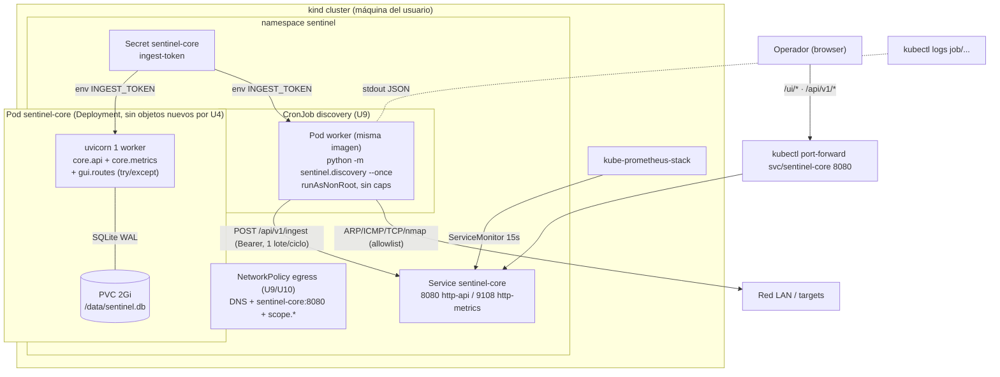

# Deployment Architecture — U4 (Configuration, scope & Discovery)

**Fase**: CONSTRUCTION — Infrastructure Design
**Fecha**: 2026-11-16
**Estado**: GENERATED — pendiente de aprobación
**Unidad**: U4 — worker `python -m sentinel.discovery` en kind (máquina del usuario), CronJob de U9
**Decisiones**: Q1–Q7 = A (ver `infrastructure-design.md` ID-U4-01..10)

---

## 1. Topología (demo en kind — tras U9)



Nota de flujo: el CronJob no expone ni escucha puertos — solo hace **egress** (DNS, 8080 del Core, targets de la allowlist); la validación de scope 400 pre-run corre en el Core con el **mismo set de env** inyectado en ambos workloads (D-U4-04); los fallos del ciclo se ven en `kubectl logs` del Job (Q6=A), no en el Core (FQ1=C).

Texto alternativo: un CronJob cada 15 min levanta un Pod efímero con la imagen del proyecto y el comando `--once`; escanea la allowlist, hace un solo POST de observaciones al Service `sentinel-core:8080` y muere; el Core persiste en su PVC; Prometheus sigue solo midiendo el Core; el operador usa el mismo port-forward de siempre.

---

## 2. Puertos y flujos de red

| Puerto | Protocolo | Quién | Flujo |
|---|---|---|---|
| 8080 | HTTP | worker CronJob → Service | `POST /api/v1/ingest` con Bearer (única conexión entrante al Core desde el worker) |
| 8080 | HTTP | port-forward (operador) | `/api/v1/*`, `/ui/*`, `/static/*` (sin cambios U3) |
| 8080 (loopback) | HTTP | `GuiClient` dentro del Pod | hereda U3 |
| 9108 | HTTP | Prometheus | `GET /metrics` (sin cambios) |
| — | — | worker | **Sin puerto entrante**, sin Service propio, sin probe (ID-U4-08) |
| LAN (allowlist) | ICMP/TCP/nmap | worker → targets | egress acotado por NetworkPolicy + C12 |

Reglas:
- La **única** pieza de red nueva es el **egress** del worker: DNS + `sentinel-core:8080` + rangos de `discovery.scope.*` (ID-U4-05, política en U9/U10).
- Sin TLS en lab (hereda U2); sin Ingress/NodePort/LB.
- `nmap`/`ping`/`ip neigh` corren **dentro** del Pod del worker — no requieren puertos, solo egress.

---

## 3. Flujo de un ciclo (CronJob `--once`)

```text
1. CronJob (*/15, Forbid) lanza el Pod worker
2. env: SENTINEL_DISCOVERY_* (values.yaml) + SENTINEL_INGEST_TOKEN (Secret)
3. load_discovery_settings(): fail-fast ConfigError (exit 1, log)
4. validate_scope (C12) sobre allowlist → Run
5. fases con presupuesto 20/30/30/20 s (deadline total):
     arp (ip neigh) → icmp (ping, omitida si sin permiso) → tcp (pool ≤32) → nmap
6. fusión 1 HostFinding/host (método preponderante) → DiscoveryObservation[]
7. POST /api/v1/ingest (1 lote, ≤1000, Bearer, with_retries ×5)
     · éxito     → exit 0 (Core: assets + events + heartbeat sensor-0)
     · 4xx/5xx   → log discovery_cycle_failed + exit 1 (sin reintento del lote)
8. timeout del runner → ingesta de parciales + log + exit 1
9. stdout: logs JSON (component=discovery.*) → kubectl logs del Job
```

Modo `--loop --interval N`: mismo ciclo en bucle dentro del proceso (demo local sin chart), misma salida por log.

---

## 4. Ciclo de desarrollo vs demo

| Fase | Ejecución | Escáner | Comando base |
|---|---|---|---|
| Code Generation / tests | pytest en la máquina | `FixtureScanner` + `MockTransport` (sin red, MNT-02) | `pytest tests/unit/discovery tests/integration tests/property` |
| Build & Test | imagen + kind | **nmap real** (capa del Dockerfile, ID-U4-01) | `docker build` → `kind load` → (U9) `helm install` → `kubectl get cronjob` |
| Demo (sin chart) | proceso local | `auto` (nmap si está, si no fixtures) | `python -m sentinel.discovery --loop --interval 15` |
| Demo (con chart, U9) | CronJob en kind | nmap real + allowlist | `kubectl logs job/…` + `/ui` en port-forward |

---

## 5. Handoff a U9/U10 (checklist de recepción)

| Artefacto | Entregado por U4 | Lo implementa |
|---|---|---|
| Env `SENTINEL_DISCOVERY_*` (8 claves) + defaults | §4 de `infrastructure-design.md` | U9 (`values.yaml` → env en worker **y** Core) |
| Spec del CronJob (*/15, Forbid, 600 s, backoff 3, Never, `--once`) | §3.2 | U9 (chart) |
| NetworkPolicy de egress del worker (DNS + 8080 + scope) | ID-U4-05 | U9/U10 |
| Dockerfile `+nmap` | §3.1 (hecho en Code Gen U4) | ya en imagen antes de U9 |
| resources/securityContext del worker | §3.2 | U9 |
| Validación 400 pre-run (env condicional) | FD D-U4-04 (código U4) | U9 solo inyecta las env en el Core |

---

## 6. Approval Gate

**Estado**: GENERATED — pendiente de aprobación (ver mensaje de completitud).
