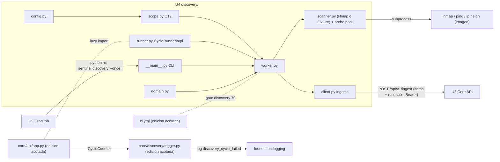

# Logical Components — U4 (Configuration, scope & Discovery)

**Fase**: CONSTRUCTION — NFR Design
**Fecha**: 2026-11-16
**Estado**: GENERATED — pendiente de aprobación
**Unidad**: U4 — `src/sentinel/discovery/`
**Decisiones clave**: Q6=A (inyección por constructor con defaults reales), Q7=A (`CycleCounter` inyectado), Q8=A (gate como step separado de CI); concurrencia aceptada (Q2=A), paralelismo 32 hilos (Q3=A), timeouts fijos (Q4=A).

---

## 1. Componentes lógicos de U4

| Componente | Archivo | Responsabilidad | NFR / patrón |
|---|---|---|---|
| `DiscoverySettings` | `discovery/config.py` | Loader estricto `SENTINEL_DISCOVERY_*` (`extra="forbid"`, fail-fast: allowlist vacía, puertos, flags, cap de targets, interval ≥1, timeout 1..3600) + constantes de sonda (`PING_TIMEOUT_S`, `CONNECT_TIMEOUT_S`) y presupuesto de fases (20/30/30/20) | TECH-03, Q8 NFR-Req, P5 |
| `ScopeValidator` (C12) | `discovery/scope.py` | `validate_scope/validate_ports/validate_target` → `ValidationResult`; `ScopeError("host fuera de alcance")` ⇒ worker siempre / API condicional | SEC-01 (P8), FD §3.2 |
| Dominio puro | `discovery/domain.py` | `ScopeConfig`, `ScanTarget`, `HostFinding`, `CycleResult`, `CycleStatus` — sin I/O; `resolve_targets` con cap 1000 | SCAL-01 (P13), Q11 FD |
| Escáner | `discovery/scanner.py` | Protocolo `Scanner`; `NmapScanner` (subprocess `shell=False`, argv de `build_nmap_argv` + whitelist, `ip neigh`, `ping`), `FixtureScanner` (XML/ARP fixtures), `auto` con fallback (BR-U4-18); parse XML con error controlado (`ScannerError`) | TECH-01/02, SEC-02 (P7), MNT-03 |
| Probe pool | `discovery/scanner.py` (o `probes.py`) | `ThreadPoolExecutor(max_workers=32)` para ICMP/TCP por fase, shutdown ordenado; resultados normalizados por IP antes de fusionar | REL-01/TECH-04 (P4), Q3=A |
| Worker de ciclo | `discovery/worker.py` | `run_cycle(settings, scanner, ingest_client, timeout_seconds)`: presupuestos de fase, fusión por host (método preponderante), `hosts_seen`, decisión `reconcile`, `CycleResult` | AVAIL/REL (P1/P4), FD §3.3/§3.5 |
| Cliente de ingesta | `discovery/client.py` | `post_ingest(items, reconcile)`: httpx + Bearer `SENTINEL_INGEST_TOKEN` + `with_retries` ×5; `to_observations()` (frontera Pydantic U1) | SEC-04 (P6), TS-U4-05 |
| Runner bridge | `discovery/runner.py` | `CycleRunnerImpl` (defaults reales; seams por constructor): satisface `CycleRunner.run(hosts, timeout_seconds) -> int`; `ScopeError`/errores ⇒ excepción ⇒ `failed`; `DiscoveryTimeoutError` tras ingerir parciales ⇒ `timeout` | FD Q15, P9 |
| CLI | `discovery/__main__.py` | `python -m sentinel.discovery --once \| --loop --interval N`; exit 0/1; logs `component=discovery.worker` | AVAIL-01/02 (P1), BR-U4-32 |
| `CycleCounter` | U2 `core/metrics/collect.py` (edición acotada) | Contadores en proceso `cycles_total` / `cycles_failed_total`; inyectado en `DiscoveryTrigger` y `collect()` (espejo de `ApiRequestCounter`) | MNT-04 (P10), FD Q8, Q7=A |
| Trigger + log | U2 `core/discovery/trigger.py` (edición acotada) | Al finalizar: `counter.record(status)` + log `event=discovery_cycle_failed` (run_id, causa) en `failed`/`timeout` | MNT-04 (P10), ST-M2-06 |
| Scope en API | U2 `core/api/routes_discovery.py` + `app.py` (edición acotada) | `scope_validator` opcional desde env (D-U4-04): host fuera ⇒ `ScopeError` → 400 `scope_violation` pre-run + warning log | SEC-01 (P8), FD §3.2 |
| Runner lazy | U2 `core/api/app.py` (edición acotada) | Import perezoso de `discovery.runner` si `runner=None` (bloque try/except, igual que `gui`); tests inyectan `runner=` | FD Q15, P9 |
| Tests | `tests/unit/discovery/`, `tests/property/test_nmap_xml.py`, `tests/integration/test_{scope_validation,gt02_new_host,gt03_host_absent,discovery_failure}.py`, `tests/unit/test_{config_validation,nmap_args}.py` | FixtureScanner + MockTransport + settings de test (sin red); PBT Nmap XML; gates de cobertura | MNT-01/02/03 (P9/P11/P12) |

---

## 2. Layering interno (Q6=A — inyección por constructor)

```text
__main__.py (CLI --once|--loop)          create_app (U2, edición acotada)
        │                                       ├─ lazy: CycleRunnerImpl()  [defaults reales]
        │                                       └─ CycleCounter → DiscoveryTrigger(counter=...)
        ▼                                               │
runner.py (CycleRunnerImpl) ◄──────────────────────────┘
        │  run(hosts, timeout)
        ▼
worker.run_cycle(settings, scanner, ingest_client, timeout)
        ├─ scope.validate_target (antes de cualquier paquete)
        ├─ scanner.arp_neighbors → probe pool icmp/tcp (≤32 hilos) → nmap
        ├─ presupuestos de fase 20/30/30/20 (deadline total)
        ├─ domain.merge (1 HostFinding por host, método preponderante)
        └─ client.post_ingest(items, reconcile)  [with_retries ×5, Bearer]
                    │  HTTP
                    ▼
            [U2 Core API /api/v1/ingest]  →  SQLite (solo Core)

Tests:  run_cycle(DiscoverySettings(test), FixtureScanner(), IngestClient(MockTransport))
```

- **Frontera dura**: `discovery/` solo importa `sentinel.foundation.*` + stdlib + httpx — **nunca** `sentinel.core.*` ni `sqlite3` (BR-U4-26). La única dirección inversa es la **composición de arranque** en `create_app` (import perezoso del runner + inyección del counter).
- Todo efecto de red pasa por el protocolo `Scanner` (mockeable) y todo efecto de persistencia por el cliente HTTP (mockeable) — los tests de U4 no abren sockets reales (MNT-02).

---

## 3. Bordes con otras unidades (quién importa qué)



| Frontera | Contrato | Quién decide |
|---|---|---|
| U4 → U1 `foundation` | `DiscoveryObservation`/`Batch(+reconcile)`, `ScopeError`/`ConfigError`, `with_retries`, `get_logger`, `METRIC_FAMILIES(+cycles_failed_total)` | U1 (ediciones acotadas aprobadas en FD §4) |
| U4 → U2 (HTTP) | `POST /api/v1/ingest` (Bearer, lote ≤1000, `reconcile`); `POST/GET /discovery` lo consume el operador/GUI, no el worker | U2 expone; U4 consume |
| U4 → U2 (edición) | `routes_discovery` scope pre-run; `app.py` runner lazy + scope validator + counter; `trigger.py` counter + log; `collect.py` counter; `ingestion/service.py` `batch.reconcile` | U4, ediciones acotadas documentadas en FD §4 y `tech-stack-decisions.md` §3 |
| U2 → U4 | `CycleRunner` protocolo (`run(hosts, timeout) -> int`, timeout ⇒ `DiscoveryTimeoutError`) | U2 define; U4 implementa (`runner.py`) |
| U4 → imagen/CI | Dockerfile `+ nmap` (opcional, fallback si falta); `ci.yml` step gate `discovery/` ≥70 | U4 NFR (TS-U4-08, tech-stack §3) |
| U4 → U9 | env `SENTINEL_DISCOVERY_*` (values.yaml), CronJob `--once`, SecurityContext non-root sin caps | U9 (U4 solo documenta el mapeo) |
