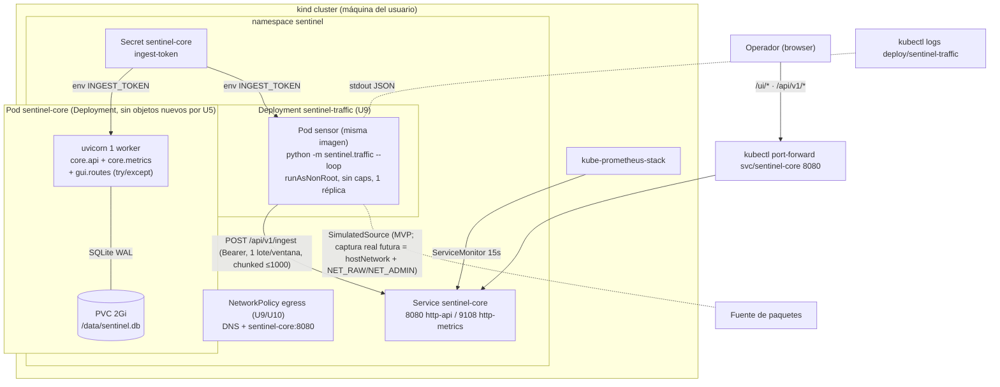

# Deployment Architecture — U5 (Traffic Sensor & ARP observation)

**Fase**: CONSTRUCTION — Infrastructure Design
**Fecha**: 2026-11-19
**Estado**: GENERATED — pendiente de aprobación
**Unidad**: U5 — worker `python -m sentinel.traffic --loop` en kind (máquina del usuario), Deployment de U9
**Decisiones**: Q1–Q7 = A (ver `infrastructure-design.md` ID-U5-01..10)

---

## 1. Topología (demo en kind — tras U9)



Nota de flujo: el Deployment no expone ni escucha puertos — solo hace **egress** (DNS, 8080 del Core) en una ventana continua de 5 s (default); el heartbeat `sensor-0` se deriva de las observaciones exitosas en el Core; los fallos de export se ven en `kubectl logs` del sensor (Q6=A).

Texto alternativo: un Pod permanente con la imagen del proyecto corre `python -m sentinel.traffic --loop`; en cada borde de ventana cierra el acumulador, proyecta las observaciones y hace un POST al Service `sentinel-core:8080`; el Core persiste en su PVC y deriva heartbeat/inventario; Prometheus sigue solo midiendo el Core; el operador usa el mismo port-forward de siempre.

---

## 2. Puertos y flujos de red

| Puerto | Protocolo | Quién | Flujo |
|---|---|---|---|
| 8080 | HTTP | sensor → Service | `POST /api/v1/ingest` con Bearer (única conexión entrante al Core desde el sensor) |
| 8080 | HTTP | port-forward (operador) | `/api/v1/*`, `/ui/*`, `/static/*` (sin cambios U3) |
| 8080 (loopback) | HTTP | `GuiClient` dentro del Pod | hereda U3 |
| 9108 | HTTP | Prometheus | `GET /metrics` (sin cambios) |
| — | — | sensor | **Sin puerto entrante**, sin Service propio, sin probe (ID-U5-06) |

Reglas:
- La **única** pieza de red nueva es el **egress** del sensor: DNS + `sentinel-core:8080` (ID-U5-04, política en U9/U10).
- Sin TLS en lab (hereda U2); sin Ingress/NodePort/LB.
- El sensor **no** genera tráfico de escaneo a la LAN (eso es U4); en el MVP ni siquiera abre sockets — `SimulatedSource`/`FixtureSource` (SEC-01).
- **Salvedad `hostNetwork`** (ID-U5-04): con captura real (`hostNetwork: true`) la NetworkPolicy puede no aplicar según el CNI ⇒ acotar por bridge/CNI (`DECISIONES_PENDIENTES.md` §1).

---

## 3. Flujo de una ventana (`--loop`)

```text
1. Deployment (1 réplica, Always) lanza el Pod: python -m sentinel.traffic --loop
2. env: SENTINEL_TRAFFIC_* (values.yaml: WINDOW_SECONDS/INTERFACE/SIM_SEED/SIM_RATE/SENSOR_ID/FALLBACK) + SENTINEL_API_BASE + SENTINEL_INGEST_TOKEN (Secret)
3. load_traffic_settings(): fail-fast ConfigError (exit 1, log)
4. por ventana (epoch-aligned UTC, W = 5 s default):
   a. clock.now() → window_start = floor(now/W)*W  [guard monótono P2: si ≤ último emitido ⇒ warning + descarte]
   b. source.events() → dataclass IpPacket|ArpPacket (sin Pydantic por evento, P5)
      → WindowAccumulator (dicts O(1); pairs ≤100)
   c. al borde: proyección una vez a TrafficObservation/ArpObservation (Pydantic U1) + window_id uuid5
      → log event="arp_rate" (BR-U5-19)
   d. POST /api/v1/ingest (Bearer, chunking ≤1000, with_retries ×5)
        · éxito     → ventana emitida (Core: dedup UUIDv5 → SQLite; heartbeat; hwsrc changed ⇒ arp_mapping_changed)
        · 4xx/5xx   → log sensor_export_failed + ventana descartada; el loop CONTINÚA (P1, sin circuit breaker)
   e. fuente falla a mitad → log sensor_source_error + acumulador descartado; loop continúa (P3/AVAIL-01)
5. SIGTERM → se atiende entre ventanas, salida 0 (AVAIL-02)
6. stdout: logs JSON (component=traffic.*) → kubectl logs del Pod
```

Modo `--once`: una sola ventana; fallo ⇒ exit 1 (BR-U5-29) — la gestión de reinicio la tiene K8s.

---

## 4. Ciclo de desarrollo vs demo

| Fase | Ejecución | Fuente | Comando base |
|---|---|---|---|
| Code Generation / tests | pytest en la máquina | `FixtureSource` + `MockTransport` + `FakeClock` (sin red, MNT-02) | `pytest tests/unit/traffic tests/integration tests/property` |
| Build & Test | imagen + kind | `SimulatedSource` (determinista, seed) | `docker build` → `kind load` → (U9) `helm install` → `kubectl get deploy` |
| Demo (sin chart) | proceso local | `SimulatedSource` | `python -m sentinel.traffic --loop` |
| Demo (con chart, U9) | Deployment en kind | `SimulatedSource` | `kubectl logs deploy/sentinel-traffic` + `/ui` en port-forward |
| Captura real (futuro, fuera de U5) | Deployment con §3.3 de infra | `AfPacketSource` + SPAN/mirror | requiere `hostNetwork`+caps (OQ-01 resuelta) y alcance acotado por CNI |

---

## 5. Handoff a U9/U10 (checklist de recepción)

| Artefacto | Entregado por U5 | Lo implementa |
|---|---|---|
| Env `SENTINEL_TRAFFIC_*` (6 claves) + `SENTINEL_API_BASE` + defaults | §4 de `infrastructure-design.md` | U9 (`values.yaml` → env en el sensor) |
| Spec del Deployment (1 réplica, `--loop`, Always) | §3.1 | U9 (chart) |
| NetworkPolicy de egress del sensor (DNS + 8080) | ID-U5-04 | U9/U10 |
| Bloque de captura real (`hostNetwork` + `NET_RAW`/`NET_ADMIN`, sin `SYS_ADMIN`) | §3.3 | U9/U10 (cuando exista captura) |
| Dockerfile | **sin cambios** (Q2=A) | nada que hacer |
| resources/securityContext del sensor | §3.1 | U9 |
| Validador de ventana para `helm lint --set traffic.window=7s` | BR-U5-02 (código U5) | U9 invoca el loader detrás del lint |

---

## 6. Approval Gate

**Estado**: GENERATED — pendiente de aprobación (ver mensaje de completitud).
