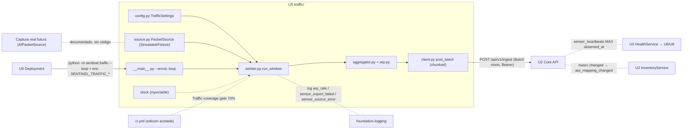

# Logical Components — U5 (Traffic Sensor & ARP observation)

**Fase**: CONSTRUCTION — NFR Design
**Fecha**: 2026-11-18
**Estado**: GENERATED — pendiente de aprobación
**Unidad**: U5 — `src/sentinel/traffic/`
**Decisiones clave**: Q6=A (inyección por constructor con defaults reales), Q7=A (gate como step separado de CI), Q1=A (loop sin circuit breaker), Q2=A (guard monótono), Q3=A (pipeline síncrono), Q4=A (dataclass + Pydantic en frontera), Q5=A (contrato U1 + logs JSON).

---

## 1. Componentes lógicos de U5

| Componente | Archivo | Responsabilidad | NFR / patrón |
|---|---|---|---|
| `TrafficSettings` | `traffic/config.py` | Loader estricto `SENTINEL_TRAFFIC_*` (`extra="forbid"`, fail-fast: ventana ∈ {1,5,10,30,60}, `sim_rate > 0`, `fallback=false` ⇒ `ConfigError`) + constantes (`MAX_PAIRS_PER_OBSERVATION = 100`) | SEC-02 (P8), TECH-02, FD §3.1 |
| Fuente abstracta | `traffic/source.py` | Protocolo `PacketSource`; `dataclass` slotted `IpPacket`/`ArpPacket` (sin validación por evento); `SimulatedSource` determinista (seed+rate), `FixtureSource` (JSON) | PERF (P5), TECH-03, SEC-03 (P6) |
| Agregador | `traffic/aggregator.py` | `WindowAccumulator` (dicts O(1) por protocolo/pares); cierre epoch-aligned UTC con **guard monótono** (`last_emitted_window_start`); proyección **una vez por ventana** a `TrafficObservation` (Pydantic U1) con `window_id` uuid5 | REL-01 (P2), MNT-03 (P12), D-U5-01/02 |
| Dominio ARP | `traffic/arp.py` | `to_arp_observations` (frontera U1) + `arp_rate(n, W)` función pura para el log `arp_rate` | SEC-03 (P6), FD BR-U5-19 |
| Worker | `traffic/worker.py` | `run_window(settings, source, client, clock, …)` **síncrono de un hilo** (P4): colecciona → cierra → proyecta → exporta chunked → siguiente borde; manejo de `sensor_source_error`/`window_clock_regression`; SIGTERM entre ventanas | AVAIL (P1/P3), REL-01 (P2), Q6=A |
| Cliente de export | `traffic/client.py` | `post_batch`: httpx + Bearer `SENTINEL_INGEST_TOKEN` + `with_retries` ×5; **chunking ≤1000** por ventana; `event=sensor_export_failed` al agotar | SCAL-01 (P13), AVAIL (P3), TS-U5-06 |
| CLI | `traffic/__main__.py` | `python -m sentinel.traffic --once \| --loop`; exit 0/1; `component=traffic.worker` | AVAIL-01/02 (P1), TECH-04, BR-U5-29 |
| PBT agregación | `tests/property/test_window_aggregation.py` | Partición temporal, conservación de bytes, determinismo (hypothesis) | MNT-03 (P12) |
| Gate de cobertura | `.github/workflows/ci.yml` (edición acotada) | Step `Traffic coverage gate`: `coverage report --include='*/traffic/*' --fail-under=70` | MNT-01 (P11), TS-U5-09 |

---

## 2. Layering interno (Q6=A — inyección por constructor)

```text
__main__.py (CLI --once|--loop)              [U9 Deployment: python -m sentinel.traffic --loop]
        │
        ▼
worker.run_window(settings, source, client, clock)
        ├─ clock.now() ────────────────► window_start = floor(now/W)*W   [guard monótono P2]
        ├─ source.events() ────────────► dataclass IpPacket|ArpPacket    [sin Pydantic por evento P5]
        │        └─────────────────────► WindowAccumulator (dicts O(1))
        ├─ al borde: aggregator.to_observations()  ──► TrafficObservation (Pydantic U1)  [frontera P5/P6]
        │            arp.to_arp_observations()     ──► ArpObservation   (Pydantic U1)
        │            arp_rate(n, W) → log event=arp_rate
        └─ client.post_batch(items)    [chunking ≤1000, with_retries ×5, Bearer]
                    │  HTTP
                    ▼
            [U2 Core API POST /api/v1/ingest]  →  dedup UUIDv5 → SQLite (solo Core)
                    │
                    ├─ sensor_heartbeats (HealthService)  ──► U6/U8
                    └─ InventoryService hwsrc changed      ──► arp_mapping_changed (U2)

Tests:  run_window(TrafficSettings(test), FixtureSource(), IngestClient(MockTransport), FakeClock())
```

- **Frontera dura**: `traffic/` solo importa `sentinel.foundation.*` + stdlib + httpx — **nunca** `sentinel.core.*` ni `sqlite3` (BR-U5-32). Cero composición inversa en `create_app` (a diferencia de U4, **U5 no edita U2** — FD §4 = ninguna edición).
- Todo efecto de red pasa por el protocolo de cliente HTTP (mockeable), todo evento por `PacketSource` (mockeable) y el tiempo por el reloj inyectable — los tests de U5 no abren sockets, no duermen y no usan scapy (MNT-02, P9).

---

## 3. Bordes con otras unidades (quién importa qué)



| Frontera | Contrato | Quién decide |
|---|---|---|
| U5 → U1 `foundation` | `TrafficObservation`/`ArpObservation`/`Batch`, `ConfigError`, `with_retries`, `get_logger` | U1 (sin ediciones — FD §4 = ninguna) |
| U5 → U2 (HTTP) | `POST /api/v1/ingest` (Bearer, lotes ≤1000 chunked, sin `reconcile` explícito); dedup UUIDv5 absorbe reenvíos | U2 expone; U5 consume |
| U2 → U5 (derivados) | `sensor_heartbeats` (HealthService) y `arp_mapping_changed` (InventoryService) se alimentan de las observaciones de U5 — U5 no los emite ni los calcula | U2 (ya generado); U5 solo exporta |
| U5 → imagen/CI | sin cambios en Dockerfile (entrypoint ya documentado); `ci.yml` step gate `traffic/` ≥70 | U5 NFR (TS-U5-09, tech-stack §3) |
| U5 → U9 | env `SENTINEL_TRAFFIC_*` (values.yaml: `traffic.window`, `traffic.interface`, `traffic.simRate`, `sensor.id`), Deployment `--loop`, SecurityContext **sin** capabilities en el MVP (caps documentadas, OQ-01) | U9 (U5 solo documenta el mapeo) |
| U5 → U11 | fixtures del simulador, suite GT-04/GT-05 con el sensor corriendo `--loop`/`--once` | U11 consume el entrypoint |

---

## 4. Notas de wiring para Code Generation

- **Ninguna edición a U1/U2** (FD §4): los tests de U5 se montan sobre el `create_app` existente de U2 con `TestClient` (como U3/U4).
- **CI**: un solo step nuevo (`Traffic coverage gate`); los PBT de U5 viven en `tests/property/` (ya ejecutados por el job `test`).
- **Seams obligatorios** en las firmas: `run_window(settings=…, source=…, client=…, clock=…)` con defaults reales — los tests jamás hacen monkeypatch de `datetime` ni `sleep` (P9, Q6=A).
- **Eventos internos** = `dataclass` slotted; **proyección** = solo modelos U1 (P5, Q4=A).
