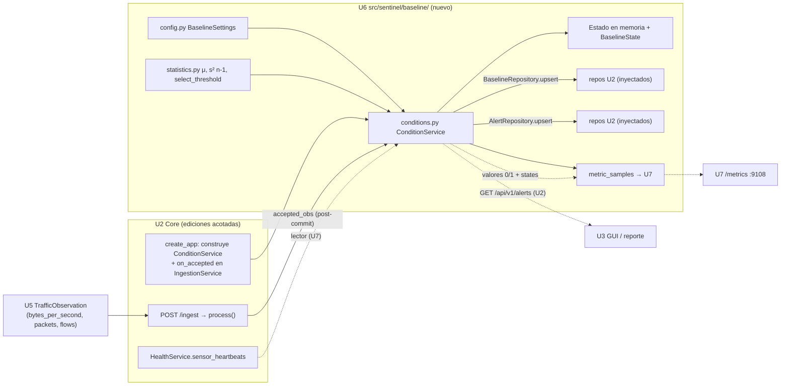

# Business Logic Model — U6 (Baseline & deterministic conditions)

**Fase**: CONSTRUCTION — Functional Design
**Fecha**: 2026-11-19
**Estado**: GENERATED — pendiente de aprobación
**Unidad**: U6 — `src/sentinel/baseline/` (estadística, umbrales, supresión, indicadores de condición)
**Plan de preguntas**: `construction/plans/u6-baseline-functional-design-plan.md` (Q1–Q13 = A, sin FQ)
**Entradas**: ST-M5-01..04 (documented-only, mínimo R-01/GT-04), FR-BASE-01..05, FR-OBS-02, PRD §3.3/§3.4 (R-01, R-04, E-06), `component-methods.md` §4 (ConditionService C5), `components.md` (C5), `implementation-scope.md` (M5), `demo-plan.md` (GT-01/GT-04), contratos U1 (`Baseline`, `AlertCondition`, `ConditionState`, `METRIC_FAMILIES`) + U2 (tablas/repos `baselines`/`alerts` «los llena U6 — OQ-02», `sensor_heartbeats`, hook de ingesta).

---

## 1. Propósito y frontera

U6 construye el **servicio de condiciones deterministas**: mantiene la línea base estadística de las series de tráfico (primeras 5 muestras, media y varianza muestral), evalúa el umbral `μ + k·s` con fallback absoluto, suprime alertas durante la ventana de establecimiento y publica indicadores deterministas (R-01 completo + indicadores de ST-M5-04) para que U7 los exponga y U8/U11 los consuman.

- **Hace**: loader `SENTINEL_BASELINE_*` (fail-fast), estadística pura (μ, s² con `n-1`), máquina de estados de condición (`baseline_establishing`/`firing`/`resolved`/`no_data`), persistencia de `baselines`/`alerts` vía repos U2 inyectados, indicadores `sentinel_traffic_threshold_exceeded`, `sentinel_baseline_status`, `sentinel_collector_up`, hook push en la ingesta (precedente `DiscoveryTrigger`).
- **No hace** (frontera): **nunca importa `sentinel.core.*` ni abre SQLite directamente** (Q1=A: repos/clock inyectados por U2, duck-typing); no expone `/metrics` (U7), no define `PrometheusRule` ni dispara canales (U8/U9), no evalúa R-02/R-03 con alerta persistida (R-02 la tasa ya la calcula U5; R-03 ya es evento de U2 — Q10=A), no decide acciones automáticas, no define labels de alta cardinalidad (sin `src_ip`/`dst_ip`/`asset_id`), no tiene UI.
- **Depende de**: U1 aprobado (`Baseline`, `AlertCondition`, `ConditionState`, `ConfigError`, `METRIC_FAMILIES`), U2 aprobado (esquema OQ-02, `BaselineRepository`/`AlertRepository`, `IngestionService`, `HealthService.sensor_heartbeats`), U5 aprobado (`TrafficObservation` con `bytes_per_second`/`packets`/`flows`/`interface`/`protocol`/`window_start`).
- **Alcance construido (implementation-scope §3)**: **solo lo mínimo para R-01/GT-04** — evaluación de umbral con fixtures; ST-M5-01..04 permanecen documented-only en el story map (el código es soporte de la unidad); R-02/R-04 se diseñan y documentan, sin alerta persistida (Q10=A).

---

## 2. Componentes lógicos

| Componente | Módulo | Responsabilidad |
|---|---|---|
| `BaselineSettings` | `baseline/config.py` | Loader propio `SENTINEL_BASELINE_*` (patrón `foundation.config`): fail-fast `ConfigError` (Q5=A) |
| Estadística | `baseline/statistics.py` | Funciones puras: `mean`, `sample_variance` (`n-1`), `update_baseline` (primeras 5 muestras, congelada), `select_threshold` (`μ + k·s` \| absoluto \| `None`) |
| `ConditionService` | `baseline/conditions.py` | Orquestador C5 (component-methods §4): `on_accepted` (hook push), `update_baseline`, `evaluate`, `is_suppressed`, `collector_up`, `metric_samples`; reloj inyectable |
| Alertas | `baseline/conditions.py` | Transiciones `firing`/`resolved`, `condition_id`/`alert_id` UUIDv5 (U2 FD), persistencia vía repos inyectados |
| Estado/series | `baseline/conditions.py` | `BaselineState` interno por `metric_key` (muestras, `t_first`, μ/s², `established`); hidratación desde `BaselineRepository` en arranque |



---

## 3. Flujos

### 3.1 Arranque y configuración (fail-fast, Q5=A)

```text
load_baseline_settings(environ)  →  BaselineSettings (frozen, extra=forbid)
  SENTINEL_BASELINE_K                        default 3.0    (> 0; umbral μ + k·s)
  SENTINEL_BASELINE_ABSOLUTE_BPS             sin default    (opcional; > 0 si presente;
                                            ausente ⇒ fallback no disponible → no_data)
  SENTINEL_BASELINE_INTERVAL_SECONDS         default 5      (≥ 1; cadencia de la serie)
  SENTINEL_BASELINE_COLLECTOR_TIMEOUT_SECONDS default 300   (≥ 1; alineado BR-U3-17)
  cualquier clave SENTINEL_BASELINE_* desconocida o violación ⇒ ConfigError (fail-fast)
  CoreSettings (U1) no cambia
```

- `N = 5` muestras para establecer la baseline es **constante de dominio** (FR-BASE-01/ST-M5-01), no env.
- `create_app` (U2) construye `BaselineSettings` + `ConditionService`; `ConfigError` ⇒ arranque fallido (mismo trato que `load_discovery_settings`).

### 3.2 Push en la ingesta (Q2=A, Q8=A)

```text
POST /api/v1/ingest
  → IngestionService.process(batch)          [U2, edición acotada: hook opcional]
      transacción: observations + assets + eventos   (sin cambios)
      post-commit: accepted_obs = observaciones recién insertadas
      → if on_accepted and accepted_obs:
            try on_accepted(accepted_obs)    # errores ⇒ log, nunca rompen el 202
  → ConditionService.on_accepted(observations)
      filtra TrafficObservation (ignora discovery/arp)
      para cada obs (interface, protocol):
        metric_key ← f"{metric}|{interface}|{protocol}"   # metric ∈ {bytes_per_second, packets, flows}
        update_baseline(metric_key, value)                # primeras 5; congelada (Q6=A)
      evalúa SOLO bytes_per_second (R-01, Q4/Q10=A):
        evaluate(TrafficWindow) → Condition
        is_suppressed? → baseline_establishing (métrica 0, sin alerta)   # Q7=A
        else select_threshold → firing|resolved|no_data
        firing/resolved ⇒ AlertRepository.upsert (alert_id UUIDv5)
      persiste baseline vía BaselineRepository.upsert
```

- **Idempotencia**: el hook solo recibe observaciones **aceptadas** (insertadas); un reenvío deduplicado no repite muestras — la línea base nunca se contamina con duplicados (regla BR-U6-11).
- **Determinismo**: mismo flujo de observaciones + mismos settings ⇒ mismos estados y alertas (reloj inyectable en tests).

### 3.3 Semántica de la línea base (FR-BASE-01/02, Q4/Q6=A)

```text
por metric_key ("bytes_per_second|eth0|tcp", "packets|…", "flows|…"):
  n < 5   → acumula muestra; interim: mean = Σx/n; variance = 0 si n=1,
                                   Σ(x-μ)²/(n-1) si n ≥ 2; established = false
  n = 5   → fija mean/variance (s² con denominador n-1=4); established = true
  n > 5   → congelada: update_baseline es no-op (sin recálculo, sin append)
            (rolling/gaps documentados como futuro — Q6=A)
  t_first → timestamp de la primera muestra (en memoria; tras restart con
            baseline parcial se reinicia ⇒ re-suprime, conservador)
```

### 3.4 Evaluación de la condición R-01 (Q7/Q12=A)

```text
evaluate(measured = bytes_per_second, state, settings, now):
  1. is_suppressed(now) = (now < t_first + N * interval)     # ventana ≈ 25 s @ 5 s
       → estado baseline_establishing; métrica = 0; SIN alerta
         (la supresión tiene prioridad aunque el absoluto se supere — Q7=A)
  2. select_threshold(state):
       established        → μ + k·s
       no established     → ABSOLUTE_BPS si está configurado; si no → None
       threshold None     → estado no_data; métrica = 0; SIN alerta
  3. firing = measured > threshold                            # estricto (Q12=A)
       firing            → estado firing; métrica = 1;
                           AlertRepository.upsert(state="firing", fired_at=…)
       no firing         → métrica = 0;
                           si había alerta en firing → upsert(state="resolved",
                           resolved_at=…); si no había → sin fila
```

- `condition_id = uuid5(ns, "R-01|" + metric_key)` (estable por condición).
- `alert_id = uuid5(ns, condition_id + "|" + fired_at_iso)` — una fila por activación (U2 FD: «UUIDv5 por (condition, asset/metric, primera activación)»); re-fire posterior ⇒ fila nueva; `resolved` actualiza la fila vigente.
- `evidence` (dict): `measured_value`, `threshold`, `k`, `mu`, `sigma`, `window_start`, `interface`, `protocol`, `sensor_id`.

### 3.5 Indicadores de ST-M5-04 (Q9/Q10=A — U6 produce, U7 expone)

| Indicador | Valor | Origen |
|---|---|---|
| `sentinel_traffic_threshold_exceeded{interface,protocol}` | `1` si R-01 firing para esa serie; `0` si resolved/establishing/no_data | estado en memoria del `ConditionService` |
| `sentinel_baseline_status{state}` | `1` para el estado vigente por serie (`establishing` \| `available`) | `BaselineState` |
| `sentinel_collector_up{collector="traffic"}` | `1` si `now − last_traffic_observed_at ≤ timeout`; `0` si excede o `None` | función pura `collector_up(...)` con el heartbeat que U7 lee de `HealthService`/BD |
| `sentinel_baseline_established` (catálogo U1 existente) | `1` si `established` por serie | coexistente (Q9=A) |

- Familias nuevas se **añaden al catálogo U1** `METRIC_FAMILIES` (precedente U4): `sentinel_traffic_threshold_exceeded`, `sentinel_baseline_status`, `sentinel_collector_up`.
- `collector_up` no depende del push: es una función pura con timeout `SENTINEL_BASELINE_COLLECTOR_TIMEOUT_SECONDS` (default 300 s, alineado `HEARTBEAT_STALE_SECONDS` BR-U3-17).

### 3.6 Recuperación tras restart (Q8=A)

```text
create_app → ConditionService.__init__(repos, clock)
  → BaselineRepository.list()  ⇒ hidrata BaselineState por metric_key
      established=true  → continúa sin supresión (persistida)
      established=false → t_first = now (re-supresión conservadora)
  → memoria de alertas vigentes: se reconstruye con un SELECT de la última
    fila firing por condition_id (AlertRepository) para poder resolver
```

### 3.7 Frontera de imports (Q1=A, BR-U6-01)

```text
baseline/* importa: sentinel.foundation.*, stdlib, typing
baseline/* NO importa: sentinel.core.*, sqlite3
inyección desde core/api/app.py: repos (duck-typing con Protocol local),
Clock, y el hook on_accepted pasados como objetos — core importa baseline
(nunca al revés), mismo patrón que discovery/traffic.
```

---

## 4. Interacciones por unidad

| Unidad | Interacción | Tipo |
|---|---|---|
| U1 | Modelos `Baseline`/`AlertCondition`/`ConditionState`; `ConfigError`; +3 familias en `METRIC_FAMILIES` | lectura + **edición acotada catálogo** (Q9=A, precedente U4) |
| U2 | `create_app` construye `ConditionService` (app.py); `IngestionService` gana hook opcional `on_accepted` (service.py, post-commit); esquema/repos **sin cambios** (OQ-02 ya los define «los llena U6») | **ediciones acotadas** (precedente U4 en service.py/app.py) |
| U5 | Series `TrafficObservation` como muestras; `window_id`/`window_start` en `evidence` | lectura de datos (vía push) |
| U7 | Consumirá `metric_samples()` + `collector_up` + heartbeats para `/metrics` (fuera de U6) | contrato de salida |
| U8/U11 | `GET /api/v1/alerts` (filas de U6) y reglas Prometheus `for` (fuera de U6) | contrato de salida |
| U3 | GUI ya consume `/api/v1/alerts` y badges de heartbeat — sin cambios | lectura |

## 5. Alcance documentado (no implementado en U6)

- **R-02** `ArpRateThresholdExceeded`: umbral sobre `arp_messages_per_second` (U5 ya lo calcula) — diseño: mismo `select_threshold` con serie `arp_rate|<interface>`; sin código (U8/U7 futuros).
- **R-04** `SensorUnavailable` como **alerta persistida** / evento **E-06**: solo el indicador `sentinel_collector_up` se implementa (Q10=A); la alerta y el evento quedan para U8 (documentado).
- Rolling window, re-establecimiento por gaps, series históricas (Q6=A).
- `PrometheusRule` con duración `for` (U7/U8) — R-01 dice «Prometheus aplica la duración for».
