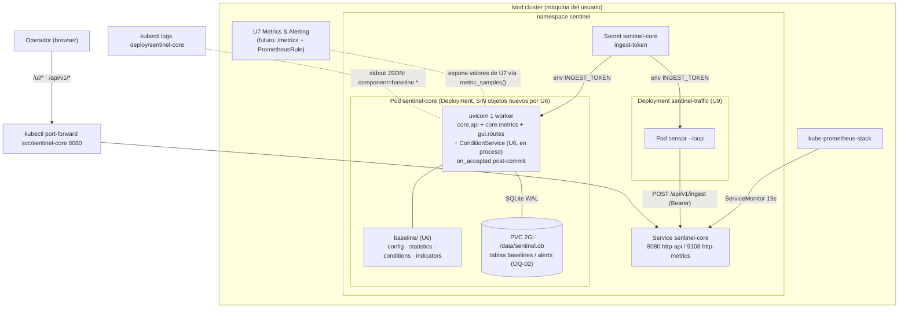

# Deployment Architecture — U6 (Baseline & deterministic conditions)

**Fase**: CONSTRUCTION — Infrastructure Design
**Fecha**: 2026-11-19
**Estado**: GENERATED — pendiente de aprobación
**Unidad**: U6 — librería `baseline/` en proceso dentro del Pod `sentinel-core` (kind en la máquina del usuario)
**Decisiones**: Q1–Q6 = A (ver `infrastructure-design.md` ID-U6-01..08)

---

## 1. Topología (demo en kind — tras U9)



Nota de flujo: **U6 no añade ningún objeto, puerto, volumen ni probe** — la ingesta entra por el mismo Service 8080, el hook corre en el mismo proceso uvicorn, persiste en el mismo SQLite/PVC y sus logs salen por el stdout ya existente del Core.

Texto alternativo: el Pod del Core recibe las observaciones del sensor por HTTP, las inserta en SQLite y, post-commit, el `ConditionService` de U6 actualiza la estadística de la serie afectada, evalúa el umbral con supresión de establecimiento y persiste `baselines`/`alerts` en las tablas ya definidas; U7 (futuro) expondrá esos valores en `/metrics` del mismo Pod; el operador sigue usando el mismo port-forward de siempre.

---

## 2. Puertos y flujos de red

| Puerto | Protocolo | Quién | Flujo |
|---|---|---|---|
| 8080 | HTTP | sensor → Service | `POST /api/v1/ingest` (el hook de U6 corre **después** del commit, sin tráfico nuevo) |
| 8080 | HTTP | port-forward (operador) | `/api/v1/*`, `/ui/*`, `/static/*` (sin cambios) |
| 9108 | HTTP | Prometheus | `GET /metrics` (hoy sin cambios; U7 agregará familias nuevas) |
| — | — | U6 | **Sin puerto, sin Service, sin egress, sin tráfico propio** (ID-U6-01/06; Messaging/Networking sin pregunta justificada) |

Reglas:
- **Cero red nueva por U6**: todo es memoria y SQLite dentro del mismo contenedor.
- Sin TLS en lab (hereda U2); sin Ingress/NodePort/LB; NetworkPolicy sin cambios.
- El `collector_up` que U7 expondrá se deriva de `sensor_heartbeats` (U2) + indicadores de U6 — sin conexiones nuevas.

---

## 3. Flujo de una ingesta con el hook de U6

```text
1. sensor → POST /api/v1/ingest (Bearer) → IngestionService.insert(batch)
2. INSERT de las observaciones aceptadas en SQLite (commit)          [U2, sin cambios]
3. post-commit, solo para TrafficObservation insertadas:
      ConditionService.on_accepted(obs)                              [Q3: ≤3 claves metric|iface|proto]
        a. statistics: media / varianza n-1 sobre el buffer (≤5)      [PBT P12]
        b. si <5 muestras → esperar; si ≥5 → congelar μ/s² → BaselineRepository.upsert  [P6]
        c. supresión prioritaria (t_first + 5×interval) → no evalúa aún
        d. si ya establecida: measured > umbral (μ + k·s | absolute)  [Q1 NFR-Req]
             · dispara   → AlertRepository.upsert (uuid5 por activación) + log condition_firing
             · recupera  → log condition_resolved
        e. CUALQUIER fallo → log condition_persistence_failed / condition_evaluation_failed
                             + estado en memoria; SIN excepción al cliente (P1)
4. respuesta 202 al sensor intacta (BR-U6-15)
5. U7 (futuro) scrapea GET /metrics → metric_samples() bajo demanda   [P7]
```

---

## 4. Handoff de configuración a U9 (NFR-U6-OPS-01)

| `values.yaml` (U9) | env en `sentinel-core` | Default de referencia | Origen |
|---|---|---|---|
| `baseline.k` | `SENTINEL_BASELINE_K` | `3.0` | FD §3.1 (k > 0) |
| `baseline.absoluteBps` | `SENTINEL_BASELINE_ABSOLUTE_BPS` | **sin default en código** — valor obligatorio en values | FD BR-U6-03 (PRD §3.3) |
| `baseline.intervalSeconds` | `SENTINEL_BASELINE_INTERVAL_SECONDS` | `5` | FD §3.1 |
| `baseline.collectorTimeoutSeconds` | `SENTINEL_BASELINE_COLLECTOR_TIMEOUT_SECONDS` | `300` | FD §3.1 |

- Entrega **por env literales** desde `values.yaml` (patrón U4/U5); **sin ConfigMap**, sin secretos nuevos (ID-U6-07).
- El loader falla al arranque (`ConfigError`) ante claves desconocidas o valores inválidos — U9 debe traducir los 4 parámetros y nada más.

---

## 5. Notas operativas y futuros documentados (sin código hoy)

- **Logs GT-04**: `kubectl logs deploy/sentinel-core | grep baseline` muestra `baseline_established`, `condition_firing`, `condition_resolved`, `condition_evaluation_failed`, `baseline_hydration_failed` (ID-U6-06).
- **Reinicio del Core**: las baselines persistidas se rehidratan al arrancar; si la BD falla, el servicio arranca vacío y re-suprime conservadoramente (ID-U6-05 / NFR-Req Q5=A) — `live`/`ready` no cambian.
- **Retención/tamaño de PVC**: revisión futura cuando `alerts` acumule activaciones (ID-U6-04); hoy sin retención y con query paginada.
- **`/metrics` y alertas R-01**: los expone U7 (mismo Pod/Service 9108) — U6 solo produce valores y familias (ID-U6-06).
- **Sizing**: si U11 evidencia presión de CPU/memoria en el Core, ajustar `resources` en U9 (ID-U6-03) — sin cambios preventivos.
