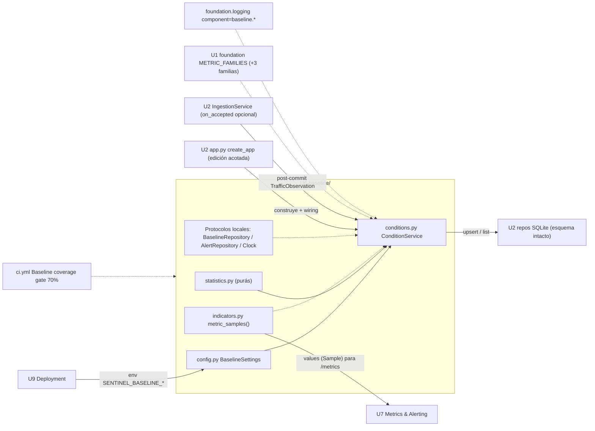

# Logical Components — U6 (Baseline & deterministic conditions)

**Fase**: CONSTRUCTION — NFR Design
**Fecha**: 2026-11-19
**Estado**: GENERATED — pendiente de aprobación
**Unidad**: U6 — `src/sentinel/baseline/`
**Decisiones clave**: Q1=A (try/log sin retry ni breaker), Q2=A (buffer ≤5 en memoria), Q3=A (evaluación acotada a la serie observada), Q4=A (confiar en frontera U2), Q5=A (4 módulos, sin `rules.py`), Q6=A (`Clock` Protocol local), Q7=A (`metric_samples()` bajo demanda).

---

## 1. Componentes lógicos de U6

| Componente | Archivo | Responsabilidad | NFR / patrón |
|---|---|---|---|
| `BaselineSettings` | `baseline/config.py` | Loader estricto `SENTINEL_BASELINE_{K, ABSOLUTE_BPS, INTERVAL_SECONDS, COLLECTOR_TIMEOUT_SECONDS}` (`extra="forbid"`, `k>0`, `absolute_bps>0`, `interval≥1`, `timeout≥1`, `ABSOLUTE_BPS` sin default ⇒ `ConfigError`); constante `BASELINE_SAMPLES = 5` | SEC-02 (P3), FD §3.1, BR-U6-02/03/04 |
| Estadística pura | `baseline/statistics.py` | Funciones sin estado: `mean`, `sample_variance` (`n-1`), `select_threshold(mu, sigma, k, absolute)` ⇒ umbral efectivo (fallback absoluto) — **blanco del PBT designado** | MNT-02 (P12), STACK-01 (P15), BR-U6-06/07/09/10 |
| `ConditionService` | `baseline/conditions.py` | Hook `on_accepted(traffic_obs)`: ≤3 claves por obs → `update_baseline` (buffer ≤5, congelar, persistir) → `evaluate` (supresión prioritaria `t_first+5×interval` → umbral estricto `>`) → upsert baseline/alerta (uuid5) → logs `condition_firing`/`condition_resolved`; **try/log sin excepción propagada** (P1); máquina de estados sobre `ConditionState` U1 | AVAIL-01 (P1), PERF-01 (P4), REL-01, BR-U6-08..17 |
| Protocolos locales | `baseline/conditions.py` | `Protocol` duck-typing: `BaselineRepository` (`list`/`upsert`), `AlertRepository` (`upsert`/`list`), `Clock` (`now() -> datetime`) — **locales**, sin importar `core.db` ni `traffic.worker` | Q6=A (P11), frontera U4/U5 |
| Indicadores | `baseline/indicators.py` | `metric_samples() -> list[Sample]` **bajo demanda** (sin caché): valores de todas las series con labels permitidos + `sentinel_collector_up` para U7 | Q7=A (P7), FD §3.5, BR-U6-22/23 |
| Wiring de arranque | `core/api/app.py` (edición acotada) | `BaselineSettings` fail-fast → construir `ConditionService` con repos U2 + `SystemClock` → `app.state.condition` → pasar `on_accepted` a `IngestionService`; try de hidratación (`baseline_hydration_failed`) | AVAIL-02 (P2), FD §3.7 |
| Seam del hook | `core/ingestion/service.py` (edición acotada) | Parámetro opcional `on_accepted: Callable[[TrafficObservation], None] | None`; invocado **post-commit** solo para observaciones insertadas; excepción ⇒ log, no propaga | FD §3.2, BR-U6-14/15, patrón `DiscoveryTrigger` |
| Familias de métricas | `foundation/metrics_contract.py` (+3) | `sentinel_traffic_threshold_exceeded` (R-01), `sentinel_baseline_status` (estado por serie), `sentinel_collector_up` (señal derivada U7) en `METRIC_FAMILIES` | BR-U6-22, precedente U4 |
| PBT | `tests/property/test_baseline_statistics.py` | 4 propiedades (estadística vs brute force, congelada, monotonía en k, invariantes de `ConditionState`) | MNT-02 (P12), NFR-TECH-03 |
| Gate de cobertura | `.github/workflows/ci.yml` (edición acotada) | Step `Baseline coverage gate (U6, P11)`: `coverage report --include='*/baseline/*' --fail-under=70` | MNT-01 (P13) |

---

## 2. Layering interno (Q1/Q3/Q4=A — hook post-commit, sin retry, acotado)

```text
[U2 Core API — create_app]                          (ediciones acotadas de U6)
        │
        ├─ BaselineSettings = load_baseline_settings()          [ConfigError fail-fast P3]
        ├─ ConditionService(settings, baseline_repo, alert_repo, SystemClock(), logger)
        │        app.state.condition = service                  [hidratación try → vacío P2]
        └─ IngestionService(on_accepted=service.on_accepted)    [post-commit, solo obs insertadas]
 POST /api/v1/ingest ─► IngestionService.insert(batch)
        │                      │ (post-commit, TrafficObservation aceptada)
        │                      ▼
        │            ConditionService.on_accepted(obs)          [Q3: ≤3 claves de esta obs]
        │                      ├─ statistics.select_threshold   [PBT P12]
        │                      ├─ buffer memoria ≤5 → congelar → BaselineRepository.upsert
        │                      ├─ supresión t_first+5×interval (prioritaria) → measured > umbral
        │                      ├─ dispara → AlertRepository.upsert (uuid5 por activación)
        │                      └─ try/log: condition_persistence_failed / condition_resolved  [P1]
        ▼
   SQLite (baselines / alerts — esquema U2 intacto)

[U7 Metrics & Alerting] ◄── metric_samples() bajo demanda [P7] + familias U1 (+3)
[U9 Deployment] ── env SENTINEL_BASELINE_* ──► config.py       [handoff NFR-U6-OPS-01]
[CI ci.yml] ── Baseline coverage gate 70% ──► baseline/        [P13]
```

- **Frontera dura**: `baseline/` solo importa `sentinel.foundation.*` + stdlib — **nunca** `sentinel.core.*` ni `sqlite3` (los repos llegan como `Protocol` inyectados; duck-typing estructural).
- **Composición inversa**: la única edición de código de U2 es en `app.py` (wiring) y `service.py` (parámetro `on_accepted`) — mismo precedente acotado que U4 (`DiscoveryTrigger`). Esquema, `CoreSettings` y repos **intactos** (OQ-02/FD Q7).
- **Cero red, cero sleep**: todo tiempo pasa por `Clock.now()`; los tests usan `FakeClock` + repos fake/BD temporal + `TestClient`.

---

## 3. Bordes con otras unidades (quién importa qué)



| Frontera | Contrato | Quién decide |
|---|---|---|
| U6 → U1 `foundation` | `ConfigError`, `get_logger`, modelos U1 (`TrafficObservation`, `Sample`), **edición acotada**: +3 familias en `METRIC_FAMILIES` | U1 publica; U6 añade las familias (precedente U4) |
| U6 → U2 (in-process) | **Ediciones acotadas**: `IngestionService(on_accepted=…)`, `create_app` construye `ConditionService`; consume `BaselineRepository`/`AlertRepository` existentes (duck-typing) | FD §3.2/§3.7 define; U2 no cambia de esquema ni de `CoreSettings` |
| U6 → U2 (sin salida) | Los `alerts`/`baselines` que U6 escribe los leerán U7 (estado de condición) y U8 (reportes) | U6 escribe; U7/U8 consumen |
| U6 → U7 | `metric_samples()` (valores frescos bajo demanda) + nombres de familias nuevas (`…_threshold_exceeded`, `…_baseline_status`, `…_collector_up`) | U6 expone; U7 los scrapea/vigila |
| U6 → U9 | env `SENTINEL_BASELINE_*` listas para `values.yaml` (`baseline.k`, `baseline.absoluteBps`, `baseline.intervalSeconds`, `baseline.collectorTimeoutSeconds`) — U6 **no** toca Helm | U9 mapea (patrón U4/U5) |
| U6 → CI | step `Baseline coverage gate` + PBT en job `test` | U6 define; `ci.yml` edición acotada |
| U6 → U11 | suite GT-04/GT-05: `test_baseline_suppression.py` (`init_window`/`after_window`) con `TestClient` + BD temporal + reloj falso | U6 genera; U11 ejecuta |

---

## 4. Notas de wiring para Code Generation

- **Seams obligatorios**: `ConditionService(settings, baseline_repo, alert_repo, clock, logger)` — los tests jamás hacen monkeypatch de `datetime` ni `sleep` (P11, Q6=A); `Clock` es **local** (no importar de `sentinel.traffic`).
- **Hook**: `on_accepted` solo recibe observaciones **insertadas** (post-commit); su excepción jamás llega al cliente (BR-U6-15); evaluación **acotada a las claves de la obs** (Q3=A).
- **Hidratación**: `list()` en try dentro de `create_app` (P2); el servicio arranca vacío ante fallo.
- **Tests de integración**: `TestClient` + BD temporal + `FakeClock` + hook real (NFR-Req Q9=A) — mismo estilo que `test_ingestion_idempotency.py` de U2.
- **CI**: un solo step nuevo (`Baseline coverage gate`); los PBT viven en `tests/property/` (job `test` existente).
- **Sin**: endpoints propios, `/metrics` propio, dependencias pip, cambios de esquema, Dockerfile, `CoreSettings`.
