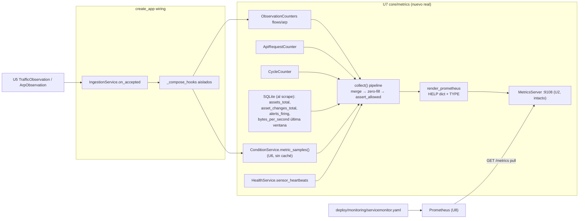

# Business Logic Model — U7 (Metrics exposure)

**Fase**: CONSTRUCTION — Functional Design
**Fecha**: 2026-11-24
**Estado**: GENERATED — pendiente de aprobación
**Unidad**: U7 — `src/sentinel/core/metrics/` + `deploy/monitoring/servicemonitor.yaml`
**Plan de preguntas**: `construction/plans/u7-metrics-exposure-functional-design-plan.md` (Q1–Q11 = Acepto todo, sin FQ)
**Entradas**: ST-M6-01..03, FR-CORE-02, FR-OBS-01/02, PRD §3.2 (cardinalidad) y §9 M6, `component-methods.md` §5 (MetricsExporter C6), `implementation-scope.md` (M6), contratos U1 (`METRIC_FAMILIES`, `metric_name`, `assert_labels`) + U2 (`MetricsServer`, `ApiRequestCounter`, `CycleCounter`, `HealthService.sensor_heartbeats`, `IngestionService.on_accepted`, esquema `assets`/`observations`/`events`/`alerts`) + U6 (`ConditionService.metric_samples()`, `ConditionService.collector_up()`).

---

## 1. Propósito y frontera

U7 convierte el `collect()` **stub** de U2 en un **exporter real**: materializa en cada scrape las 14 familias del contrato U1 (12 actuales + 2 de inventario aprobadas en Q3=C), integra la proyección de condiciones de U6 (Q5/Q6=A), crea el manifiesto ServiceMonitor (ST-M6-03, Q7=A) y endurece la validación de labels con allowlist (Q10=B).

- **Hace**: agrega contadores en proceso (api, discovery, flows, arp), gauges de SQLite al scrape (alertas, inventario, heartbeat, última ventana de tráfico), indicadores de U6 vía `ConditionService.metric_samples()` sin caché, hook post-commit que alimenta los contadores de tráfico/ARP (Q1/Q2=A), HELP por familia (Q11=A), validación denylist+allowlist por sample, manifiesto ServiceMonitor, tests de cardinalidad con fixtures (criterio de frontera).
- **No hace** (frontera): **no toca `server.py`** (ni rutas ni puerto; docstring «U7 sustituye el `collect` sin tocar este servidor»); no evalúa reglas de alerta ni emite alertas Prometheus (U8); no guarda series temporales en Core; no añade labels de alta cardinalidad (`src_ip`/`dst_ip`/`mac`/`asset_id` prohibidos, BR-21); no envía nada a red (scrape es pull); no crea `values.yaml` ni reglas (U8); no modifica `specs/backlog.md`; sin UI.
- **Depende de**: U1 (contrato; **ampliación aprobada**: 2 familias + 2 labels), U2 (servidor, contadores, repos/BD, hooks, `HealthService`), U5 (observaciones `traffic`/`arp` como fuente), U6 (`ConditionService`).

---

## 2. Componentes lógicos

| Componente | Módulo | Responsabilidad |
|---|---|---|
| Contrato v2 | `foundation/metrics_contract.py` | `METRIC_FAMILIES` (14), `ALLOWED_LABELS_DEFAULT` (7: +`collector`, +`metric`), nuevo `assert_allowed()` = denylist (BR-21) **y** allowlist por sample |
| Contadores en proceso | `core/metrics/collect.py` | `ApiRequestCounter`, `CycleCounter` (existentes) + **`ObservationCounters`** (nuevo: `flows_total` por suma de `obs.flows`, `arp_messages_total` por `+1` por `ArpObservation`) |
| Pipeline de scrape | `core/metrics/collect.py` | `collect(...)` ampliado: providers opcionales → merge → zero-fill → `assert_allowed` por sample → `render_prometheus` (HELP dict, TYPE por sufijo) |
| Composición de hook | `core/api/app.py` | `_compose_hooks(condition.on_accepted, counters.on_accepted)` — un solo slot `on_accepted` en `IngestionService`, consumidores aislados individualmente |
| Condiciones U6 | `baseline/conditions.py` (consumido) | `ConditionService.metric_samples()` y `.collector_up()` llamados **en cada scrape**, sin caché (Q5/Q6=A) |
| Manifiesto SM | `deploy/monitoring/servicemonitor.yaml` (nuevo) | ServiceMonitor `sentinel-core` ns `sentinel`, selector `app.kubernetes.io/name: sentinel-core`, endpoint `port: metrics`, label `release: monitoring` (Q7=A) |



---

## 3. Flujos

### 3.1 Arranque y wiring (`create_app`, Q1/Q5/Q8=A)

```text
create_app(settings, runner, metrics_port)
  api_counter  = ApiRequestCounter()            # existente
  cycle_counter = CycleCounter()                # existente
  obs_counters = ObservationCounters()          # nuevo U7
  app.state.condition (ConditionService)        # existente U6
  IngestionService(..., on_accepted=_compose_hooks(
      app.state.condition.on_accepted,          # U6 (no se rompe)
      obs_counters.on_accepted))                # U7 (nuevo consumidor)
  MetricsServer(collect_fn=lambda: collect(
      api_requests=api_counter,
      cycles=cycle_counter,
      heartbeats=HealthService(db).health().sensor_heartbeats,
      condition_service=app.state.condition,    # Q5=A
      db=db,                                    # gauges SQLite
      obs_counters=obs_counters))               # Q1/Q2=A
```

- Todos los providers de `collect()` son **opcionales** (default `None` ⇒ zeros) — compatibilidad con los tests unitarios existentes que llaman `collect()` bare.
- `_compose_hooks` invoca cada consumidor en su propio `try/except` (log `metrics_hook_failed`): un fallo de U6 no impide incrementar los contadores y viceversa; el slot único de `IngestionService` sigue tragando errores (BR-U2-07 intacto).

### 3.2 Hook post-commit de contadores (Q1/Q2=A)

```text
IngestionService.process(batch) — post-commit, solo observaciones aceptadas
  → _compose_hooks([ConditionService.on_accepted, ObservationCounters.on_accepted])
      ObservationCounters.on_accepted(obs_list):
        for obs:
          TrafficObservation → flows += int(obs.flows)      # suma de flujos observados
          ArpObservation     → arp_messages += 1            # un mensaje ARP = una obs
        (solo aceptadas ⇒ un lote reenviado deduplicado NO duplica contadores)
```

- Semántica: contadores **de proceso** (reset en restart; Prometheus absorbe resets). Alternativa B (COUNT persistente) fue descartada en Q1/Q2=A.
- `sentinel_flows_total` = acumulado de `obs.flows` de ventanas aceptadas (mismo flujo puede contar en varias ventanas — métrica de observación, no de flujos únicos); `sentinel_arp_messages_total` = nº de observaciones ARP aceptadas.

### 3.3 Pipeline del scrape (Q1/Q9/Q10/Q11=A/B)

```text
GET :9108/metrics
  → collect():
      1. contadores en proceso: api_requests, discovery_cycles{,_failed}, flows, arp
      2. gauges SQLite (si db): alerts_firing = COUNT alerts WHERE state='firing'
                                assets_total   = COUNT assets
                                asset_changes_total = COUNT events
                                   WHERE type IN ('asset_first_seen','asset_missing',
                                                  'arp_mapping_changed','port_service_changed')
                                bytes_per_second = última observación 'traffic'
                                   por serie (interface, protocol)
      3. heartbeats (si provider): collector_heartbeat_age_seconds
      4. condition_service.metric_samples() (si provider): familias de U6
         (traffic_threshold_exceeded, baseline_status, baseline_established,
          collector_up{collector="traffic"})
      5. zero-fill: familias sin ninguna muestra ⇒ (family, {component: core}, 0.0)
         (garantía names == set(METRIC_FAMILIES) preservada)
      6. assert_allowed(labels) por sample (denylist BR-21 + allowlist v2)
  → render_prometheus: HELP desde dict por familia (sin «U2 stub»), TYPE counter
     si sufijo _total si no gauge, labels ordenados
  → 200 text/plain; version=0.0.4
  excepción en collect/render → log metrics_error + 500 (Q9=A, sin valores fabricados)
```

### 3.4 ServiceMonitor (ST-M6-03, Q7=A)

```text
deploy/monitoring/servicemonitor.yaml
  apiVersion: monitoring.coreos.com/v1   kind: ServiceMonitor
  metadata.name: sentinel-core   namespace: sentinel   labels.release: monitoring
  spec.selector.matchLabels: app.kubernetes.io/name: sentinel-core
  spec.namespaceSelector.matchNames: [sentinel]
  spec.endpoints[0]: port: metrics, path: /metrics        # sin intervalo propio (default del stack)
```

- Aplicación: `kubectl apply -f deploy/monitoring/servicemonitor.yaml` **después** de instalar kube-prometheus-stack (SN-031, U8/PRD-U7) — el CRD debe existir; U7 solo publica el manifiesto.
- El `Service sentinel-core` con puerto nombrado `metrics:9108` lo crea el chart de Sentinel (AIDLC U9); U7 no toca `charts/`.
- Validación en unit test **sin PyYAML** (restricción: sin deps nuevas): aserciones estructuradas sobre líneas clave (kind/name/namespace/selector/endpoint/port).

---

## 4. Modelo por familia (contrato v2 — 14 familias)

| Familia | Tipo | Fuente (provider) | Labels | Origen |
|---|---|---|---|---|
| `sentinel_api_requests_total` | counter | `ApiRequestCounter` | `component=api`, `state` | U2 (ya medido) |
| `sentinel_discovery_cycles_total` | counter | `CycleCounter` | `component=discovery`, `state` | U2 (ya medido) |
| `sentinel_discovery_cycles_failed_total` | counter | `CycleCounter` | `component=discovery`, `state` | U2 (ya medido) |
| `sentinel_flows_total` | counter | `ObservationCounters` (hook) | `component=traffic` | **U7 nuevo valor** |
| `sentinel_arp_messages_total` | counter | `ObservationCounters` (hook) | `component=traffic` | **U7 nuevo valor** |
| `sentinel_bytes_per_second` | gauge | SQLite: última obs `traffic` por serie | `interface`, `protocol` | **U7 nuevo valor** |
| `sentinel_alerts_firing` | gauge | SQLite `COUNT alerts state='firing'` | `component=core` | **U7 nuevo valor** (Q4=A global) |
| `sentinel_assets_total` | gauge | SQLite `COUNT assets` | `component=core` | **familia nueva** (Q3=C) |
| `sentinel_asset_changes_total` | counter | SQLite `COUNT events` (4 tipos de cambio) | `component=core` | **familia nueva** (Q3=C) |
| `sentinel_baseline_established` | gauge | `ConditionService.metric_samples()` | `interface`, `protocol`, `metric` | U6 (integra U7) |
| `sentinel_traffic_threshold_exceeded` | gauge | `ConditionService.metric_samples()` | `interface`, `protocol` | U6 (integra U7) |
| `sentinel_baseline_status` | gauge | `ConditionService.metric_samples()` | `interface`, `protocol`, `metric`, `state` | U6 (integra U7) |
| `sentinel_collector_up` | gauge | `ConditionService.metric_samples()` (→ `collector_up`) | `collector=traffic` | U6 (integra U7; Q6=A) |
| `sentinel_collector_heartbeat_age_seconds` | gauge | `HealthService.sensor_heartbeats` | `component=core` | U2 (ya medido) |

- Zero-fill: familia sin datos ⇒ muestra única `component=core` con `0.0` (comportamiento U2 preservado; las series reales con labels propios la reemplazan cuando hay datos).
- Series de U6 desaparecen del scrape cuando no hay estados (cero familias) — comportamiento Prometheus estándar (stale after 5 min); no se fabrican.

---

## 5. Decisiones de diseño (traza a preguntas)

| # | Decisión | Pregunta |
|---|---|---|
| 1 | Arquitectura híbrida: contadores en proceso + gauges SQLite por scrape + U6 en scrape | Q1=A |
| 2 | `flows`/`arp` por hook post-commit; `bytes_per_second` = última ventana por serie | Q2=A |
| 3 | Contrato U1 ampliado con `sentinel_assets_total` + `sentinel_asset_changes_total` | Q3=C |
| 4 | `alerts_firing` = conteo global (`component=core`) | Q4=A |
| 5 | Indicadores U6 vía `ConditionService.metric_samples()` en cada scrape, sin caché | Q5=A |
| 6 | `collector_up` reutiliza `ConditionService.collector_up` (una sola semántica de vigencia) | Q6=A |
| 7 | ServiceMonitor standalone en `deploy/monitoring/` (no en el chart de U9) | Q7=A |
| 8 | Se mantienen funciones de módulo (sin clase `MetricsExporter`); `create_app` ensambla | Q8=A |
| 9 | Fallo de scrape ⇒ 500 + `metrics_error` (target down, sin caché de último valor) | Q9=A |
| 10 | Allowlist v2 `{component, protocol, interface, rule, state, collector, metric}` **enforceada** por sample en `collect()`/`render_prometheus()` vía `assert_allowed()`; `assert_labels` (denylist) sin cambios | Q10=B |
| 11 | HELP real por familia desde dict; TYPE por sufijo `_total` | Q11=A |
| — | «hook o COUNT» de `asset_changes_total` resuelto ⇒ `COUNT(*)` de `events` (monótono, append-only, sin hook nuevo) | Step 5 análisis |

---

## 6. Alcance construido y verificación

- **ST-M6-01** (ya implementado): se preserva; test existente de scrape 200 + contrato intacto.
- **ST-M6-02**: valores reales en todas las familias + `sentinel_collector_up{collector=…}` + prueba de ausencia de `src_ip`/`dst_ip` (grep en body).
- **ST-M6-03**: manifiesto ServiceMonitor nuevo + test estructural.
- **Tests previstos (codegen)**: `tests/unit/foundation/test_metrics_contract.py` (14 familias, allowlist 7, `assert_allowed`), `tests/unit/core/test_metrics.py` (pipeline, zero-fill, HELP, 500, contadores), `tests/unit/test_servicemonitor.py` (manifiesto), `tests/integration/test_metrics_endpoint.py` (create_app + DB temporal + scrape con assets/condiciones reales).
- **Sin cambios**: `server.py`, esquema, `CoreSettings`, `specs/backlog.md`, Dockerfile.
