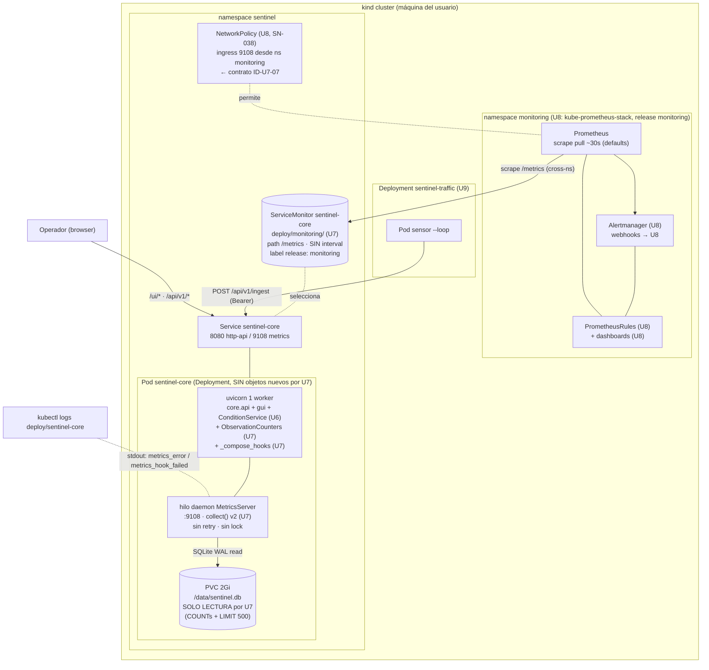

# Deployment Architecture — U7 (Metrics exposure)

**Fase**: CONSTRUCTION — Infrastructure Design
**Fecha**: 2026-11-24
**Estado**: APPROVED (2026-11-24)
**Unidad**: U7 — pipeline `collect()` en proceso + `ServiceMonitor` estático (kind en la máquina del usuario; stack de monitoreo instalado por U8)
**Decisiones**: Q1–Q6 = A (ver `infrastructure-design.md` ID-U7-01..12)

---

## 1. Topología (demo en kind — SM aplicado tras U8)

Nota de flujo: **U7 no añade ningún objeto, puerto, volumen, env ni probe** — solo sustituye el `collect()` dentro del hilo de métricas que ya creó U2, añade contadores en memoria y publica un `ServiceMonitor` standalone que **U8** hará vivo al instalar el stack (SN-031) y al abrir la regla de red (SN-038). Sin la NetworkPolicy del handoff, el scrape cruza el default-deny y el target queda `down` (ID-U7-07).

Texto alternativo: Prometheus (namespace `monitoring`, instalado en U8 con release `monitoring`) selecciona el ServiceMonitor de U7 por el label `release: monitoring`, resuelve el Service `sentinel-core` y hace pull de `:9108/metrics`; el hilo daemon del Pod ejecuta `collect()` — contadores de proceso (api/cycles/flows/arp) + gauges leídos de SQLite en el PVC (solo lectura, `LIMIT 500` por ventana) + heartbeats ligeros + muestras de U6 — y devuelve el render de las 14 familias; el operador no ve cambios en la UI y la ingesta del sensor sigue entrando por 8080 con el hook U6+U7 compositado post-commit.

---

## 2. Secuencia de entrega (orden importa)

| Paso | Cuándo | Qué |
|---|---|---|
| 1 | **U7 Code Gen** | Código + `deploy/monitoring/servicemonitor.yaml` + README «Metrics & monitoring» (aplicación documentada) |
| 2 | **U8** | `helm upgrade --install monitoring … -n monitoring` (SN-031) → `kubectl apply -f deploy/monitoring/servicemonitor.yaml` → NetworkPolicy contrato §3.4 (SN-038) → reglas/dashboards (SN-032..035) |
| 3 | **U11 (Build & Test en kind)** | Verificar `up == 1` y familias presentes en el scrape; si falta el stack, el test structural de U7 (sin YAML parser) ya cubre el manifiesto |

---

## 3. Contrato de red (handoff a U8 — ID-U7-07)

| Tráfico | De → A | Puerto | Estado en U7 |
|---|---|---|---|
| Scrape metrics | pods ns `monitoring` → `sentinel-core` | TCP 9108 | **Declarado, implementado en U8** (SN-038) |
| API/ingesta/UI | sensor/operator → `sentinel-core` | TCP 8080 | Heredado de U2 (U8 define si default-deny lo toca) |
| Egress de U7 | ninguno | — | U7 no hace llamadas salientes |

---

## 4. Señales de fallo en esta topología

| Fallo | Señal visible | Dónde se ve |
|---|---|---|
| `collect()` lanza excepción | HTTP 500 + log `metrics_error` | Prometheus target `down` + `kubectl logs` |
| NetworkPolicy bloquea 9108 (handoff olvidado) | scrape falla en timeout/connection refused | Prometheus `up == 0` — **causa raíz en U8**, no en U7 |
| SM mal etiquetado (otro `release`) | Prometheus no selecciona el SM | `serviceMonitorSelector` del stack — revisar `release: monitoring` (ID-U7-09) |
| Consumidor del hook lanza | log `metrics_hook_failed`; el otro consumidor sigue; `202` intacto | `kubectl logs` |
| Reinicio del Pod | contadores a 0 (counter reset) + gauges reconstruidos desde SQLite | Serie Prometheus con reset aceptado (AVAIL-02) |
