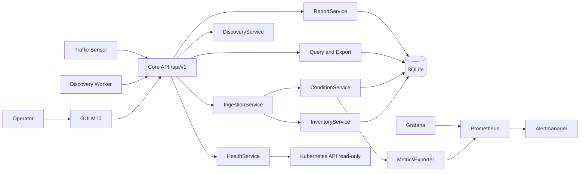

# Application Design — Sentinel (consolidado)

**Fase**: INCEPTION — Application Design
**Fecha**: 2026-11-07
**Estado**: GENERATED — pendiente de aprobación
**Documentos fuente**: `components.md`, `component-methods.md`, `services.md`, `component-dependency.md`
**Entradas**: `requirements.md` (M1–M10), `stories.md` (ST-M1..M10 + EN-01..07), `execution-plan.md`, `implementation-scope.md`, `contexto/arquitectura.md`

---

## 1. Resumen ejecutivo

Sentinel se diseña como un **monolito modular** en el Core (API, ingesta, inventario, condiciones, métricas, reporte y GUI embebida) más dos workloads separados del mismo proyecto/imagen: **Discovery Worker** (CronJob + ejecución manual en proceso) y **Traffic Sensor** (captura con fallback simulado). El Core es el **único escritor de SQLite**; todos los demás componentes se comunican por **HTTP/JSON**. Prometheus hace scraping de `/metrics` y alimenta Alertmanager/Grafana. No hay IA ni actuación sobre los activos.

---

## 2. Diagrama de arquitectura

**Alternativa textual**: el operador usa la GUI; GUI, Discovery Worker y Traffic Sensor llaman a la API del Core. La API delega en ingesta, discovery, consultas/export y reporte. Ingesta usa inventario y condiciones. Inventario, condiciones, consultas y reporte usan SQLite; solo el Core escribe. Condiciones alimenta métricas, que expone `/metrics` a Prometheus; Prometheus alimenta Alertmanager y Grafana. Salud consulta la API de Kubernetes en solo lectura.

---

## 3. Componentes

| ID | Componente | Tipo | Responsabilidad |
|---|---|---|---|
| C1 | Sentinel Core | Deployment | Proceso central y único escritor |
| C2 | API Layer | Módulo | REST/JSON `/api/v1`, `/metrics`, `/ui` |
| C3 | IngestionService | Módulo | Validar, deduplicar, normalizar y persistir |
| C4 | InventoryService | Módulo | Reconciliar inventario y emitir eventos |
| C5 | ConditionService | Módulo | Baseline mínima y condiciones deterministas |
| C6 | MetricsExporter | Módulo | Métricas agregadas para Prometheus |
| C7 | ReportService | Módulo | Reporte Markdown/PDF bajo demanda |
| C8 | Operator GUI | Módulo | Vistas Jinja + HTMX |
| C9 | Discovery Worker | CronJob/Job | Descubrimiento de hosts autorizados |
| C10 | Traffic Sensor | Deployment | Metadatos IP/ARP con fallback |
| C11 | SQLite | PVC | Persistencia |
| C12 | Scope & Config Validator | Compartido | Validar alcance y parámetros |

Detalle completo en `components.md`.

---

## 4. Servicios y orquestación

| Servicio | Flujo principal |
|---|---|
| IngestionService | Lote → deduplicar → normalizar → persistir → reconciliar → condiciones |
| InventoryService | Ciclo → comparar → eventos (`AssetFirstSeen`, `AssetMissing`, `PortServiceChanged`) |
| ConditionService | Ventana → baseline/umbral → condiciones |
| MetricsService | Datos → familias → `/metrics` |
| ReportService | Rango → secciones → Markdown → PDF |
| DiscoveryService | Trigger → validar → lock → ciclo con timeout → estado |
| HealthService | Core + ciclos + heartbeats + K8s API (read-only) |
| GuiService | Consultas y acciones → render HTML |

Detalle completo en `services.md`.

---

## 5. Contratos HTTP principales

| Método | Ruta | Propósito |
|---|---|---|
| POST | `/api/v1/ingest` | Ingesta de observaciones |
| GET | `/api/v1/assets`, `/api/v1/assets/{id}` | Inventario y detalle |
| GET | `/api/v1/events`, `/api/v1/alerts` | Eventos y alertas |
| GET | `/api/v1/health` | Salud del sistema |
| GET | `/api/v1/export` | Exportación CSV/JSON |
| POST | `/api/v1/discovery` | Disparo manual de discovery |
| GET | `/api/v1/discovery/{run_id}` | Estado del discovery |
| GET | `/api/v1/report` | Reporte Markdown/PDF |
| GET | `/metrics` | Exposición Prometheus (9108) |
| GET | `/ui/*` | Vistas de la GUI |

Detalle de entradas/salidas en `component-methods.md`.

---

## 6. Dependencias y comunicación

- **GUI → Core** por HTTP; la GUI nunca toca SQLite.
- **Colectores → Core** por HTTP con reintentos/backoff; nunca escriben SQLite.
- **Core → SQLite** como único escritor (transacciones).
- **Prometheus → Core** pull de `/metrics`; sin push.
- **Core → Kubernetes API** solo lectura para salud.
- Sin broker, sin cola, sin microservicios.

Matriz completa en `component-dependency.md`.

---

## 7. Decisiones de diseño y justificación

| # | Decisión | Justificación |
|---|---|---|
| 1 | Monolito modular + colectores separados | Coherente con SQLite de un escritor y el plazo de la sustentación |
| 2 | Discovery manual en proceso, acotado por timeout | Evita ampliar RBAC (`create jobs`); un solo ciclo a la vez |
| 3 | GUI embebida | Menos piezas, despliegue y demo simples |
| 4 | REST/JSON `/api/v1` + OpenAPI | Contrato claro y verificable |
| 5 | Sin auth; solo `port-forward` | Alcance de la demo; auth documentada como trabajo futuro |
| 6 | Reporte síncrono bajo demanda | Simple y determinista para la demo |
| 7 | HTTP + reintentos; sin broker | Menor complejidad operativa |
| 8 | Firmas de alto nivel | Reglas finas en Functional Design |

---

## 8. Trazabilidad con requisitos e historias

| Módulo | Requisitos | Historias | Componentes |
|---|---|---|---|
| M1 Inventario | FR-INV-01..05 | ST-M1-01..05 | C1, C2, C3, C4, C11, C12 |
| M2 Observabilidad SNMP | FR-SNMP-01..03 | ST-M2-01..03 | C1, C3, C4, C11 |
| M3 Sensor de tráfico | FR-SENS-01..03 | ST-M3-01..03 | C10, C3, C11 |
| M4 Comportamiento anómalo | FR-DET-01..02 | ST-M4-01..02 | C5, C1 |
| M5 Anti-falsos positivos | FR-DET-03..06 | ST-M5-01..04 | C5, C11 |
| M6 Reporte de red | FR-REP-01..04 | ST-M6-01..04 | C7, C2, C8 |
| M7 Explicabilidad/auditoría | FR-EXP-01..02 | ST-M7-01..02 | C1, C4, C7 |
| M8 Integración | FR-INT-01..05 | ST-M8-01..05 | C2, C6, C1 |
| M9 Health/AI-assist | FR-EN-01..03 | EN-01..07 | C1, C2, C6 |
| M10 GUI + reporte | FR-GUI-01..08, FR-DISC-06 | ST-M10-01..07 | C8, C9, C7, C12 |

---

## 9. Pendientes para fases posteriores

- **Functional Design**: reglas finas de reconciliación, baseline, supresión, esquema SQLite, contratos Pydantic.
- **NFR Design**: perfiles, timeouts, límites de lote, cardinalidad, fallback determinista.
- **Infrastructure Design**: Helm, RBAC, NetworkPolicy, PVC, ServiceMonitor, dashboards.
- **Build & Test**: tests de contrato, integración y verificación de la demo.

---

## 10. Fuera de alcance

Autenticación de operador, IA/LLM/agente, captura profunda de paquetes, multi-sensor, Loki, GitOps, panel de topología y cualquier actuación sobre activos.
