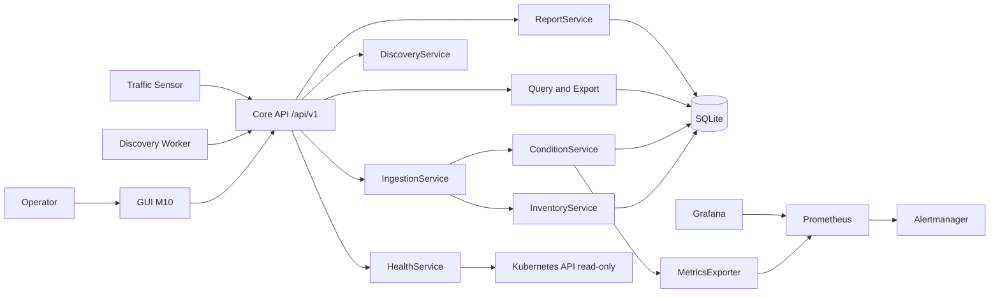

# Component Dependency — Sentinel

**Fase**: INCEPTION — Application Design
**Fecha**: 2026-11-07
**Estado**: GENERATED — pendiente de aprobación
**Patrón de comunicación**: HTTP síncrono + reintentos; sin broker (Q7=A). Core como único escritor de SQLite.

---

## 1. Diagrama de dependencias



**Alternativa textual**: el operador usa la GUI; la GUI llama a la API del Core. Discovery Worker y Traffic Sensor también llaman a la API del Core por HTTP. La API delega en IngestionService, DiscoveryService, consultas/export y ReportService. IngestionService usa InventoryService y ConditionService. Inventory, Conditions, consultas y Report leen/escriben SQLite (único escritor: el Core). ConditionService alimenta MetricsExporter, que expone `/metrics` a Prometheus; Prometheus alimenta Alertmanager y Grafana. HealthService consulta la API de Kubernetes en solo lectura.

---

## 2. Matriz de dependencias

| Origen \ Destino | Core API | Ingestion | Inventory | Conditions | Metrics | Report | GUI | Discovery | Sensor | SQLite | Prometheus | K8s API |
|---|---|---|---|---|---|---|---|---|---|---|---|---|
| GUI M10 | Sí | — | — | — | — | — | — | — | — | No | — | — |
| Discovery Worker | Sí | — | — | — | — | — | — | — | — | No | — | — |
| Traffic Sensor | Sí | — | — | — | — | — | — | — | — | No | — | — |
| Core API | — | Sí | — | — | — | Sí | Sí | Sí | — | — | — | — |
| IngestionService | — | — | Sí | Sí | — | — | — | — | — | Sí | — | — |
| InventoryService | — | — | — | — | — | — | — | — | — | Sí | — | — |
| ConditionService | — | — | — | — | Sí | — | — | — | — | Sí | — | — |
| MetricsExporter | — | — | — | — | — | — | — | — | — | — | Sí | — |
| ReportService | — | — | — | — | — | — | — | — | — | Sí | — | — |
| HealthService | — | — | — | — | — | — | — | — | — | Sí | — | Sí |
| Prometheus | — | — | — | — | — | — | — | — | — | — | — | — |
| Alertmanager | — | — | — | — | — | — | — | — | — | — | — | — |
| Grafana | — | — | — | — | — | — | — | — | — | — | Sí | — |

**Reglas derivadas**
- La GUI **no** accede a SQLite ni ejecuta sondeos; todo pasa por la API.
- Los colectores **no** escriben SQLite; solo envían lotes al Core.
- Solo el Core escribe en SQLite (evita bloqueos y corrupción).
- Prometheus **pull** sobre `/metrics`; nunca el Core hace push.
- Kubernetes API es **solo lectura**; el Core no crea ni modifica recursos.

---

## 3. Patrones de comunicación

| Enlace | Protocolo | Dirección | Resiliencia |
|---|---|---|---|
| GUI → Core | HTTP/1.1 REST/JSON | request/response | Reintento de UI; errores visibles |
| Discovery → Core | HTTP/1.1 REST/JSON | request/response | Reintentos con backoff simple |
| Sensor → Core | HTTP/1.1 REST/JSON | request/response | Reintentos con backoff simple |
| Core → SQLite | SQL local (archivo) | lectura/escritura | Transacciones; un solo escritor |
| Prometheus → Core | HTTP scrape `/metrics` | pull | Intervalo y timeout de scrape |
| Prometheus → Alertmanager | HTTP | push de alertas | Configuración estándar de Prometheus |
| Grafana → Prometheus | HTTP | query | Configuración estándar de Grafana |
| Core → K8s API | HTTPS | read-only | Degradación a `salud desconocida` |

---

## 4. Flujo de datos de extremo a extremo

```text
[Discovery Worker / Traffic Sensor]
        |  POST /api/v1/ingest (lote)
        v
[Core API] -> [IngestionService] -> validar/deduplicar/normalizar
        |                                   |
        |                                   +-> [InventoryService] -> eventos
        |                                   +-> [ConditionService] -> condiciones
        v
[SQLite] <---------------- solo Core escribe ----------------+
        |
        +-> [Query/Export] -> GUI / CSV / JSON
        +-> [ReportService] -> Markdown / PDF
        +-> [MetricsExporter] -> /metrics -> Prometheus -> Alertmanager / Grafana
```

---

## 5. Dependencias externas y modos de fallo

| Dependencia | Si falla | Comportamiento esperado |
|---|---|---|
| SQLite/PVC | Core no puede persistir | Error `503`; no se simula éxito |
| Prometheus | No hay dashboards/alertas externas | La GUI sigue mostrando inventario y salud local |
| Alertmanager | Alertas no enrutadas | Prometheus mantiene el estado; se documenta |
| Kubernetes API | Salud de workloads desconocida | Mostrar `salud desconocida`, no inventar estado |
| Core | Colectores no entregan | Reintentos con backoff; sin pérdida del lote |
| Sensor | Sin heartbeat | Mostrar `sensor caído`; no reportar "red sin activos" |

---

## 6. Restricciones de despliegue derivadas

- Core: `Deployment` con Service `ClusterIP` (8080 app/UI, 9108 métricas).
- Discovery: `CronJob` (programado) y ejecución manual en proceso del Core.
- Sensor: `Deployment` con `hostNetwork`/feed de laboratorio y capabilities acotadas (NFR Design).
- SQLite: `PVC` con `ReadWriteOnce`; réplicas del Core = 1.
- Sin `LoadBalancer`/`NodePort` para la GUI; acceso solo por `kubectl port-forward`.
