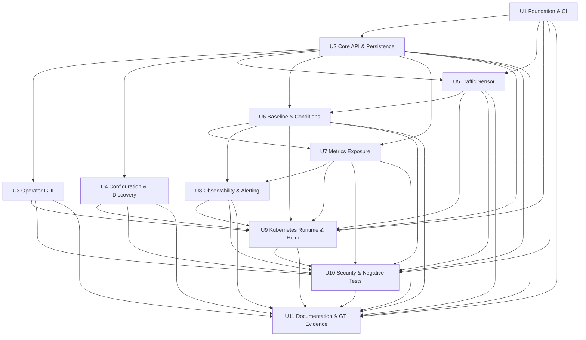

# Unit of Work — Dependency Matrix — Sentinel

**Fase**: INCEPTION — Units Generation (Parte 2: Generation)
**Fecha**: 2026-11-11
**Estado**: GENERATED — pendiente de aprobación
**Entradas**: `unit-of-work.md`, `plans/unit-of-work-plan.md` (Q5=A: dependency-first con GUI ∥ Discovery), `execution-plan.md` §4.

---

## 1. Grafo de dependencias

La flecha `A --> B` indica que B requiere las salidas/contratos de A.

Once unidades y 48 dependencias directas. No implica que cada unidad sea un proceso o servicio independiente.

---

## 2. Matriz de dependencias

| Unidad | Depende directamente de | Puede avanzar en paralelo con |
|---|---|---|
| U1 | — | — |
| U2 | U1 | — |
| U3 | U2 | U4 (tras cerrar U2) |
| U4 | U2 | U3 (tras cerrar U2) |
| U5 | U1, U2 | U3/U4 (dependencias satisfechas tras U1+U2; ver §3) |
| U6 | U2, U5 | — (secuencial tras U5) |
| U7 | U2, U6 | — |
| U8 | U6, U7 | — |
| U9 | U1–U8 | — |
| U10 | U1–U9 | — |
| U11 | U1–U10 | — (cierre) |

---

## 3. Orden de ejecución (dependency-first — Q5=A)

| Fase | Unidades | Resultado de salida | Condición para avanzar |
|---|---|---|---|
| F1 — Fundación | U1 → U2 (secuencial) | repo, imagen base, CI y Core API con SQLite operativo | Core responde `/api/v1` y `/metrics` con fixtures |
| F2 — Visualización y descubrimiento | **U3 ∥ U4** (paralelo aprobado); U5 inicia cuando haya capacidad (deps satisfechas al cerrar F1) | GUI sobre API real; discovery con fixtures; sensor con simulador | U3 y U4 cerradas; U5 cerrada |
| F3 — Condiciones | U6 | indicadores de condición y umbral mínimo para R-01 | tests de umbral/sin línea base en verde |
| F4 — Métricas y alertas | U7 → U8 | `/metrics` + ServiceMonitor; reglas R-01/R-04 y Grafana | `promtool check rules` pasa; dashboard validado |
| F5 — Runtime | U9 | chart Helm desplegado en kind/k3s con todos los workloads | `helm lint` + rollout status OK |
| F6 — Seguridad | U10 | RBAC, Pod Security, prueba de no-escritura | tests negativos en verde |
| F7 — Evidencia | U11 + **Build & Test único (Q7=A)** | docs, suite GT-01..GT-05, pipeline completo sobre unidades implementadas | suite GT pasa (fixtures cuando no hay captura real) |

**Notas de coordinación**:
- El paralelismo aprobado es **U3 (GUI) ∥ U4 (Discovery)** tras cerrar U2; U5 (Sensor) es dependency-ready al mismo tiempo pero se enmarca en F2 según capacidad.
- Cada unidad completa su cadena (functional design → NFR → código/tests) antes de declararse cerrada; no se salta fases.
- Build & Test se ejecuta **una sola vez al final** (F7), sobre las unidades implementadas; las pruebas unitarias corren dentro de cada unidad.
- U9–U11 son acumulativas: dependen del conjunto, no de una sola unidad.

---

## 4. Puntos de integración

| ID | Entre | Contrato | Verificación |
|---|---|---|---|
| IP1 | U1 → todas | modelos tipados (`Asset`, `Observation`, `DiscoveryCycle`, `TrafficWindow`, `ArpObservation`, `InventoryEvent`, `AlertCondition`), config validada, logger JSON, contrato de métricas | tests unitarios sin red/clúster |
| IP2 | U4, U5 → U2 | POST de observaciones por HTTP interno al ClusterIP Core:8080 con token de Secret; reintentos e idempotencia | tests de ingesta con fixtures |
| IP3 | U2 → U3 | API REST/JSON `/api/v1` (assets, events, alerts, health, report, trigger discovery) | tests de la GUI contra API con fixtures |
| IP4 | U1/U2 → U4 | scope `explicit_hosts` validado (C12) antes de sondear | tests de validación de alcance |
| IP5 | U5 → U6 | series/agregados (bytes/s, mensajes ARP) y heartbeats disponibles para condición | fixtures parametrizados bajo/igual/encima |
| IP6 | U6 → U7 | indicadores de condición publicados vía `MetricsExporter` (C6) | `/metrics` contiene el indicador esperado |
| IP7 | U7 → U8 | métricas scrapeables + ServiceMonitor; reglas PrometheusRule sobre esas métricas | `promtool check rules` |
| IP8 | U9 → todas | chart que empaqueta workloads de U2/U4/U5, PVC, Services, probes; entrypoints por módulo de la imagen única | despliegue kind/k3s + rollout |
| IP9 | U10 → U9+ | RBAC, Pod Security y capabilities limitadas aplicadas a los workloads; política mínima de red | `kubectl auth can-i` + prueba de no-escritura |
| IP10 | U11 → todas | fixtures y suite GT-01..GT-05 sobre el stack desplegado; docs con comandos literales | `pytest tests/integration/test_gt_01_05.py -v` |

---

## 5. Approval Gate

**Estado**: GENERATED — pendiente de aprobación. Ver `unit-of-work.md` (§5) para el gate conjunto de Units Generation.
