# Execution Plan — Sentinel

**Fase**: INCEPTION — Workflow Planning
**Fecha**: 2026-11-07
**Entradas**: `entradas/prd.md` (v3.0), `entradas/pvb.md`, `aidlc-docs/inception/requirements/requirements.md`, `aidlc-docs/inception/user-stories/stories.md`, `aidlc-docs/inception/user-stories/personas.md`
**Scope Lock**: Producto determinista, sin IA/LLM/agente/orquestación. El alcance se mantiene en todos los stages de este plan.

---

## 1. Detailed Analysis Summary

### 1.1 Transformation Scope

- **Project Type**: Greenfield (no hay código; solo documentación de inception).
- **Transformation Type**: N/A. Se construye el sistema completo desde cero.
- **Primary Changes**: Implementar Sentinel sobre Kubernetes con los módulos M1–M10: configuración y alcance (incluye `explicit_hosts`), descubrimiento, sensor de tráfico/ARP, Core con inventario y persistencia, condiciones deterministas y baselines, exposición de métricas, observabilidad/alertas, runtime Kubernetes, seguridad y GUI de operador con reporte de red.
- **Related Components**: Core API, Discovery Job, Traffic Sensor, Baseline Engine, Metrics Projector, Export/Evidence, Report Generator, Operator GUI (M10), Helm chart, PrometheusRule/Alertmanager/Grafana, RBAC/NetworkPolicy.
- **Reuse**: `kube-prometheus-stack` como stack de observabilidad externo; SQLite como persistencia; Nmap/Scapy/FastAPI como librerías.

### 1.2 Change Impact Assessment

| Área | Impacto | Descripción |
|---|---|---|
| User-facing changes | Yes | Inventario, dashboards, alertas y exportaciones para PER-OPR. |
| Structural changes | Yes | Nuevos servicios Core/Sensor/Discovery y chart Helm. |
| Data model changes | Yes | Esquema SQLite para activos, observaciones, eventos, alertas y baselines. |
| API changes | Yes | Ingesta, consulta, exportación CSV/JSON y `/metrics`. |
| NFR impact | Yes | Seguridad (RBAC, NetworkPolicy, capabilities), rendimiento, observabilidad y CI. |

### 1.3 Component Relationships (Greenfield baseline)

- **Core** es el nodo central: recibe observaciones, normaliza, persiste, calcula baselines/condiciones y exporta.
- **Discovery** depende de configuración/alcance y del Core para ingestar observaciones.
- **Traffic Sensor** depende de la visibilidad de red (SPAN/mirror) y del Core para ingestar agregados.
- **Metrics/Alerting** depende de las condiciones publicadas por Core y de `kube-prometheus-stack`.
- **GUI (M10)** depende del Core API; solo lee/escribe a través de la API y nunca accede a SQLite directamente. Genera el reporte de red a partir de datos persistidos.
- **Security/Runtime** es transversal: RBAC, NetworkPolicy, Pod Security, Helm y PVC aplican a todos los componentes.

### 1.4 Risk Assessment

- **Risk Level**: High.
- **Rollback Complexity**: Easy (greenfield; no hay producción previa), pero alto coste de rediseño si falla la visibilidad de red.
- **Testing Complexity**: Complex (red real, captura de paquetes, reglas temporales, Kubernetes y CI).
- **Key Risks**:
  1. No obtener visibilidad LAN (bridge/SPAN) — mitigado con POC temprano de captura.
  2. Privilegios del sensor — mitigado con capabilities mínimas y prueba negativa.
  3. Cardinalidad de métricas — mitigado sin labels `src_ip`/`dst_ip`.
  4. Ruido de alertas — mitigado con baseline, `for` configurable y supresión.
  5. Falsos ausentes por ciclos parciales — mitigado con ST-M2-04/ST-M2-06.

---

## 2. Workflow Visualization

```mermaid
flowchart TD
    Start(["User Request: Sentinel"])

    subgraph INCEPTION["INCEPTION PHASE"]
        WD["Workspace Detection<br/><b>COMPLETED</b>"]
        RE["Reverse Engineering<br/><b>SKIPPED</b>"]
        RA["Requirements Analysis<br/><b>COMPLETED</b>"]
        US["User Stories<br/><b>COMPLETED</b>"]
        WP["Workflow Planning<br/><b>COMPLETED</b>"]
        AD["Application Design<br/><b>EXECUTE</b>"]
        UG["Units Generation<br/><b>EXECUTE</b>"]
    end

    subgraph CONSTRUCTION["CONSTRUCTION PHASE"]
        FD["Functional Design<br/><b>EXECUTE per unit</b>"]
        NFRR["NFR Requirements<br/><b>EXECUTE per unit</b>"]
        NFRD["NFR Design<br/><b>EXECUTE per unit</b>"]
        ID["Infrastructure Design<br/><b>EXECUTE per unit</b>"]
        CG["Code Generation<br/><b>EXECUTE per unit</b>"]
        BT["Build and Test<br/><b>EXECUTE</b>"]
    end

    subgraph OPERATIONS["OPERATIONS PHASE"]
        OPS["Operations<br/><b>PLACEHOLDER</b>"]
    end

    Start --> WD
    WD --> RE
    RE --> RA
    RA --> US
    US --> WP
    WP --> AD
    AD --> UG
    UG --> FD
    FD --> NFRR
    NFRR --> NFRD
    NFRD --> ID
    ID --> CG
    CG --> BT
    BT --> OPS
    OPS --> End(["Complete"])

    style Start fill:#CE93D8,stroke:#6A1B9A,stroke-width:3px,color:#000
    style End fill:#CE93D8,stroke:#6A1B9A,stroke-width:3px,color:#000
    style WD fill:#4CAF50,stroke:#1B5E20,stroke-width:3px,color:#fff
    style RE fill:#BDBDBD,stroke:#424242,stroke-width:2px,stroke-dasharray: 5 5,color:#000
    style RA fill:#4CAF50,stroke:#1B5E20,stroke-width:3px,color:#fff
    style US fill:#4CAF50,stroke:#1B5E20,stroke-width:3px,color:#fff
    style WP fill:#4CAF50,stroke:#1B5E20,stroke-width:3px,color:#fff
    style AD fill:#FFA726,stroke:#E65100,stroke-width:3px,stroke-dasharray: 5 5,color:#000
    style UG fill:#FFA726,stroke:#E65100,stroke-width:3px,stroke-dasharray: 5 5,color:#000
    style FD fill:#FFA726,stroke:#E65100,stroke-width:3px,stroke-dasharray: 5 5,color:#000
    style NFRR fill:#FFA726,stroke:#E65100,stroke-width:3px,stroke-dasharray: 5 5,color:#000
    style NFRD fill:#FFA726,stroke:#E65100,stroke-width:3px,stroke-dasharray: 5 5,color:#000
    style ID fill:#FFA726,stroke:#E65100,stroke-width:3px,stroke-dasharray: 5 5,color:#000
    style CG fill:#4CAF50,stroke:#1B5E20,stroke-width:3px,color:#fff
    style BT fill:#4CAF50,stroke:#1B5E20,stroke-width:3px,color:#fff
    style OPS fill:#BDBDBD,stroke:#424242,stroke-width:2px,stroke-dasharray: 5 5,color:#000
    style INCEPTION fill:#BBDEFB,stroke:#1565C0,stroke-width:2px,color:#000
    style CONSTRUCTION fill:#C8E6C9,stroke:#2E7D32,stroke-width:2px,color:#000
    style OPERATIONS fill:#FFF59D,stroke:#F9A825,stroke-width:2px,color:#000
    linkStyle default stroke:#333,stroke-width:2px
```



### Text Alternative (workflow)

```text
INCEPTION
- Workspace Detection: COMPLETED
- Reverse Engineering: SKIPPED (greenfield)
- Requirements Analysis: COMPLETED
- User Stories: COMPLETED
- Workflow Planning: COMPLETED
- Application Design: EXECUTE
- Units Generation: EXECUTE

CONSTRUCTION (per unit)
- Functional Design: EXECUTE (when data models/business logic exist)
- NFR Requirements: EXECUTE (when NFR impact exists)
- NFR Design: EXECUTE (when NFR Requirements runs)
- Infrastructure Design: EXECUTE (Kubernetes/Helm)
- Code Generation: EXECUTE (always)
- Build and Test: EXECUTE (always, after all units)

OPERATIONS
- Placeholder
```

---

## 3. Phases to Execute

### INCEPTION PHASE

- [x] Workspace Detection — COMPLETED
- [x] Reverse Engineering — SKIPPED (greenfield)
- [x] Requirements Analysis — COMPLETED
- [x] User Stories — COMPLETED
- [x] Workflow Planning — COMPLETED (este documento)
- [ ] Application Design — **EXECUTE**
  - **Rationale**: Sistema nuevo con múltiples componentes, contratos de API, modelos de datos y dependencias entre Core, Sensor, Discovery, Baseline y observabilidad. Se requiere diseño detallado (comprehensive).
- [ ] Units Generation — **EXECUTE**
  - **Rationale**: Nueve módulos funcionales, nuevos modelos/esquema, APIs, algoritmos estadísticos y despliegue multi-paquete. Se requiere descomposición en unidades de trabajo (comprehensive).

### CONSTRUCTION PHASE

- [ ] Functional Design — **EXECUTE (per unit, condicional)**
  - **Rationale**: Core, baseline, reconciliación de inventario y agregación tienen lógica de negocio y modelos de datos que requieren diseño funcional. Unidades puramente de infraestructura pueden saltarlo.
- [ ] NFR Requirements — **EXECUTE (per unit con impacto NFR)**
  - **Rationale**: Existen NFR de seguridad, rendimiento, disponibilidad y observabilidad que requieren asignación explícita.
- [ ] NFR Design — **EXECUTE (per unit cuando NFR Requirements ejecuta)**
  - **Rationale**: Los NFR deben traducirse a patrones concretos (rbac, networkpolicy, cardinalidad, baseline, health checks).
- [ ] Infrastructure Design — **EXECUTE (per unit/sistema)**
  - **Rationale**: Arquitectura de despliegue en Kubernetes: Helm, PVC, ServiceMonitor, NetworkPolicy, capabilities y stack de observabilidad.
- [ ] Code Generation — **EXECUTE (ALWAYS, per unit)**
  - **Rationale**: Implementación de cada unidad y sus pruebas.
- [ ] Build and Test — **EXECUTE (ALWAYS)**
  - **Rationale**: Build, pruebas unitarias, integración GT-01..GT-05, seguridad y despliegue en kind/k3s.

### OPERATIONS PHASE

- [ ] Operations — **PLACEHOLDER**
  - **Rationale**: Etapa futura de despliegue y monitoreo operativo; fuera del alcance de este workflow.

---

## 4. Recommended Unit Sequence

> La numeración definitiva y los límites exactos se fijan en **Units Generation**. Esta secuencia es una recomendación basada en dependencias.

| Orden | Unidad candidata | Módulos | Depende de | Rationale |
|---|---|---|---|---|
| 1 | Project foundation & CI skeleton | Enablers EN-01/EN-05 | — | Layout del repo, imagen OCI común, pipeline base y convenciones. Habilita todo lo demás. |
| 2 | Core API, persistence & export | M4 | Foundation | Ingesta, consulta, exportación, SQLite/PVC y UUID estable; base de todos los flujos de datos. |
| 3 | Operator GUI & network report | M10 | Core | Inventario, detalle, eventos/alertas, salud, disparo de discovery y reporte MD/PDF sobre la API del Core. |
| 4 | Configuration, scope & Discovery | M1, M2 | Core | Valores Helm, modos `cidr`/`explicit_hosts`, validación de alcance, ARP/ICMP/TCP/Nmap y reconciliación. |
| 5 | Traffic Sensor & ARP observation | M3 | Core, Foundation | Captura/agregación y envío al Core; incluye POC de visibilidad SPAN/mirror con fallback simulado. |
| 6 | Baseline & deterministic conditions | M5 | Core, Sensor | Estadísticos, umbral, supresión e indicadores de condición. |
| 7 | Metrics exposure | M6 | Core, Baseline | `/metrics` en 9108, ServiceMonitor y control de cardinalidad. |
| 8 | Observability & alerting | M7 | Metrics, Baseline | PrometheusRule R-01..R-04, Grafana y Alertmanager. |
| 9 | Kubernetes runtime & Helm | M8 | Unidades 1–8 | Consolidación de CronJobs/Deployments/Services/PVC y despliegue en kind/k3s. |
| 10 | Security & negative tests | M9 | Unidades 1–9 | RBAC, NetworkPolicy, Pod Security y prueba de no escritura. |
| 11 | Documentation & GT evidence | Enablers EN-03/EN-06 | Unidades 1–10 | Runbooks, documentación, fixtures y suite ground truth GT-01..GT-05. |

**Nota de coordinación**: aunque la secuencia es dependency-first, el bucle de construcción completa cada unidad (diseño + código + pruebas) antes de pasar a la siguiente. Las unidades 3 (GUI) y 4 (Discovery) pueden ejecutarse en paralelo tras cerrar Core. `Build and Test` se ejecuta una sola vez al final, sobre las unidades implementadas.

---

## 5. Implementation Scope (Sustentación vs Documentado)

> El alcance completo del producto (M1–M10) queda documentado en `requirements.md`, `stories.md` y este plan. El corte de lo que se implementa para la sustentación se registra en `aidlc-docs/inception/application-design/implementation-scope.md`. Clasificación:

| Nivel | Significado | Unidades |
|---|---|---|
| **Implementado (demo)** | Se construye, se prueba y se demuestra en la sustentación | Foundation, Core, GUI, Configuration/Discovery (`explicit_hosts`), Metrics/Alerting mínimo, Helm/Grafana, Security mínimo, docs/GT |
| **Documentado** | Se diseña y documenta; no se codifica en el plazo | Traffic Sensor real (M3) con fallback simulado, Baseline completo (M5), SNMP, NetworkPolicy avanzada, reporte PDF avanzado |
| **Fuera de alcance** | Solo se menciona como trabajo futuro | Multi-sensor, Loki, GitOps/Argo CD, panel de topología, HA, canal externo de alertas |

**Regla de demo**: la sustentación nunca depende de una condición de red no reproducible; los casos GT usan fixtures cuando la captura real no está disponible.

## 6. Estimated Timeline

- **Total de stages en INCEPTION**: 7 (5 completados/skipped, 2 por ejecutar).
- **Unidades candidatas**: 11 (incluye foundation, GUI y documentación/GT).
- **Por unidad**: hasta 5 stages de construcción (Functional Design, NFR Requirements, NFR Design, Infrastructure Design, Code Generation).
- **Cierre**: 1 stage de Build and Test.
- **Duración calendario**: no estimada; depende de la velocidad del equipo y del resultado del POC de visibilidad de red. El plan prioriza reducir ese riesgo desde la unidad 5 (Traffic Sensor), después de asegurar Core y GUI.

---

## 7. Success Criteria

- **Primary Goal**: Entregar Sentinel desplegable en Kubernetes que descubra activos, registre inventario y telemetría, emita alertas deterministas, presente un reporte de red en una GUI de operador y exporte evidencia, sin IA y sin modificar endpoints.
- **Key Deliverables**:
  - Helm chart desplegable en kind/k3s.
  - Core API + SQLite/PVC + exportación CSV/JSON.
  - Discovery Job funcional con modo `explicit_hosts` y reconciliación de inventario.
  - GUI M10 (inventario, detalle, eventos/alertas, salud, disparo de discovery y reporte MD/PDF).
  - Traffic Sensor con captura de metadatos y ARP (con fallback simulado para la demo).
  - Baseline y reglas R-01..R-04 en Prometheus/Alertmanager (subconjunto demostrable).
  - `/metrics` en 9108 y dashboards Grafana.
  - RBAC, NetworkPolicy, Pod Security y prueba de no escritura.
  - CI con lint, tests, build, escaneo, helm test y despliegue.
- **Quality Gates**:
  - GT-01..GT-05 pasan con fixtures; los casos con red real se marcan como evidencia de laboratorio.
  - PBT de Nmap XML, normalización y baseline pasan.
  - Scope lock verificado (sin IA/LLM/agente).
  - Cero escrituras remotas en la prueba negativa.
  - `helm lint` y `helm template` sin error.
  - GUI no expuesta públicamente (solo `port-forward`); autenticación de operador fuera de alcance de la demo.

---

## 8. Approval Gate

**Estado**: APPROVED — re-aprobado por defecto (2026-11-07T16:25:32Z).

**Change log**:
- 2026-11-07T16:25:32Z: Added unit 3 (Operator GUI & network report, M10), `explicit_hosts` scope mode, implementation scope tiers (section 5), sensor fallback, and revised success criteria. Re-approved by default per user instruction; recorded in `audit.md`.

El usuario puede solicitar cambios o forzar la inclusión/exclusión de stages. Se avanza a **Application Design** con el alcance actualizado.
