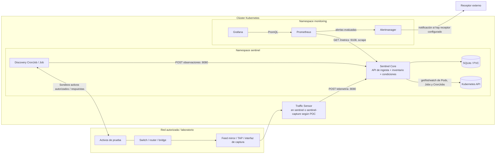
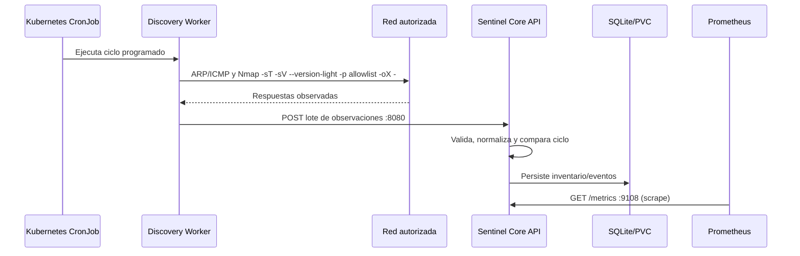
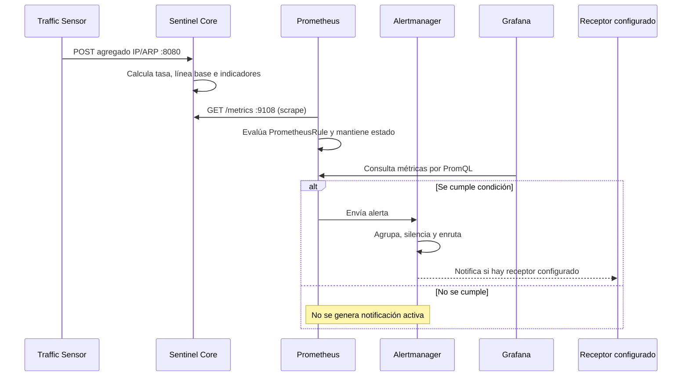

# Arquitectura técnica — Sentinel

**Versión:** 3.0  
**Fecha:** 2026-11-05  
**Estado:** arquitectura propuesta; el acceso a la red externa y los permisos de captura requieren POC.

## 1. Objetivo y restricciones

La arquitectura despliega en Kubernetes un sistema que descubre activos, recibe metadatos de tráfico, mantiene inventario/eventos y expone métricas y alertas deterministas.

Restricciones principales:

- Kubernetes es el plano de ejecución y programación de los componentes de Sentinel.
- Sentinel no administra ni modifica los endpoints observados.
- La recolección se limita a segmentos, rangos, puertos y horarios autorizados.
- No se persisten payloads completos en el MVP.
- El número de workloads y servicios se mantiene reducido.
- Discovery Worker y Traffic Sensor entregan sus observaciones al Core; no escriben directamente en la base de datos.
- Sentinel Core es el único escritor de SQLite y consulta la API Kubernetes solo en modo lectura.

## 2. Arquitectura lógica



**Límite de visibilidad:** la conexión desde `MIR` al sensor es una fuente de captura que debe configurarse; no aparece automáticamente por ejecutar un Pod. El namespace `sentinel-capture` solo se crea si el POC demuestra que uno o ambos colectores necesitan `CAP_NET_RAW` explícitamente. La necesidad de esa capability y la política de admisión excepcional se validan por separado; no se relaja el namespace `sentinel`.

## 3. Componentes y responsabilidades

| Componente | Tipo Kubernetes | Responsabilidad | Acceso y permisos |
|---|---|---|---|
| Sentinel Core | Deployment, 1 réplica en MVP, estrategia `Recreate` | API interna de ingesta/consulta, validación/normalización, comparación de inventario, persistencia, cálculo de condiciones de dominio y endpoint `/metrics` | SQLite/PVC; Secret de ingesta; RBAC `get/list/watch` limitado a Pods/Jobs/CronJobs en namespaces Sentinel que utilice |
| Discovery Worker | CronJob + Job | Ejecutar descubrimiento ARP/ICMP/TCP/Nmap limitado a rangos/puertos autorizados y remitir observaciones al Core | Misma imagen OCI común de Sentinel; acceso de red de sondeo; token de ingesta; sin token de API Kubernetes |
| Traffic Sensor | Deployment, inicialmente una réplica | Recibir feed de captura, extraer metadatos IP/ARP, agregar bytes/s y mensajes ARP/s, remitir lotes al Core | Misma imagen OCI común de Sentinel; acceso a feed/interfaz y token de ingesta; sin token de API Kubernetes |
| Sentinel Core Service | Un Service ClusterIP con dos puertos nombrados | Exponer API interna, health checks y métricas | `api:8080` y `metrics:9108` (`/metrics`) |
| SQLite | Archivo sobre PVC | Inventario actual, observaciones, historial y eventos | Un solo escritor: Sentinel Core |
| Prometheus | StatefulSet gestionado por Operator | Scraping, series temporales y evaluación de reglas de alerta declarativas (`PrometheusRule`) | Scrape del ServiceMonitor de Sentinel |
| Alertmanager | Dependencia del chart | Agrupar, deduplicar, silenciar y enrutar alertas | Receptor externo configurable; no asumir canal por defecto |
| Grafana | Dependencia del chart | Dashboards y consulta/visualización | Acceso de operador; datasource Prometheus; datasource Alertmanager opcional |

## 4. Contratos de comunicación internos

### 4.1 Discovery Worker → Core

- Método/ruta propuesta: `POST /internal/v1/discovery-observations`.
- Contenido: lote de observaciones normalizadas, ciclo, rango autorizado, método, hora, estado de cobertura y errores parciales.
- El Core valida el lote y actualiza inventario/eventos. La ausencia de activos solo se evalúa si el ciclo está marcado como completo y exitoso para el alcance configurado.

### 4.2 Traffic Sensor → Core

- Método/ruta propuesta: `POST /internal/v1/traffic-observations`.
- Contenido: ventana, interfaz, protocolo, bytes/s, direcciones IP cuando existan, campos ARP, hora y estado del sensor.
- El Core actualiza la persistencia, calcula indicadores de condición y publica métricas.

### 4.3 Autenticación y resiliencia

- El envío utiliza credenciales de ingesta separadas por colector, guardadas en Secrets de Kubernetes e inyectadas solo en Core y en el colector correspondiente (`sentinel-discovery-token` y `sentinel-sensor-token` como nombres propuestos).
- Si un colector se mueve a `sentinel-capture`, su Secret debe crearse también allí, porque los Secrets tienen alcance de namespace; ambos valores se gestionan desde la misma fuente segura, sin duplicarlos en texto plano en Git.
- El token nunca se guarda en la imagen, ConfigMap ni logs.
- El Core responde con código de aceptación/rechazo y un identificador de lote para facilitar idempotencia.
- **TBD:** esquema final, tamaño máximo de lote, timeout, reintentos, deduplicación e idempotency key.
- Los colectores no montan credenciales del API server (`automountServiceAccountToken: false`).

## 5. Componentes dentro y fuera del clúster

### Dentro

- Sentinel Core, Discovery CronJob/Job, Traffic Sensor si la interfaz/feed puede adjuntarse al Pod, API interna, Services y PVC. Los tres workloads reutilizan una imagen OCI de Sentinel y se ejecutan con comandos, ServiceAccounts y `securityContext` separados.
- Prometheus, Grafana y Alertmanager mediante `kube-prometheus-stack`.

### Fuera

- Activos observados y switches/routers.
- Segmento de captura, bridge, mirror/SPAN o TAP.
- Hipervisor/VMs/emuladores de la topología de laboratorio.
- Generador externo de tráfico de prueba y de la actividad ARP controlada.

La topología de captura no se confunde con la red overlay del clúster. Si la captura solo puede realizarse desde el host/nodo, debe documentarse esa frontera y el permiso requerido.

## 6. Acceso a la red de activos

### 6.1 Descubrimiento

Discovery Worker utiliza ARP cuando opera en el mismo dominio de broadcast y sondeos IP/TCP acotados cuando existe ruta de red. La modalidad TCP usa Nmap `-sT -sV --version-light -oX -`, limitada a CIDR y puertos configurados. `-sV` envía sondas de aplicación a puertos TCP abiertos; no es una lectura pasiva y debe estar autorizada dentro de la allowlist. Los servicios identificados por respuesta guardan método; las correspondencias deducidas solo por número de puerto se marcan como probables; sin evidencia suficiente se registra `desconocido`. La detección de SO por `-O` queda deshabilitada hasta validar la necesidad de privilegios para paquetes crudos. Todos los resultados guardan método y certeza.

Los sondeos activos no cambian la configuración del activo, pero generan paquetes y pueden crear carga/registros. Requieren autorización explícita, rate limit, timeout y lista permitida de puertos/targets. El TCP connect scan puede ejecutarse sin privilegios de paquetes crudos; ARP en capa 2 y la captura de paquetes pueden requerir `CAP_NET_RAW`. El modo promiscuo de interfaz puede requerir `CAP_NET_ADMIN`, que no se concede por defecto.

### 6.2 Captura

El sensor debe recibir una interfaz o feed de tráfico del segmento monitoreado. La captura de sockets RAW/PACKET puede requerir `CAP_NET_RAW`; cambiar la interfaz a modo promiscuo puede requerir `CAP_NET_ADMIN`. El POC debe comprobar si el feed llega ya replicado y puede leerse sin cambiar configuración de interfaz; no se asume que ambas capabilities sean necesarias. Opciones:

1. bridge de laboratorio conectado a los activos de prueba;
2. interfaz mirror/SPAN/TAP;
3. interfaz del nodo o `hostNetwork` como excepción controlada.

**Preferencia:** bridge de laboratorio para la demostración; SPAN/TAP para una red física. La opción final depende del hardware, hipervisor y CNI. El volumen IP se calcula sobre la longitud de capa IP (IPv4 `total_length`; IPv6 longitud de payload más cabecera base), sin cabecera Ethernet; los mensajes ARP se cuentan por separado como mensajes/s.

### 6.3 NetworkPolicy no sustituye la captura

NetworkPolicy controla flujos de Pods cuando el CNI implementa enforcement; no crea una copia del tráfico de la LAN ni habilita por sí sola la captura. El comportamiento con Pods `hostNetwork` es indefinido y depende del plugin de red; debe validarse por separado.

## 7. Modelo de despliegue

### Namespaces

| Namespace | Uso |
|---|---|
| `sentinel` | Core, Discovery, configuración, PVC, Services y ServiceMonitor |
| `sentinel-capture` | Discovery Worker y/o Traffic Sensor solo si requieren capabilities/interfaz incompatibles con la política del namespace principal; de lo contrario, permanecen en `sentinel` |
| `monitoring` | release `kube-prometheus-stack` |
| `argocd` | solo si GitOps se implementa en el proyecto |

Nombres propuestos `[INTERNO]`; revisar colisiones y labels del chart al desplegar.

### Workloads

- `sentinel-core`: Deployment de una réplica con estrategia `Recreate`, para impedir solapamiento de Pods que monten el PVC SQLite durante una actualización.
- `sentinel-discovery`: CronJob; intervalo `TBD`; permanece en `sentinel` salvo que el POC requiera `CAP_NET_RAW` explícita y la excepción de admisión se haya implementado.
- `sentinel-sensor`: Deployment de una réplica inicial; DaemonSet solo si el POC demuestra que se necesita captura por nodo. Puede residir en `sentinel-capture` si requiere `CAP_NET_RAW` explícita y la excepción de admisión se ha implementado.
- `sentinel-data`: PVC montado únicamente por Core para SQLite.
- `sentinel-core`: Service ClusterIP con puerto API `8080` y puerto de métricas `9108`.
- `ServiceMonitor`: scrape del endpoint `/metrics`.
- `PrometheusRule`: reglas de notificación sobre indicadores de condición publicados por Core.

### Ingress

No se requiere Ingress en el MVP. Para laboratorio se prefiere `kubectl port-forward` a Grafana y Alertmanager, evitando exponer interfaces hacia la LAN/Internet sin autenticación TLS y control de acceso.

## 8. Tecnología de implementación

- Python 3.x para Core, Discovery Worker, Traffic Sensor, parser, agregador y cálculo de condiciones `[INTERNO]`. Los tres workloads reutilizan una única imagen OCI común, con distintos comandos de arranque y permisos por Pod; esta decisión reduce variantes de imagen, a cambio de incluir las dependencias de los colectores en la imagen compartida.
- Cliente oficial `kubernetes` para Python en Sentinel Core. El Core usa configuración in-cluster y consulta Pods, Jobs y CronJobs en `sentinel`; si un colector se ubica en `sentinel-capture`, consulta allí los recursos con RBAC condicional de solo lectura. No crea, modifica ni elimina recursos.
- CronJobs Kubernetes programan los ciclos de descubrimiento.
- Nmap para sondeo/inferencia, invocado con argumentos construidos desde una allowlist, no comandos libres.
- Scapy como candidato para leer PCAP/capturar ARP y paquetes; probar dependencias de captura en el runtime real.
- Prometheus, Grafana y Alertmanager vía `kube-prometheus-stack`.
- SQLite en PVC para el prototipo; no plantearlo como base de alta disponibilidad.

## 9. Datos y persistencia

### Inventario y eventos

SQLite almacena:
- activos, observaciones y ciclos de descubrimiento;
- última IP/MAC vista y fuentes;
- SO declarado o inferido mediante un método habilitado, con su evidencia y método; desconocido cuando no exista evidencia suficiente;
- puertos/servicios observados;
- cambios y eventos con identidad estable;
- estado de colectores y errores. El estado de las reglas y notificaciones lo mantienen Prometheus/Alertmanager.

Los colectores no escriben directamente en SQLite. Envían lotes al Core, que mantiene el único escritor.

### Métricas

Prometheus almacena series temporales de tráfico agregado, mensajes ARP, estado de sensores, ciclos y contadores de eventos. Métricas iniciales:

```text
sentinel_traffic_bytes_per_second{protocol,interface}
sentinel_arp_messages_total{operation,interface}
sentinel_arp_messages_per_second{interface}
sentinel_arp_mapping_changes_total
sentinel_traffic_threshold_exceeded{scope}
sentinel_arp_rate_threshold_exceeded{interface}
sentinel_collector_up{collector}
sentinel_discovery_last_success_timestamp_seconds
sentinel_discovery_duration_seconds
sentinel_discovery_errors_total
sentinel_assets_observed
sentinel_events_total{event_type}
```

Los labels `scope`, `protocol` e `interface` deben ser de cardinalidad controlada. Las IP de origen/destino y la asociación IP↔MAC se conservan en eventos/logs estructurados, no como dimensiones ilimitadas de Prometheus.

### Logs

Los procesos escriben JSON por stdout/stderr. En el MVP se consultan con `kubectl logs`. Integrar Loki se deja como mejora opcional.

### Retención

TBD: retención de eventos, muestras y métricas; tamaño de PVC y copias de seguridad. Una sola réplica Core es requisito mientras SQLite sea la única persistencia.

## 10. Modelo de métricas y condiciones

La separación entre observación, hecho, condición y alerta evita que dos componentes implementen la misma responsabilidad:

| Componente | Responsabilidad única | No le corresponde |
|---|---|---|
| U4 / Traffic Sensor | extraer metadatos de paquetes y calcular ventanas de bytes/s IP y mensajes/s ARP | comparar inventario, construir línea base o mantener estado de alerta |
| U5 / Core | persistir observaciones e inventario, comparar ciclos y registrar eventos fuente con `event_id` estable | duplicar el evento al generar indicadores o decidir el ciclo temporal de una alerta |
| U6 / Core | calcular línea base y condiciones de dominio; proyectar cada evento fuente una sola vez en indicadores idempotentes | mantener estados `pending`, `firing` o `resolved`, agrupar o notificar |
| Prometheus / U7 | consultar `GET /metrics`, conservar series y evaluar `PrometheusRule`, incluido `for` | almacenar el inventario detallado o notificar directamente a operadores |
| Alertmanager / U7 | agrupar, deduplicar, silenciar y enrutar alertas firing/resolved | recalcular las condiciones de dominio |
| Grafana / U7 | consultar Prometheus y presentar dashboards agregados | servir como repositorio del detalle IP/MAC/puertos/servicios |

Las condiciones publicadas por Core son `TrafficThresholdExceeded`, `ArpRateThresholdExceeded`, `ArpMappingChanged` y `SensorUnavailable`. El detalle de la línea base se define únicamente en `specs/prd.md`, sección 3.3; los umbrales, la dimensión de agregación y los valores de `for` permanecen `TBD` hasta el POC. No se generan alertas de tráfico basadas en línea base antes de completar sus muestras.

Core consulta el estado de Jobs/CronJobs de descubrimiento desde la API Kubernetes. Un ciclo fallido o parcial se registra como `DiscoveryCycleFailed` en el inventario/log y no se convierte en `SensorUnavailable`; esta última condición se reserva a la falta de ventanas/latidos del Traffic Sensor. `AssetMissing` solo se deriva de ciclos completos y exitosos.

Prometheus obtiene las métricas mediante scrape HTTP GET al endpoint `/metrics` publicado por Core. Las reglas `PrometheusRule` mantienen el estado temporal y envían firing/resolved a Alertmanager. Grafana consulta las series agregadas. Para evitar cardinalidad alta, las etiquetas de métricas y agrupación se limitan a dimensiones controladas (`scope`, `protocol`, `interface`, `sensor_id`, `alertname`); IP origen/destino, MAC y puertos específicos permanecen en eventos y exportaciones CSV/JSON de Core. La visualización directa de Alertmanager requiere datasource/configuración propia y no se presupone automática.

## 11. Seguridad

### 11.1 RBAC Kubernetes

ServiceAccounts separados para Core, Discovery y Sensor:

- `sentinel-core`: Role/RoleBinding en `sentinel`, con `get`, `list`, `watch` sobre `pods`, `jobs` y `cronjobs`; sin `create`, `update`, `patch` o `delete`. U8 define y verifica esos permisos; U2 consume el contrato de lectura.
- Si un colector se despliega en `sentinel-capture`, crear allí otro Role/RoleBinding de solo lectura que vincule el ServiceAccount `sentinel-core` del namespace `sentinel`; limitarlo a `get/list/watch` sobre Pods, Jobs y CronJobs de ese namespace.
- `sentinel-discovery` y `sentinel-sensor`: `automountServiceAccountToken: false`; no requieren API Kubernetes.

Verificación mínima:

```bash
kubectl auth can-i get pods --as=system:serviceaccount:sentinel:sentinel-core -n sentinel
kubectl auth can-i list jobs --as=system:serviceaccount:sentinel:sentinel-core -n sentinel
kubectl auth can-i watch cronjobs.batch --as=system:serviceaccount:sentinel:sentinel-core -n sentinel
kubectl auth can-i create jobs --as=system:serviceaccount:sentinel:sentinel-core -n sentinel
kubectl auth can-i patch pods --as=system:serviceaccount:sentinel:sentinel-core -n sentinel
kubectl auth can-i delete pods --as=system:serviceaccount:sentinel:sentinel-core -n sentinel
```

Los tres primeros resultados deben ser `yes`; los tres últimos, `no`. Repetir las pruebas en `sentinel-capture` solo si hay workloads trasladados allí y existe el Role/RoleBinding condicional. No se conceden permisos globales ni permisos de escritura.

### 11.2 Acceso de red

- Rangos y puertos permitidos explícitos.
- Rate limit y timeout de sondeos.
- Sin rutas de escaneo fuera del laboratorio.
- API interna accesible solo desde Discovery/Sensor mediante NetworkPolicy y token de ingesta.
- Core permite scrape desde Prometheus al puerto `9108`.
- Credenciales SNMP si se agregan: Secret Kubernetes y acceso de lectura únicamente.

### 11.3 Capabilities del contenedor

Separar RBAC Kubernetes de capabilities Linux para ambos colectores. El Discovery Worker puede requerir `CAP_NET_RAW` para descubrimiento ARP; el Traffic Sensor puede requerirla para sockets RAW/PACKET. `CAP_NET_ADMIN` solo se considera si el sensor debe cambiar la configuración de interfaz o activar modo promiscuo, y no se concede por defecto. Habilitar únicamente las capabilities comprobadas, descartar las restantes, ejecutar como no-root cuando sea viable, usar filesystem de solo lectura y seccomp/AppArmor cuando el runtime lo soporte.

Pod Security Baseline no permite añadir `CAP_NET_RAW` y Restricted solo permite añadir `NET_BIND_SERVICE`. Por tanto, crear otro namespace no resuelve por sí solo la admisión de `CAP_NET_RAW`: si el POC la exige explícitamente, la política estándar Baseline/Restricted también la rechazará dentro de `sentinel-capture`. Ese namespace dedicado requerirá una configuración explícita de Pod Security Admission que no contradiga la capability excepcional y una política de admisión adicional que reproduzca las demás restricciones relevantes y permita únicamente `CAP_NET_RAW` a los ServiceAccounts/workloads autorizados. La política debe rechazar `privileged`, `hostNetwork`, `hostPID`, `hostIPC`, `hostPath`, `CAP_NET_ADMIN` y cualquier otra capability añadida; además, el acceso RBAC para crear workloads en ese namespace debe quedar restringido. Si no se dispone de esa combinación verificable, utilizar un feed de captura que no requiera añadir la capability dentro del Pod. No usar `privileged: true` como atajo.

Cualquier uso de `hostNetwork`, `hostPID`, `hostPath` o interfaz del nodo es una excepción que requiere justificación, prueba y revisión de NetworkPolicy/CNI.

### 11.4 Pod Security y NetworkPolicy

Aplicar política `restricted` al Core y a los workloads que no requieren capabilities adicionales. Si un colector necesita `CAP_NET_RAW`, trasladar únicamente ese workload a `sentinel-capture`. La política Pod Security Admission de ese namespace debe configurarse explícitamente para que no rechace la capability requerida, pero solo después de instalar una política de admisión complementaria, probada y más restrictiva, que conserve las demás barreras indicadas en §11.3. Restringir también por RBAC quién puede crear o modificar workloads en ese namespace. Si no se puede demostrar esa cadena completa, no habilitar `CAP_NET_RAW` y usar un feed que no la requiera dentro del Pod. NetworkPolicy controla tráfico del clúster solo si el CNI implementa enforcement; no se usa como sustituto de monitoreo físico. Si un colector se traslada, actualizar la política de entrada de Core para permitir el origen del namespace `sentinel-capture`.

## 12. Helm y observabilidad

`kube-prometheus-stack` se instala desde el repositorio Helm de Prometheus Community. El chart instala los componentes principales del stack, incluyendo Prometheus Operator, Prometheus, Grafana, Alertmanager, kube-state-metrics y node-exporter; no incluye todos los proyectos opcionales de kube-prometheus.

Comandos propuestos:

```bash
helm repo add prometheus-community https://prometheus-community.github.io/helm-charts
helm repo update
helm show values prometheus-community/kube-prometheus-stack > values-upstream.yaml
helm template monitoring prometheus-community/kube-prometheus-stack \
  --namespace monitoring -f values-monitoring.yaml
```

Configurar explícitamente los selectores/labels para que Prometheus descubra el ServiceMonitor ubicado en `sentinel`. En el recurso, `endpoints[].port` debe referir el nombre de puerto del Service (`metrics`), no el número `9108`; el Service resuelve ese nombre al puerto numérico. Confirmar con `kubectl get servicemonitor -n sentinel` y revisar Targets en Prometheus. Fijar la versión del chart y de las imágenes; no usar tags flotantes en el despliegue final.

## 13. CI/CD y GitOps

Flujo propuesto:

1. cambios de código/Helm;
2. lint, pytest y validación de manifests;
3. build de imagen y análisis de dependencias;
4. publicación con tag inmutable;
5. actualización de manifests/values;
6. Argo CD sincroniza si se implementa en la fase final;
7. rollback por reversión declarativa.

Argo CD es opcional en el alcance funcional, pero puede incorporarse como evidencia de GitOps.

## 14. Flujos de secuencia

### 14.1 Descubrimiento



### 14.2 Alerta de tráfico alto



## 15. ADR — decisiones de arquitectura

### ADR-001 — Kubernetes como plano de ejecución

**Contexto:** Sentinel debe desplegar, programar y observar sus propios componentes en un clúster, sin gestionar activos externos.  
**Opciones:** ejecución directa en VM; Compose; Kubernetes.  
**Decisión:** Kubernetes para Sentinel. Los CronJobs programan descubrimientos y Core consulta el estado de Pods/Jobs/CronJobs con un cliente Python de solo lectura.  
**Consecuencia:** Kubernetes forma parte del flujo operativo del producto, aunque agrega complejidad frente a scripts ejecutados directamente en un host.

### ADR-002 — Observación sin administración de endpoints

**Contexto:** el propósito es observar, no administrar.  
**Decisión:** sondeos autorizados y credenciales de lectura; sin comandos de modificación.  
**Consecuencia:** menor intrusión, pero cobertura limitada y tráfico activo de sondeo.

### ADR-003 — Nmap para descubrimiento acotado

**Contexto:** inventario de IP/puertos/servicios.  
**Decisión:** Nmap limitado a rangos/puertos autorizados con argumentos generados desde allowlist; TCP connect `-sT` y sondas de servicio ligeras `-sV --version-light`. Se excluyen UDP, NSE, `-A` y `-O`.  
**Consecuencia:** los sondeos generan tráfico y pueden aparecer en logs; los servicios/versiones pueden quedar desconocidos o probables si la respuesta es insuficiente.

### ADR-004 — Scapy como candidato para el sensor

**Contexto:** observar ARP y metadatos de tráfico.  
**Decisión:** prototipo con Scapy tras abstraer la fuente de paquetes y probar permisos/interfaz.  
**Consecuencia:** requiere acceso de captura; no usar privilegio general por defecto.

### ADR-005 — Core como único escritor

**Contexto:** Discovery y Sensor producen observaciones que deben consolidarse en un único inventario.  
**Decisión:** ambos envían lotes por API interna al Core; Core escribe SQLite en PVC.  
**Consecuencia:** una réplica escritora simplifica consistencia; los colectores dependen de la disponibilidad de la API interna.

### ADR-006 — Prometheus/Grafana/Alertmanager mediante Helm

**Contexto:** métricas, dashboards y enrutamiento de alertas.  
**Decisión:** instalar `kube-prometheus-stack` con valores y versiones fijados.  
**Consecuencia:** revisar selectores de ServiceMonitor, recursos del chart y configuración de receptores.

### ADR-007 — Condiciones en Core y notificaciones en Prometheus/Alertmanager

**Contexto:** la línea base inicial se calcula con cinco muestras y el umbral final sigue pendiente.  
**Decisión:** U5 conserva eventos fuente con identidad estable y Core/U6 calcula condiciones y publica indicadores derivados idempotentes; PrometheusRule evalúa la persistencia temporal (`for`) y Prometheus mantiene el estado firing/resolved; Alertmanager agrupa, silencia y enruta las notificaciones.  
**Consecuencia:** la lógica de medición queda en pruebas de Python; la evaluación declarativa y el ciclo de notificación tienen una única autoridad en Prometheus/Alertmanager.

### ADR-008 — SQLite/PVC para el MVP

**Contexto:** evitar una base externa y limitar carga de operación.  
**Decisión:** un solo escritor Core y un PVC.  
**Consecuencia:** no HA; backup/retención pendientes.

### ADR-009 — Logs estructurados sin backend adicional

**Contexto:** reducir componentes y conservar evidencia consultable.  
**Decisión:** JSON stdout/stderr y `kubectl logs`; Loki queda como extensión.  
**Consecuencia:** dashboards iniciales se centran en métricas/alertas, no en explorar logs.

### ADR-010 — Sin respuesta automática

**Contexto:** el proyecto termina en observación, eventos y alertas.  
**Decisión:** no ejecutar controles ni remediación.  
**Consecuencia:** la atención de incidentes permanece fuera de Sentinel.

## 16. Decisiones abiertas

- Interfaz real de captura y conectividad del sensor.
- Necesidad exacta de `CAP_NET_RAW`, `hostNetwork` o fuente externa de paquetes.
- Política Pod Security/excepción para la carga de captura.
- Esquema, autenticación y política de reintentos de la API interna.
- SO inferido frente a SO declarado de laboratorio.
- Intervalo de descubrimiento y retención.
- Umbral de tráfico, umbral ARP y algoritmo de línea base.
- Dimensión de agregación del tráfico.
- Canal de alertas externo.
- Si se despliega Loki.
- Tamaño del PVC y backup final.
