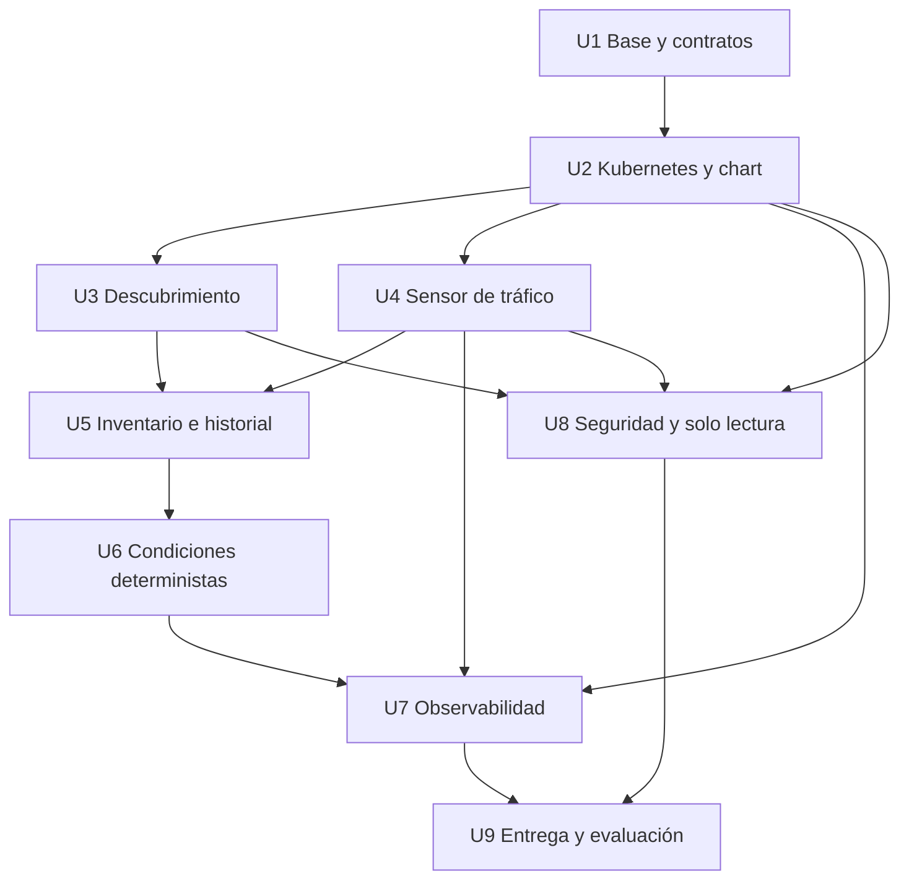

# Backlog de ingeniería — Sentinel

**Versión:** 3.0 · **Fecha:** 2026-11-05 · **Historias:** 47 · **Estado:** propuesta ejecutable.

## 1. Objetivo y reglas

El backlog implementa descubrimiento autorizado, captura de metadatos, inventario temporal, reglas deterministas, alertas y observabilidad. Las historias se limitan al alcance descrito en el PRD; las funciones de administración de endpoints y respuesta activa quedan fuera de esta versión.

- Una historia se acepta solo con el criterio verificable y su evidencia.
- Los sondeos se limitan a CIDR/puertos autorizados.
- El acceso a la red externa y las capabilities del sensor son riesgos técnicos bloqueantes.
- Las reglas describen condiciones observadas, no amenazas confirmadas.
- `TBD` en umbrales/intervalos no debe reemplazarse por cifras arbitrarias.

## 2. Épicas

| Épica | Unidades | Historias | Objetivo |
|---|---|---:|---|
| E01 Base y contratos | U1 | SN-001–005 | Dominio, configuración, logs y contrato de métricas |
| E02 Plataforma Kubernetes | U2 | SN-006–010 | Clúster, imagen, chart y persistencia |
| E03 Descubrimiento | U3 | SN-011–015 | Inventario de red, servicios y certeza de SO |
| E04 Sensor de tráfico | U4 | SN-016–020 | Captura de metadatos y agregación |
| E05 Inventario e historial | U5 | SN-021–025 | Persistencia y comparación determinista |
| E06 Condiciones deterministas | U6 | SN-026–030 | Cálculo de condiciones de dominio, umbrales e idempotencia de indicadores derivados de eventos fuente |
| E07 Observabilidad | U7 | SN-031–035 | Prometheus, Grafana, dashboards y reglas |
| E08 Seguridad y solo lectura | U8 | SN-036–040 | RBAC, NetworkPolicy y límites del sensor/endpoints |
| E09 Entrega y evaluación | U9 | SN-041–047 | CI/CD, GitOps, ground truth y demo |

## 3. Historias de usuario

### E01

#### SN-001 — Crear estructura de repositorio

**Unidad:** U1 · **Módulo del curso:** M1 Linux/SDD

**Historia:** Como desarrollador, quiero una estructura modular para mantener configuración, dominio, colectores y despliegue separados.

**Criterio de aceptación:** `tree -L 3` muestra `src/sentinel`, `tests`, `deploy/helm` y `docs`; no existen duplicados de módulos.

**Evidencia:** Árbol de archivos versionado.

**Depende de:** —.

#### SN-002 — Definir contratos de dominio

**Unidad:** U1 · **Módulo del curso:** M1 Linux/SDD

**Historia:** Como sistema, quiero modelos tipados para activos, observaciones, eventos y alertas.

**Criterio de aceptación:** `pytest -q tests/unit/test_models.py` valida modelos válidos e inválidos.

**Evidencia:** Reporte pytest y fixtures.

**Depende de:** SN-001.

#### SN-003 — Validar configuración de alcance

**Unidad:** U1 · **Módulo del curso:** M1 Linux/SDD

**Historia:** Como operador, quiero declarar CIDR, puertos, intervalos y límites antes de sondear.

**Criterio de aceptación:** `pytest -q tests/unit/test_config.py` rechaza CIDR/puertos inválidos y rangos fuera del allowlist.

**Evidencia:** Fixtures y salida de pruebas negativas.

**Depende de:** SN-002.

#### SN-004 — Crear logger JSON

**Unidad:** U1 · **Módulo del curso:** M1 Linux/SDD

**Historia:** Como operador, quiero logs estructurados y consistentes.

**Criterio de aceptación:** `pytest -q tests/unit/test_logging.py` verifica timestamp, nivel, componente y event_id.

**Evidencia:** Ejemplo JSON y pruebas.

**Depende de:** SN-002.

#### SN-005 — Definir contrato de métricas

**Unidad:** U1 · **Módulo del curso:** M1 Linux/SDD

**Historia:** Como desarrollador, quiero nombres y etiquetas de métricas estables.

**Criterio de aceptación:** `pytest -q tests/unit/test_metrics_contract.py` detecta nombres/labels inválidos y cardinalidad prohibida.

**Evidencia:** Catálogo de métricas y pruebas.

**Depende de:** SN-002.

### E02

#### SN-006 — Preparar clúster y namespaces

**Unidad:** U2 · **Módulo del curso:** M2 Kubernetes/CKA

**Historia:** Como administrador, quiero un clúster de laboratorio con namespaces separados.

**Criterio de aceptación:** `kubectl get ns sentinel monitoring` devuelve ambos namespaces.

**Evidencia:** Salida kubectl y versión del clúster.

**Depende de:** SN-001.

#### SN-007 — Empaquetar la imagen común de Sentinel

**Unidad:** U2 · **Módulo del curso:** M2 Contenedores

**Historia:** Como desarrollador, quiero una imagen OCI común y reproducible que pueda ejecutar Core, Discovery Worker y Traffic Sensor con comandos de arranque diferentes.

**Criterio de aceptación:** `docker build -t sentinel:test .` termina; `docker inspect sentinel:test` muestra usuario no-root y `pytest -q tests/container/test_entrypoints.py` valida el arranque de Core, Discovery Worker y Traffic Sensor con `command/args` diferentes.

**Evidencia:** Digest de imagen, Dockerfile y pruebas de entrypoints.

**Depende de:** SN-001,SN-002.

#### SN-008 — Definir Helm chart de Sentinel

**Unidad:** U2 · **Módulo del curso:** M3 CKAD/Helm

**Historia:** Como operador, quiero instalar Sentinel con valores declarativos.

**Criterio de aceptación:** `helm lint deploy/helm/sentinel` termina sin errores.

**Evidencia:** Salida de helm lint.

**Depende de:** SN-006,SN-007.

#### SN-009 — Desplegar Core y PVC

**Unidad:** U2 · **Módulo del curso:** M3 CKAD/Helm

**Historia:** Como operador, quiero que Core y su persistencia corran en Kubernetes.

**Criterio de aceptación:** `kubectl rollout status deploy/sentinel-core -n sentinel` y `kubectl get pvc -n sentinel` muestran recursos listos; el Deployment tiene una réplica y estrategia `Recreate` para evitar dos escritores/montajes concurrentes del PVC durante una actualización.

**Evidencia:** Salida kubectl y manifiestos renderizados.

**Depende de:** SN-008.

#### SN-010 — Consultar estado de cargas desde Python

**Unidad:** U2 · **Módulo del curso:** M3 CKAD

**Historia:** Como operador, quiero que Sentinel consulte el estado de sus Pods y Jobs mediante la API de Kubernetes para exponer la salud de sus propios procesos.

**Criterio de aceptación:** el cliente oficial de Kubernetes para Python consulta `Pods`, `Jobs` y `CronJobs` en `sentinel`; si un colector se traslada a `sentinel-capture`, consulta allí esos recursos con un Role/RoleBinding condicional de solo lectura. `pytest -q tests/integration/test_kubernetes_readonly_client.py` pasa y las pruebas RBAC demuestran `get/list/watch` permitidos y `create/update/patch/delete` denegados para Pods, Jobs y CronJobs en cada namespace utilizado.

**Evidencia:** ServiceAccount, Role/RoleBinding, pruebas del cliente y salidas de `kubectl auth can-i`.

**Depende de:** SN-009.

### E03

#### SN-011 — Implementar descubrimiento ARP

**Unidad:** U3 · **Módulo del curso:** M2 Linux/Redes

**Historia:** Como analista, quiero detectar hosts visibles en el segmento L2 autorizado.

**Criterio de aceptación:** `pytest -q tests/unit/test_arp_discovery.py` valida parsing de fixtures; prueba de laboratorio documenta IP/MAC detectadas.

**Evidencia:** PCAP/fixture sintética y JSON de resultado.

**Depende de:** SN-002,SN-003,SN-006,SN-007.

#### SN-012 — Implementar verificación de host

**Unidad:** U3 · **Módulo del curso:** M2 Redes

**Historia:** Como analista, quiero verificar disponibilidad con métodos permitidos.

**Criterio de aceptación:** `pytest -q tests/unit/test_host_probe.py` prueba timeouts, respuestas y ausencia de respuesta.

**Evidencia:** Fixtures y métricas de ciclo.

**Depende de:** SN-003,SN-011.

#### SN-013 — Integrar Nmap con allowlist

**Unidad:** U3 · **Módulo del curso:** M2 Linux/Seguridad

**Historia:** Como operador, quiero sondear solo rangos y puertos autorizados.

**Criterio de aceptación:** `pytest -q tests/unit/test_nmap_command.py` demuestra que los argumentos se construyen desde la allowlist y usan `-sT -sV --version-light -p <puertos_autorizados> -oX -`. Los tests rechazan targets/flags arbitrarios, UDP (`-sU`), scripts NSE (`-sC`/`--script`), modo agresivo (`-A`), escaneo de SO (`-O`), `--allports` y cualquier puerto fuera de la allowlist. Los límites de tasa y timeout provienen de configuración validada. Las sondas de servicio se ejecutan solo sobre puertos TCP autorizados y quedan documentadas como tráfico activo; `-O` no se habilita en el MVP.

**Evidencia:** Comando renderizado de prueba y tests negativos.

**Depende de:** SN-003,SN-007.

#### SN-014 — Normalizar puertos y servicios

**Unidad:** U3 · **Módulo del curso:** M2 Linux

**Historia:** Como analista, quiero un formato común de los puertos/servicios observados.

**Criterio de aceptación:** `pytest -q tests/unit/test_service_parse.py` valida la salida XML de Nmap (`-oX -`) y normaliza puertos TCP observados, servicio/versión identificados por respuesta, servicio probable derivado solo del puerto y estado `desconocido`. Los fixtures prueban respuestas sin coincidencia y versiones ausentes. Solo se procesan resultados de `-sT -sV --version-light`; no se ejecuta escaneo UDP.

**Evidencia:** Fixtures XML de Nmap (`-oX`) con identificación confirmada, solo inferida por puerto, respuesta no coincidente y versión ausente; test report.

**Depende de:** SN-013.

#### SN-015 — Registrar certeza del SO

**Unidad:** U3 · **Módulo del curso:** M2 Redes

**Historia:** Como operador, quiero saber si el SO es inferido, declarado o desconocido.

**Criterio de aceptación:** `pytest -q tests/unit/test_os_confidence.py` distingue declarado, inferido y desconocido; no permite tratar un fingerprint como certeza. Si `-O` permanece deshabilitado, los activos sin evidencia suficiente se registran como `desconocido`.

**Evidencia:** Pruebas y ejemplo de inventario.

**Depende de:** SN-013,SN-014.

### E04

#### SN-016 — Crear abstracción de fuente de paquetes

**Unidad:** U4 · **Módulo del curso:** M2 Linux/Redes

**Historia:** Como desarrollador, quiero desacoplar el sensor de Scapy y permitir fixtures.

**Criterio de aceptación:** `pytest -q tests/unit/test_packet_source.py` ejecuta con fuente sintética sin privilegios.

**Evidencia:** Interfaz y pruebas unitarias.

**Depende de:** SN-002.

#### SN-017 — Implementar parser de paquetes

**Unidad:** U4 · **Módulo del curso:** M2 Redes

**Historia:** Como analista, quiero extraer solo metadatos autorizados.

**Criterio de aceptación:** `pytest -q tests/unit/test_packet_parser.py` extrae tiempo, protocolo, src/dst y longitud IP para el agregado de tráfico, además de los campos ARP, sin guardar payload. Los puertos/servicios del inventario proceden del descubrimiento activo TCP de U3; U4 no duplica ese catálogo.

**Evidencia:** Fixtures y reporte de parseo.

**Depende de:** SN-016.

#### SN-018 — Agregar tráfico en ventanas

**Unidad:** U4 · **Módulo del curso:** M2 Python

**Historia:** Como analista, quiero agregar bytes/s por ventana, protocolo e interfaz, conservando las IP de origen/destino en observaciones estructuradas.

**Criterio de aceptación:** `pytest -q tests/unit/test_traffic_aggregation.py` verifica ventanas iniciales de 5 s `[INTERNO]`, cálculo de bytes/s conforme a `specs/prd.md` sección 3.2, bytes/s IP agregados por protocolo/interfaz con `src_ip` y `dst_ip` conservados en registros estructurados, y mensajes ARP/s por separado. ARP no suma a bytes/s IP.

**Evidencia:** Salida calculada comparada con expected.

**Depende de:** SN-017,SN-005.

#### SN-019 — Integrar agregados de tráfico en métricas de Core

**Unidad:** U4 · **Módulo del curso:** M3 Observabilidad

**Historia:** Como operador, quiero que Core exponga métricas del tráfico recibido desde el sensor.

**Criterio de aceptación:** con Core desplegado, `kubectl port-forward svc/sentinel-core 9108:9108 -n sentinel` y `curl -fsS http://127.0.0.1:9108/metrics | grep sentinel_traffic_bytes_per_second` encuentran la métrica. El sensor envía agregados al endpoint interno de Core en el puerto `8080`; no publica un endpoint Prometheus independiente.

**Evidencia:** respuesta `/metrics` de Core, prueba de contrato y lote de observaciones aceptado.

**Depende de:** SN-018,SN-005.

#### SN-020 — Probar captura en interfaz de laboratorio

**Unidad:** U4 · **Módulo del curso:** M2/M3 Redes-Kubernetes

**Historia:** Como operador, quiero verificar visibilidad real del segmento autorizado.

**Criterio de aceptación:** Un test de integración registra tráfico conocido en la fuente seleccionada, entrega las observaciones a Core por el puerto `8080` y comprueba su agregación; sin interfaz/feed, el test queda explícitamente SKIP con causa.

**Evidencia:** Informe POC, comando y pcap sintético; nunca asumir acceso por defecto.

**Depende de:** SN-016,SN-017,SN-006,SN-007.

### E05

#### SN-021 — Persistir inventario SQLite

**Unidad:** U5 · **Módulo del curso:** M3 Datos

**Historia:** Como operador, quiero conservar activos y observaciones entre ciclos.

**Criterio de aceptación:** `pytest -q tests/integration/test_inventory_repository.py` escribe/lee desde DB temporal y prueba migración inicial.

**Evidencia:** DB de prueba y reporte.

**Depende de:** SN-002,SN-009,SN-011.

#### SN-022 — Comparar observaciones

**Unidad:** U5 · **Módulo del curso:** M3 Python

**Historia:** Como analista, quiero registrar altas, ausencias y cambios sin alterar el dato original.

**Criterio de aceptación:** `pytest -q tests/unit/test_inventory_diff.py` verifica `first_seen`, `missing` y cambios de atributos. Un activo solo pasa a ausente después de N ciclos completos y exitosos que cubran su segmento; un ciclo fallido o parcial no genera `AssetMissing`.

**Evidencia:** Casos de referencia y salida.

**Depende de:** SN-021,SN-015.

#### SN-023 — Registrar cambios IP↔MAC

**Unidad:** U5 · **Módulo del curso:** M3 Redes

**Historia:** Como analista, quiero historial temporal de asociaciones IP/MAC.

**Criterio de aceptación:** `pytest -q tests/unit/test_arp_change.py` compara observaciones históricas y genera `ArpMappingChanged` solo cuando una misma IP presenta una MAC diferente; conserva asociación anterior/nueva, origen de observación, interfaz y timestamp. El parser de U4 solo extrae campos ARP y no realiza esta comparación.

**Evidencia:** JSON de evento y pruebas.

**Depende de:** SN-011,SN-017,SN-021.

#### SN-024 — Guardar eventos de tráfico

**Unidad:** U5 · **Módulo del curso:** M3 Datos

**Historia:** Como operador, quiero conservar eventos agregados sin payload de paquetes.

**Criterio de aceptación:** `pytest -q tests/unit/test_traffic_event_store.py` verifica campos mínimos y ausencia de payload/bytes crudos no permitidos.

**Evidencia:** Esquema y pruebas.

**Depende de:** SN-018,SN-021.

#### SN-025 — Definir retención y exportación

**Unidad:** U5 · **Módulo del curso:** M3 Datos

**Historia:** Como administrador, quiero exportar inventario/eventos y aplicar una retención limitada.

**Criterio de aceptación:** `pytest -q tests/integration/test_export_retention.py` produce JSON/CSV y elimina solo registros vencidos en DB temporal.

**Evidencia:** Ficheros exportados y test report.

**Depende de:** SN-021,SN-022,SN-024.

### E06

#### SN-026 — Definir catálogo de condiciones y umbrales

**Unidad:** U6 · **Módulo del curso:** M3 Observabilidad

**Historia:** Como operador, quiero un catálogo versionado de condiciones de dominio y sus umbrales.

**Criterio de aceptación:** `pytest -q tests/unit/test_conditions_config.py` valida identificadores, umbrales, unidad de agregación, parámetros de línea base y valores iniciales; no incluye duración `for` de alertas ni acciones sobre endpoints.

**Evidencia:** YAML versionado de condiciones/umbrales y tests.

**Depende de:** SN-002,SN-003.

#### SN-027 — Calcular condición de tráfico elevado

**Unidad:** U6 · **Módulo del curso:** M3 Observabilidad

**Historia:** Como operador, quiero que Core calcule si la medición de tráfico supera el umbral de dominio configurado y publique un indicador verificable.

**Criterio de aceptación:** `pytest -q tests/unit/test_traffic_condition.py` cubre valores por debajo, iguales y por encima del umbral, además del estado sin línea base. Core publica el indicador verdadero/falso; la duración `for` y el estado de la alerta corresponden a SN-035 en U7. El método de umbral definitivo continúa `TBD`; los tests usan fixtures parametrizados, no valores productivos inventados.

**Evidencia:** Fixtures por debajo/encima, valor del indicador y resultado pytest.

**Depende de:** SN-018,SN-026.

#### SN-028 — Calcular condiciones ARP observadas

**Unidad:** U6 · **Módulo del curso:** M3 Redes

**Historia:** Como operador, quiero que Core publique indicadores para las condiciones ARP definidas.

**Criterio de aceptación:** `pytest -q tests/unit/test_arp_conditions.py` verifica dos condiciones independientes: tasa de mensajes ARP/s superior al umbral (requiere SN-018) y el evento `ArpMappingChanged` recibido desde U5. Core conserva evidencia de la condición sin atribuir intención; U7 define cómo se transforma el indicador en alerta.

**Evidencia:** Test report, indicadores y evento estructurado.

**Depende de:** SN-018,SN-023,SN-026.

#### SN-029 — Calcular disponibilidad del Traffic Sensor

**Unidad:** U6 · **Módulo del curso:** M3 Observabilidad

**Historia:** Como operador, quiero que Core publique el estado de disponibilidad del Traffic Sensor según la antigüedad de su última ventana recibida.

**Criterio de aceptación:** `pytest -q tests/unit/test_collector_health_condition.py` demuestra que `sentinel_collector_up{collector="traffic"}` permanece en `1` mientras la telemetría está dentro del plazo de vigencia configurado y pasa a `0` cuando lo supera; vuelve a `1` al recibirse telemetría válida. Los Jobs fallidos/parciales de descubrimiento se registran como `DiscoveryCycleFailed` y no afectan este indicador. La espera `for` y la notificación se verifican en SN-035/U7.

**Evidencia:** fixtures temporales de última ventana, valores de la métrica y resultado pytest.

**Depende de:** SN-005,SN-016,SN-019,SN-026.

#### SN-030 — Garantizar idempotencia de indicadores derivados

**Unidad:** U6 · **Módulo del curso:** M3 Observabilidad

**Historia:** Como operador, quiero que la relectura de un mismo evento fuente no duplique los indicadores derivados que consume Prometheus.

**Criterio de aceptación:** `pytest -q tests/unit/test_condition_metric_idempotency.py` demuestra que el mismo `event_id` de `ArpMappingChanged` incrementa `sentinel_arp_mapping_changes_total` una sola vez, aunque el lote se reprocese; un `event_id` distinto incrementa el contador una vez adicional. U5 conserva el evento fuente y su identidad; U6 no persiste una segunda copia del mismo evento. La agrupación, silenciamiento, repetición y resolución de notificaciones pertenecen a Alertmanager y no se replican en Core.

**Evidencia:** Fixtures con `event_id` repetidos/distintos, valores del contador antes/después y resultado pytest.

**Depende de:** SN-027,SN-028,SN-029.

### E07

#### SN-031 — Instalar kube-prometheus-stack

**Unidad:** U7 · **Módulo del curso:** M3 Helm

**Historia:** Como operador, quiero desplegar Prometheus/Grafana/Alertmanager con Helm.

**Criterio de aceptación:** `helm upgrade --install monitoring prometheus-community/kube-prometheus-stack -n monitoring --create-namespace -f deploy/monitoring/values.yaml --dry-run` renderiza sin error; los values declaran selectores compatibles para ServiceMonitor y PrometheusRule ubicados en `sentinel`.

**Evidencia:** Salida Helm y values versionados.

**Depende de:** SN-006.

#### SN-032 — Registrar ServiceMonitor

**Unidad:** U7 · **Módulo del curso:** M3 Prometheus

**Historia:** Como operador, quiero que Prometheus scrape métricas de Sentinel.

**Criterio de aceptación:** `kubectl get servicemonitor -n sentinel` muestra el recurso; los selectores de Prometheus coinciden con labels/namespace del ServiceMonitor; el endpoint declara `port: metrics`, que corresponde al puerto nombrado `metrics:9108` del Service, y el target aparece `UP` en Prometheus. Prometheus obtiene los datos mediante scrape HTTP GET a `/metrics` (modelo pull).

**Evidencia:** ServiceMonitor YAML y target status.

**Depende de:** SN-019,SN-031.

#### SN-033 — Crear dashboard de inventario

**Unidad:** U7 · **Módulo del curso:** M3 Grafana

**Historia:** Como analista, quiero consultar activos, última observación y cambios.

**Criterio de aceptación:** `python scripts/validate_dashboard.py dashboards/inventory.json` valida JSON/UID/paneles definidos. Grafana presenta métricas agregadas de inventario/cambios y última ejecución; el detalle por activo, IP/MAC y puertos/servicios se consulta mediante exportación estructurada CSV/JSON de Core, no se fuerza a labels Prometheus.

**Evidencia:** Dashboard JSON y captura.

**Depende de:** SN-022,SN-032.

#### SN-034 — Crear dashboard de tráfico

**Unidad:** U7 · **Módulo del curso:** M3 Grafana

**Historia:** Como analista, quiero visualizar bytes/s agregados por protocolo e interfaz y consultar los registros estructurados de los flujos observados.

**Criterio de aceptación:** `python scripts/validate_dashboard.py dashboards/traffic.json` valida datasource y consultas de métricas. El dashboard no usa IP origen/destino como labels de Prometheus; esos campos se consultan en los eventos exportados por Core en CSV/JSON.

**Evidencia:** Dashboard JSON y captura.

**Depende de:** SN-019,SN-032.

#### SN-035 — Publicar reglas Prometheus

**Unidad:** U7 · **Módulo del curso:** M3 Prometheus

**Historia:** Como operador, quiero alertas integradas al stack de observabilidad.

**Criterio de aceptación:** `promtool check rules deploy/monitoring/rules/sentinel.yml` termina sin errores; las reglas cubren `sentinel_traffic_threshold_exceeded`, `sentinel_arp_rate_threshold_exceeded`, incrementos de `sentinel_arp_mapping_changes_total` y `sentinel_collector_up{collector="traffic"} == 0`. Prometheus muestra las reglas cargadas y Alertmanager recibe una alerta de prueba. La configuración de Alertmanager agrupa notificaciones por regla y alcance acotado (`alertname`, `scope`, `sensor_id`), permite silencios y evita reenvíos duplicados dentro de la ventana configurada. No usa IP origen/destino ni MAC como labels de agrupación. `DiscoveryCycleFailed` se conserva en logs/inventario y no se confunde con la pérdida de latidos del Traffic Sensor.

**Evidencia:** Salida promtool y pantalla Rules.

**Depende de:** SN-026,SN-031,SN-032,SN-030.

### E08

#### SN-036 — Crear ServiceAccounts separadas

**Unidad:** U8 · **Módulo del curso:** M4 Seguridad/CKS

**Historia:** Como administrador, quiero identidades separadas para Core y colectores.

**Criterio de aceptación:** `kubectl get sa -n sentinel` muestra `sentinel-core`, `sentinel-discovery` y `sentinel-sensor`; si algún colector se traslada a `sentinel-capture`, sus ServiceAccounts separadas existen allí. Ningún workload sensible utiliza la cuenta `default`.

**Evidencia:** Manifiestos y salida kubectl.

**Depende de:** SN-006,SN-009.

#### SN-037 — Aplicar RBAC mínimo

**Unidad:** U8 · **Módulo del curso:** M4 CKS

**Historia:** Como administrador, quiero permisos Kubernetes mínimos para las operaciones internas.

**Criterio de aceptación:** las consultas `kubectl auth can-i get/list/watch` para Pods, Jobs y CronJobs, con `--as=system:serviceaccount:sentinel:sentinel-core -n sentinel`, devuelven `yes`; `create/update/patch/delete` para esos recursos devuelven `no`. Si un colector vive en `sentinel-capture`, la misma matriz se comprueba allí mediante Role/RoleBinding en ese namespace. Discovery y Sensor no reciben token del API server.

**Evidencia:** Salida de autorización revisada.

**Depende de:** SN-036.

#### SN-038 — Aislar red interna del namespace

**Unidad:** U8 · **Módulo del curso:** M4 CKS

**Historia:** Como administrador, quiero limitar comunicaciones entre workloads.

**Criterio de aceptación:** `kubectl get networkpolicy -n sentinel` muestra políticas declarativas; prueba de conectividad verifica allowlist en CNI compatible. Si se usa `hostNetwork`, se documenta y valida el comportamiento específico del CNI; no se afirma que NetworkPolicy filtre esos Pods de forma uniforme.

**Evidencia:** YAML y matriz de conectividad.

**Depende de:** SN-006,SN-009.

#### SN-039 — Restringir capabilities de los colectores

**Unidad:** U8 · **Módulo del curso:** M4 CKS

**Historia:** Como administrador, quiero conceder solo las capacidades requeridas por descubrimiento ARP y captura de paquetes.

**Criterio de aceptación:** se inspeccionan los `securityContext` del CronJob de descubrimiento y del Deployment del sensor. Ambos mantienen `privileged: false` y usuario no-root cuando sea viable. El POC separa `CAP_NET_RAW` de `CAP_NET_ADMIN`; esta última no se concede en el MVP. Baseline/Restricted no permiten añadir `CAP_NET_RAW`; si es imprescindible, el workload se mueve a `sentinel-capture`, se configura explícitamente Pod Security Admission para no contradecir la excepción y una política de admisión complementaria conserva las demás restricciones, permitiendo solo esa capability al ServiceAccount/workload autorizado. También se restringe por RBAC quién puede crear workloads en ese namespace. Los tests/manifiestos deben demostrar el rechazo de `privileged`, host namespaces, `hostPath`, `CAP_NET_ADMIN` y otras capabilities añadidas. Si no se puede verificar esa cadena de controles, debe utilizarse un feed que no requiera `CAP_NET_RAW` dentro del Pod.

**Verificación:** inspeccionar los `securityContext` de ambos workloads en el namespace real. Si se trasladan, comprobar también la política de admisión y el Role/RoleBinding condicional. La verificación final debe mostrar únicamente `CAP_NET_RAW` cuando el POC la justifique, `privileged: false`, `CAP_NET_ADMIN` ausente y `drop: [ALL]` más las excepciones aprobadas.

**Evidencia:** manifests, resultados de `kubectl auth can-i` cuando aplique, pruebas de captura y justificación de cada capability.

**Depende de:** SN-013,SN-020,SN-036.

#### SN-040 — Probar ausencia de acciones de escritura

**Unidad:** U8 · **Módulo del curso:** M4 Seguridad

**Historia:** Como responsable de red, quiero evidencia de que Sentinel no modifica endpoints.

**Criterio de aceptación:** Tests de integración verifican que los comandos invocados pertenecen a allowlist de sondeo y no existen operaciones de configuración/firewall/servicio; `pytest -q tests/security/test_read_only_boundary.py` pasa.

**Evidencia:** Lista de comandos permitidos, tests negativos y captura del laboratorio.

**Depende de:** SN-013,SN-017,SN-037.

### E09

#### SN-041 — Configurar pipeline CI

**Unidad:** U9 · **Módulo del curso:** M5 CI/CD

**Historia:** Como desarrollador, quiero validar calidad en cada cambio.

**Criterio de aceptación:** El workflow ejecuta pytest, lint y helm lint; un PR con fallo queda no aprobado.

**Evidencia:** Run de CI.

**Depende de:** SN-001,SN-008.

#### SN-042 — Escanear la imagen común de Sentinel

**Unidad:** U9 · **Módulo del curso:** M5 Supply chain

**Historia:** Como operador, quiero que la imagen común de Sentinel tenga versión inmutable y análisis de componentes.

**Criterio de aceptación:** CI construye una imagen `sentinel:<tag-inmutable>` reutilizada por Core y colectores y genera reporte de scanner/SBOM; no publica si falla la política definida.

**Evidencia:** Digest, SBOM/reporte y log CI.

**Depende de:** SN-007,SN-041.

#### SN-043 — Desplegar manifests por GitOps

**Unidad:** U9 · **Módulo del curso:** M5 GitOps

**Historia:** Como operador, quiero reconciliar el estado deseado desde Git.

**Criterio de aceptación:** Si Argo CD está habilitado, Application queda Synced/Healthy tras commit; si se excluye, queda documentado el procedimiento Helm equivalente.

**Evidencia:** Application status o evidencia Helm.

**Depende de:** SN-008,SN-031,SN-041.

#### SN-044 — Construir ground truth de laboratorio

**Unidad:** U9 · **Módulo del curso:** M5 Evaluación

**Historia:** Como evaluador, quiero un inventario esperado y escenarios reproducibles.

**Criterio de aceptación:** `pytest -q tests/e2e/test_ground_truth.py` valida topología, fixtures y datos esperados.

**Evidencia:** Archivo de ground truth y resultados.

**Depende de:** SN-011,SN-018.

#### SN-045 — Ejecutar prueba de tráfico alto

**Unidad:** U9 · **Módulo del curso:** M5 Demo

**Historia:** Como evaluador, quiero comprobar que la regla alerta ante tráfico sintético por encima del umbral.

**Criterio de aceptación:** un generador de prueba controlado produce una tasa por encima del umbral; la condición y alerta aparecen dentro de la ventana definida y el caso normal no dispara. La fuente de captura real de SN-020 debe estar validada; las pruebas con PCAP sintético se identifican como tales.

**Evidencia:** PCAP/estadística, regla, log y captura de Grafana.

**Depende de:** SN-020,SN-027,SN-034,SN-044.

#### SN-046 — Ejecutar prueba ARP controlada

**Unidad:** U9 · **Módulo del curso:** M5 Demo

**Historia:** Como evaluador, quiero registrar el cambio IP↔MAC y la actividad ARP del escenario de laboratorio.

**Criterio de aceptación:** en una red aislada, dos dispositivos Android, un equipo macOS y un equipo Windows consultan la página HTTP del servidor Linux; un sexto activo temporal genera actividad ARP de prueba. Sentinel registra el aumento de mensajes ARP/s y el cambio observado de asociación entre la IP del servidor y la MAC de prueba, esperado aproximadamente 10 s después del inicio `[INTERNO]`. El registro describe la observación y no afirma detección general ni ataque confirmado.

**Evidencia:** Logs, campos ARP y captura de Grafana.

**Depende de:** SN-018,SN-020,SN-028,SN-033,SN-044.

#### SN-047 — Preparar sustentación y límites

**Unidad:** U9 · **Módulo del curso:** M5 Sustentación

**Historia:** Como estudiante, quiero demostrar capacidades y límites sin sobreafirmar detección.

**Criterio de aceptación:** checklist documenta despliegue, permisos, casos positivos/negativos, topología (cinco activos base y un sexto activo temporal para el escenario ARP), límites de identificación del SO, visibilidad de captura, umbrales utilizados y resultados de las pruebas.

**Evidencia:** Guion, evidencias y matriz de trazabilidad.

**Depende de:** SN-035,SN-039,SN-040,SN-043,SN-045,SN-046.

## 4. Dependencias resumidas entre unidades

El grafo completo y la verificación acíclica están en `units/unit-of-work-dependency.md`.

## 5. Orden recomendado

1. **Fundación:** SN-001–010.
2. **Recolección:** SN-011–020. El POC de interfaz de captura (SN-020) es bloqueante para el caso de tráfico real.
3. **Estado y alertas:** SN-021–030.
4. **Visualización:** SN-031–035.
5. **Seguridad:** SN-036–040; comenzar en paralelo desde que el deployment esté disponible.
6. **Entrega y evaluación:** SN-041–047.

## 6. Camino crítico

La ruta más larga calculada a partir de las dependencias directas de las historias es: `SN-001 → SN-002 → SN-007 → SN-008 → SN-009 → SN-021 → SN-023 → SN-028 → SN-030 → SN-035 → SN-047` (11 historias). La ruta se reproduce mediante `python scripts/verify_traceability.py`.

El POC de captura real (SN-020) es un prerrequisito explícito de SN-045 y SN-046; también puede convertirse en bloqueo de calendario antes de completar la lógica, por lo que debe ejecutarse temprano. Si no se resuelve la interfaz/feed, la evidencia debe identificarse como PCAP sintético y no como observación de la LAN.

## 7. Agrupación por módulos

| Módulo | Historias | Entregable visible |
|---|---|---|
| Linux, shell y redes | SN-001–005, SN-011–018 | Scripts, parser, modelos y pruebas |
| Contenedores | SN-007, SN-042 | Imagen reproducible/no-root y escaneo |
| Kubernetes / CKA | SN-006, SN-009, SN-010 | Namespaces, Jobs, Deployments, PVC |
| CKAD / Helm | SN-008, SN-031 | Charts y values versionados |
| Observabilidad | SN-019, SN-032–035 | Métricas, dashboards y reglas |
| CKS / KCSA | SN-036–040 | RBAC, NetworkPolicy y capabilities acotadas |
| CI/CD / GitOps | SN-041–043 | Pipeline y reconciliación |
| Evaluación / sustentación | SN-044–047 | Ground truth, pruebas y demo |

## 8. Fuera del backlog

Quedan fuera de esta versión: administración o configuración remota de endpoints, bloqueo o contención de tráfico, remediación, gestión de cuentas/servicios/procesos, identificación o clasificación de amenazas, inteligencia de amenazas, escaneo de vulnerabilidades, parcheo, inspección de payloads y respuesta automática. Estas capacidades requieren una propuesta independiente y no forman parte del alcance aprobado de Sentinel.
