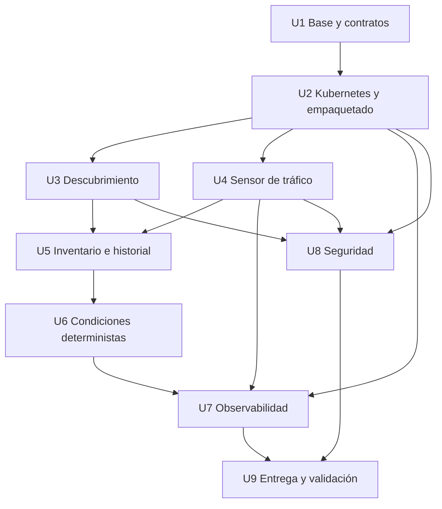

# Sentinel — Dependencias entre unidades

**Fase:** definición de unidades de trabajo  
**Versión:** 3.0 · **Fecha:** 2026-11-05

## Grafo de dependencias

La flecha `A --> B` indica que B requiere las salidas/contratos de A. Las aristas son las mismas que declara `scripts/verify_unit_dag.py`.



El grafo declara nueve unidades y catorce dependencias. No implica que cada unidad sea un proceso o servicio independiente.

## Matriz de dependencias

| Unidad | Depende directamente de | Puede avanzar en paralelo con |
|---|---|---|
| U1 | — | — |
| U2 | U1 | — |
| U3 | U2 | U4 tras completar U2 |
| U4 | U2 | U3 tras completar U2 |
| U5 | U3, U4 | U8 puede iniciar tras U2 y validar de forma incremental U3/U4 |
| U6 | U5 | U8 |
| U7 | U2, U4, U6 | U8; la integración final espera a ambas |
| U8 | U2, U3, U4 | U5/U6/U7 según los manifiestos disponibles |
| U9 | U7, U8 | — |

## Fases de ejecución propuestas

| Fase | Unidades | Resultado de salida | Condición para avanzar |
|---|---|---|---|
| F1 — Fundación | U1, U2 | contratos y Core mínimo desplegado | Core Ready, Service y PVC disponibles |
| F2 — Recolección | U3, U4 | observaciones de inventario y agregados de tráfico | tests con fixtures; POC de red iniciado temprano |
| F3 — Estado | U5 | inventario, historial y eventos | ciclos completos/parciales probados; diff y ARP histórico correctos |
| F4 — Condiciones y seguridad de plataforma | U6, U8 | indicadores de condiciones de dominio y controles de mínimo privilegio | tests de condiciones, RBAC y capabilities |
| F5 — Visualización | U7 | métricas, dashboards y alertas | ServiceMonitor `UP`, dashboards validados, reglas cargadas |
| F6 — Integración | U9 | entrega reproducible y escenarios finales | pipeline y pruebas integrales completas |

Las fases son una guía de coordinación, no una serialización absoluta. U8 debe comenzar temprano y puede progresar en paralelo cuando se disponga de manifiestos de los componentes.

## Walking skeleton

1. Crear un modelo de activo y una observación en U1.
2. Desplegar el Core mínimo de U2 en Kubernetes con SQLite/PVC y sus dos puertos internos.
3. Ejecutar un Job de U3 con fixtures de descubrimiento y enviar el lote al Core.
4. Ejecutar U4 con un PCAP sintético; enviar agregados IP/ARP al Core.
5. Persistir observaciones en U5 y comprobar la comparación de dos ciclos.
6. Publicar una métrica de Core y mostrarla en un panel mínimo de U7.
7. Probar la fuente real de captura de U4 antes de depender de ella para la demostración.
8. Añadir condiciones de dominio en U6 y reglas de alerta/visualización en U7; completar los controles de U8 y la integración final en U9.

El POC de visibilidad de red debe ejecutarse pronto, en paralelo con las pruebas sintéticas. De lo contrario, se podría terminar el software de captura sin disponer de una fuente de tráfico real.

## Camino crítico

Una ruta de mayor profundidad del grafo es:

`U1 → U2 → U3 → U5 → U6 → U7 → U9`

También existe una ruta de igual profundidad que incorpora el sensor:

`U1 → U2 → U4 → U5 → U6 → U7 → U9`

Ambas contienen siete unidades. U8 es una rama transversal que puede avanzar en paralelo, pero es prerrequisito de U9. El POC de interfaz/feed de U4 es un riesgo de calendario adicional: aunque no cambie la profundidad lógica del grafo, puede bloquear la demostración de tráfico real.

## Verificación acíclica reproducible

Comando desde la raíz del repositorio:

```bash
python scripts/verify_unit_dag.py
```

Salida esperada del script actual:

```text
OK: 9 units, 14 dependencies, 0 cycles
Topological order: U1 -> U2 -> U3 -> U4 -> U5 -> U8 -> U6 -> U7 -> U9
```

El orden topológico es una secuencia válida para las aristas declaradas, no una obligación de ejecutar U3/U4/U8 en ese orden si sus dependencias directas ya se satisfacen. La verificación se implementa mediante ordenamiento topológico; el script falla si aparece una dependencia hacia un nodo inexistente o un ciclo.
